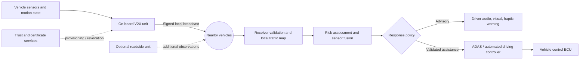
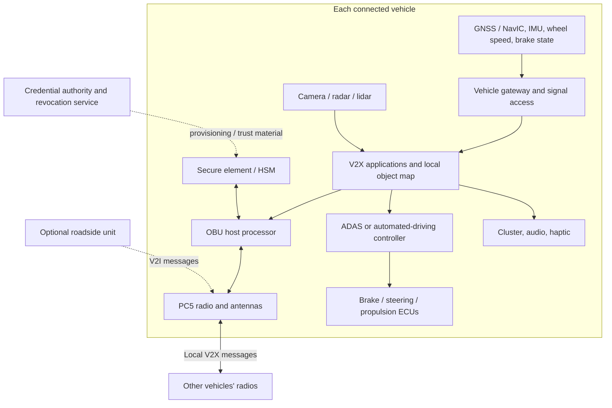
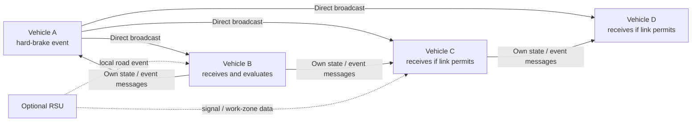

# V2V System Guide: Real-Time Cooperative Safety

This guide describes how a practical vehicle-to-vehicle (V2V) system can exchange state and hazard information, build a shared picture of nearby traffic, and support a driver or automated safety system during an emergency.

> **Scope:** this is a technical design guide and research summary, not an AIS-230 compliance specification or a road-tested autonomous driving system. Radio bands, message profiles, latency targets, security policy, and regulatory requirements must be selected from the applicable final standards and approvals. The existing HTML pages in this folder are explanatory simulations, not connected vehicles.


## At a glance

Each vehicle senses its own motion, periodically broadcasts a signed status message over a local V2X radio link, and listens for messages from nearby vehicles. A receiver checks whether a message is authentic, fresh, plausible, and useful for its current path. It can then warn the driver or provide verified context to the vehicle's own ADAS/autonomy stack.



V2V supplements a vehicle's own camera, radar, lidar, GNSS, and motion sensors. It does not replace them. Basic direct safety communication should not depend on a cloud connection; backend services can support certificate provisioning, revocation distribution, fleet tools, and software updates.

## System components

| Component | What it does | Design notes |
|---|---|---|
| **Vehicle sensors** | Measure position, speed, heading, acceleration, yaw rate, braking, and nearby objects | Inputs may include GNSS, wheel speed, IMU, camera, radar, and lidar. Every measurement needs a timestamp and uncertainty estimate. |
| **Vehicle networks and gateway** | Read approved vehicle signals and pass safety data between ECUs | Use access control and a defined interface to CAN/CAN FD or Automotive Ethernet. V2X messages must not become an unfiltered path into safety-critical buses. |
| **V2X on-board unit (OBU)** | Creates, signs, transmits, receives, and verifies V2X messages | May be a dedicated OBU or a qualified function integrated into a telematics ECU. |
| **Radio and antenna system** | Provides the local wireless link | PC5 sidelink is a direct V2X path in cellular-V2X systems; the exact radio profile and band are jurisdiction-dependent. Antenna placement, interference, and obstruction affect reception. |
| **GNSS and time source** | Supplies position and time for interpreting moving-object reports | GNSS can be degraded by urban canyons, tunnels, multipath, or spoofing. Track uncertainty and use other sensors where available. |
| **Secure element / HSM** | Protects credentials and performs signing or verification operations | Certificate formats, trust anchors, privacy rules, and revocation procedures must follow the deployment's security profile. |
| **V2X services and local dynamic map** | Decodes messages, maintains nearby-object tracks, and manages event lifetimes | Reject stale, duplicate, malformed, implausible, or out-of-region data before it affects a warning or planner. |
| **Risk assessment and sensor fusion** | Predicts possible conflicts using local sensing plus received V2X data | Align data by time and coordinate frame; account for position error, age, packet loss, and sensor disagreement. |
| **HMI and ADAS/autonomy interface** | Presents warnings or passes bounded evidence to an approved controller | The HMI should avoid warning overload. Any braking or steering request remains under the vehicle's independently validated safety controller. |
| **Optional roadside unit (RSU)** | Broadcasts infrastructure observations or signal/road-event data | Adds V2I context; the core vehicle-to-vehicle path should remain useful without RSU or cellular coverage. |
| **Backend trust / operations services** | Manages credential provisioning, revocation information, diagnostics, and updates | Not part of the immediate collision-warning loop. Loss of internet access must not disable local safety messaging. |



The diagram is logical rather than a fixed wiring prescription. Production vehicles need a safety and cybersecurity architecture that controls which data can cross between infotainment, telematics, V2X, ADAS, and actuation networks.

## Message types and the data they carry

The exact message set depends on the selected standard and market. ETSI and SAE define different message profiles; do not assume that message names or encodings are interchangeable, or that a proposed Indian AIS-230 profile adopts one of them unchanged.

| Message family / role | Typical information | Use |
|---|---|---|
| **Periodic awareness** (for example, ETSI CAM or a market-specific BSM) | Time, position, speed, heading, acceleration, yaw rate, vehicle type/dimensions, and selected status | Lets receivers estimate where a nearby participant is and how it is moving. |
| **Event notification** (for example, ETSI DENM or an equivalent profile) | Event type, event location, detection/reference time, validity, direction or affected area, and updates/cancellation | Communicates a crash, hard braking, road hazard, or other time-bounded event. |
| **Collective perception** (ETSI CPM or an equivalent profile) | Sensor capabilities and descriptions of detected objects or perception regions | Can share observations of objects a receiver's own sensors may not see, such as a vehicle behind a large truck. |
| **Intent / maneuver messages** | Intended path or maneuver, when supported by the chosen profile | Can support cooperative planning, but intent is not a promise that another vehicle will execute that maneuver. |

Use the message-generation rules, security envelope, rate control, and field semantics from the selected standards. Do not hard-code a universal 10 Hz rate or a universal sub-100-ms guarantee into the design: actual rates, deadlines, and priority depend on the radio and application profile.

## How two vehicles communicate

Assume Vehicle A detects hard braking. It creates an event message with a source time, location, motion context, event type, and validity period. Its OBU signs the message and sends it using the configured V2X profile. Vehicle B receives it, verifies the signature and freshness, checks physical plausibility, and compares the reported event with its own radar/camera and motion data. If the evidence indicates a relevant hazard, B warns the driver or supplies the validated hazard to its ADAS controller.

```mermaid
sequenceDiagram
    participant A as Vehicle A sensors / OBU
    participant Radio as Local V2X radio link
    participant B as Vehicle B OBU / safety app
    participant Sensors as Vehicle B local sensors
    participant Control as Driver / ADAS controller

    A->>A: Detect hard brake; timestamp and classify event
    A->>A: Build profile-compliant message and sign it
    A-->>Radio: Broadcast event and updated motion state
    Radio-->>B: Deliver if within link coverage and packet is received
    B->>B: Verify signature, certificate, time, region, and replay status
    B->>B: Check kinematics, message age, confidence, and plausibility
    Sensors-->>B: Supply independent local observations
    B->>B: Fuse evidence and predict path conflict / closing risk
    alt Relevant and sufficiently credible risk
        B->>Control: Driver warning or bounded ADAS hazard input
    else Stale, implausible, irrelevant, or uncertain
        B->>B: Discard, down-weight, or keep as advisory only
    end
```

The direct radio message can arrive before a camera has line-of-sight, but this is not guaranteed. A truck or building can attenuate or block a transmission; distance, antenna placement, interference, channel load, and radio conditions also matter.

## How multiple vehicles share information

With many connected vehicles, each OBU can broadcast its own state and listen to messages from other vehicles in radio range. This is normally a **many-to-many local exchange**, not a central server commanding every car. Each receiver builds its own neighborhood view and makes its own safety decision.



The arrows show possible direct radio exchanges, not guaranteed connectivity. A vehicle that receives a message does **not** automatically retransmit it. Multi-hop relaying, geocast forwarding, or infrastructure forwarding requires an explicit protocol and duplicate suppression, hop limits, authentication, and congestion controls. Do not assume an intermediate bus will relay a message around an obstruction.

### Example: hazard propagating through a traffic queue

1. A lead vehicle brakes sharply and emits a signed event plus its current motion state.
2. Following vehicles that receive it independently check age, signature, location, direction, and plausible deceleration.
3. Each receiver predicts whether the event intersects its own path and time horizon.
4. A vehicle may warn its driver, pre-charge or prepare its own braking system where approved, or pass an event update according to the deployed message/forwarding profile.
5. A receiver that does not get the message still relies on its own radar, camera, lidar, and driver. A radio outage must not remove normal collision mitigation.

## Emergency handling and autonomous response

V2V can provide earlier or wider-area evidence, but **V2V alone cannot guarantee that a vehicle will avoid a crash**. A received message may be delayed, inaccurate, spoofed, or based on a sensor error. The safest design is a staged decision path:

1. **Receive:** check packet format and resource limits before deeper processing.
2. **Authenticate:** validate the signed message and its certificate under the active trust policy. Authentication proves which credential signed a message; it does not prove the reported event is true.
3. **Check freshness and plausibility:** reject replayed or expired information; test time, location, speed, heading, acceleration, and event progression for consistency.
4. **Associate:** align the sender/object to a local track. Avoid merging two vehicles or treating an uncertain position as exact.
5. **Predict risk:** estimate relative motion, possible path overlap, time-to-collision (TTC), stopping distance, and uncertainty. Thresholds depend on vehicle, speed, road friction, geometry, and the validated application.
6. **Fuse evidence:** compare V2V/collective-perception reports with local sensing. Use confidence and age to down-weight uncertain observations.
7. **Choose a bounded action:** issue an advisory first when appropriate. Automated braking or steering must be a separately validated vehicle function, with its own safe operating limits and arbitration logic.
8. **Monitor and recover:** keep checking the hazard and the vehicle response; cancel or reduce assistance when evidence changes, sensors disagree, or the operating conditions leave the function's limits.

Examples of bounded responses:

| Situation | Appropriate V2V contribution | Possible vehicle response |
|---|---|---|
| Hard braking ahead | Share deceleration/event and location sooner than local visual detection may allow | Early warning; a qualified AEB function may use it as additional evidence, after its own validation and local risk checks |
| Occluded intersection | Share approach state or a sensor-detected object, with timestamp and uncertainty | Warn, limit speed, or yield if the vehicle's own planner confirms a conflict |
| Emergency vehicle approach | Share authenticated role/approach context if the profile supports it | Alert and request a route/yield behavior; do not make an unsafe sudden lane change |
| Road hazard beyond a curve | Share an event with a finite validity and affected direction | Warn and adapt speed according to local sensing, road rules, and controller capability |

V2V should not directly command an actuator from an unauthenticated or uncorroborated packet. Functional safety, intended-functionality safety, and cybersecurity need separate assurance work. Relevant references include [ISO 26262 functional safety](https://www.iso.org/publication/PUB200262.html), [ISO 21448 SOTIF](https://www.iso.org/standard/77490.html), and [UNECE Regulation No. 155 cybersecurity](https://unece.org/transport/documents/2021/03/standards/un-regulation-no-155-cyber-security-and-cyber-security).

## Communication choices

| Path | Strength | Limits / design use |
|---|---|---|
| **PC5 direct sidelink** | Local V2X exchange can work without a cellular subscription or coverage, where the selected deployment supports it | Range and delivery are not guaranteed; spectrum, radio profile, interference, congestion, and certification are jurisdiction-specific. |
| **Uu cellular path** | Can connect vehicles to network services, cloud systems, or managed group communication | Depends on network coverage and operator/service conditions; avoid making it the sole emergency-warning path. |
| **V2I / roadside unit** | Can provide signal phase, work-zone, road-hazard, or intersection context | Requires deployed and maintained infrastructure and compatible services. |
| **GNSS / backend** | Supports time, positioning, credential lifecycle, fleet operations, and updates | Position can be uncertain or unavailable; backend availability should not be required for immediate local safety decisions. |

3GPP TS 23.287 describes 5G-system architecture support for V2X services; it distinguishes V2X communication over PC5 from communication over Uu. The chosen application determines which path is appropriate. A project-specific safety profile must define its actual deadlines, message sizes, update rules, and fallback behavior.

## Reliability, security, and privacy requirements

- **Message age:** include and validate source/reference times; expire events and tracks rather than displaying stale hazards forever.
- **Uncertainty:** carry or derive position/perception confidence; never silently treat GNSS coordinates as lane-level truth.
- **Packet loss and congestion:** rate-control messages, prioritize safety events, deduplicate, and test dense traffic, interference, and radio shadows.
- **Misbehavior:** verify signatures, then apply plausibility and consistency checks. A valid certificate does not make sensor data truthful.
- **Privacy:** use the chosen profile's privacy-preserving identifiers and data-retention rules. Avoid collecting long-term movement histories unless there is a defined lawful need.
- **Key lifecycle:** define secure provisioning, pseudonym/certificate rotation where specified, revocation distribution, recovery, and vehicle decommissioning.
- **Fail-safe behavior:** when data is missing, stale, or conflicting, degrade to local sensors and conservative driver warnings; do not assume silence means the road is clear.
- **Actuation separation:** isolate V2X reception from direct actuator authority. A safety controller must arbitrate any request using its own operating limits and validated inputs.

## Research directions and what they imply

Research is moving beyond exchanging only each vehicle's position and speed toward **cooperative perception**: vehicles share detected-object reports or compressed sensor features so that a receiver can reason about occluded road users. This is promising but brings new engineering problems.

| Research area | What it adds | Engineering implication |
|---|---|---|
| **Collective perception messages** | Standardized sharing of perceived objects, sensor capabilities, and perception regions | Manage object age, coordinate transforms, duplicate tracks, sensor quality, and message size. See ETSI's [Collective Perception Service (TS 103 324)](https://www.etsi.org/deliver/etsi_ts/103300_103399/103324/02.01.01_60/ts_103324v020101p.pdf). ETSI's [Release 2 work item](https://portal.etsi.org/webapp/WorkProgram/Report_WorkItem.asp?WKI_ID=69494) is evolving; check its current status before implementation. |
| **Cooperative perception fusion** | Early, intermediate, or late fusion of object lists / features from several agents | More shared data can improve visibility but raises bandwidth, alignment, trust, and computation costs. Recent empirical work reports distinct performance for V2V vs. V2I and vulnerability to online communication interference; treat cooperation as fallible evidence, not ground truth. See [When Autonomous Vehicle Meets V2X Cooperative Perception (2025)](https://arxiv.org/abs/2509.24927). |
| **Loss-aware cooperation** | Methods that account for delayed or missing messages | Test packet loss, latency, and interruption explicitly. A study of [interruption-aware cooperative perception](https://arxiv.org/abs/2304.11821) and the [OPV2V benchmark](https://arxiv.org/abs/2109.07644) are useful starting points. |
| **Real-world validation** | Evaluation with real traffic, sensors, and communications rather than simulation alone | Use multiple scenarios and measure false positives, missed hazards, track errors, latency distributions, and safe fallback. [V2V4Real](https://arxiv.org/abs/2303.07601) provides real-world data for cooperative perception research. |
| **NR V2X evolution** | Newer 5G V2X service and sidelink capabilities beyond early LTE-V2X designs | Select only capabilities supported by the deployment and device profile. See the [3GPP V2X architecture specification TS 23.287](https://portal.3gpp.org/desktopmodules/Specifications/SpecificationDetails.aspx?specificationId=3578). |

These papers and standards are references for system design and evaluation; their results do not certify this repository's simulations or prove that a specific production vehicle will avoid a collision.

### Featured paper: V2V-LLM and the V2V-QA benchmark

[V2V-LLM: Vehicle-to-Vehicle Cooperative Autonomous Driving with Multimodal Large Language Models, arXiv:2502.09980v4](https://arxiv.org/html/2502.09980v4) is directly relevant to the autonomous-cooperation direction of this project. It proposes a V2V-QA dataset and evaluates a multimodal LLM that combines scene-level and object-level LiDAR perception features from multiple connected autonomous vehicles. The model answers grounding and notable-object questions, and generates candidate future trajectories for planning. The V2V-QA benchmark is built using V2V4Real and V2X-Real data and reports about 1.45 million generated question-answer pairs.

The paper's evaluated setup has the vehicles send perception features to a **centralized LLM compute node**. That is a different architecture from direct peer-to-peer PC5 safety broadcasts: it may add useful cooperative reasoning, but brings compute placement, connectivity, data volume, privacy, and latency questions. The authors report tests with injected communication latency and positional noise, but their paper also shows planning failures where generated trajectories enter an opposite-direction lane. Treat its results as research evidence, not as a validated emergency-braking controller. A production system would need independent trajectory and road-rule validation before any action, and must continue operating safely if the LLM service is slow or unavailable.

The authors' project page provides the [V2V-QA dataset and code](https://eddyhkchiu.github.io/v2vllm.github.io/) and links to the related [V2V-LLM repository](https://github.com/eddyhkchiu/V2V-LLM). A practical extension for this project is to evaluate this cooperative reasoning layer in simulation after the message validation, timing, and fail-safe layers are modeled.

### Follow-up: V2V-GoT and V2V-GoT-QA

[V2V-GoT](https://arxiv.org/abs/2509.18053) is a follow-up accepted at ICRA 2026. It adds **Graph-of-Thoughts** reasoning for occlusion-aware perception and planning-aware prediction, then evaluates perception, prediction, and planning tasks. Its separate [V2V-GoT-QA dataset](https://huggingface.co/datasets/eddyhkchiu/V2V-GoT-QA) has nine task types and reports 110,000 training and 31,000 testing question-answer pairs. It is built from V2V4Real geometry and includes per-vehicle perception features and detection outputs; the dataset card reports a total download size of about 81.5 GB.

Keep the dataset names distinct: **V2V-QA** belongs to the earlier V2V-LLM benchmark (about 1.45 million generated QA pairs), while **V2V-GoT-QA** is the later Graph-of-Thoughts benchmark (about 141,000 train/test pairs). The Hugging Face page currently says its browser dataset viewer is unavailable; use the dataset repository files and the [V2V-GoT code](https://github.com/eddyhkchiu/V2V-GoT) for download and usage instructions. These are offline research datasets and model evaluations, not a live V2V radio network or a production-ready vehicle controller.

## Suggested development and validation path

1. **Freeze the target profile:** jurisdiction, radio, message set, certificate policy, safety use cases, and the applicable conformance process.
2. **Build a message simulator:** create timestamped vehicle trajectories, event messages, packet delay/loss, clock error, position error, and certificate failures.
3. **Implement receive validation:** parsing, authentication, event expiry, replay handling, plausibility checks, duplicate suppression, and uncertainty-aware tracks.
4. **Implement warning-only use cases:** start with event timelines and HMI behavior; collect false-warning and missed-warning metrics.
5. **Add sensor fusion:** use synchronized local sensor tracks plus message confidence. Exercise occlusion, multipath, localization error, dense traffic, and conflicting reports.
6. **Evaluate cooperative perception:** use open research datasets such as OPV2V and V2V4Real, then validate against hardware-in-the-loop and controlled closed-course trials.
7. **Integrate bounded ADAS actions:** only after hazard analysis, safety requirements, cybersecurity review, conformance testing, and vehicle-level validation. Keep an independent fallback path.

### Minimum test scenarios

- Lead-vehicle emergency braking at several speeds and following distances.
- A motorcycle or car hidden by a bus/truck at an intersection.
- Stale, duplicated, out-of-order, replayed, malformed, or incorrectly signed messages.
- GNSS drift, time offset, tunnel exit, urban canyon, and inconsistent headings.
- Packet loss, burst loss, interference, high channel load, and radio-shadowing.
- Conflicting reports from multiple vehicles and false or compromised senders.
- Mixed traffic where most road users do not have V2X equipment.
- Sensor disagreement and safe degradation to local sensing / driver alert only.

Track at least: message delivery and age distributions, detection lead time, time-to-collision estimation error, object association error, false-alert rate, missed-event rate, warning lead time, unsafe intervention rate, and behavior under communication outage. Averages alone hide dangerous tail cases.

## Simulations in this repository

The HTML demos illustrate concepts; they do not implement actual PC5/NR sidelink radios, cryptographic certificates, vehicle sensors, or autonomous actuation. GitHub will display these as source rather than running them. To play locally, run a web server from the repository root:

```bash
python -m http.server 8000
```

Open the local pages in a browser:

- [Blind Crossing](http://localhost:8000/V2V/blind_crossing.html) - intersection warning scenario.
- [Chain Brake](http://localhost:8000/V2V/blind_braking.html) - braking warning scenario.
- [Signal Path](http://localhost:8000/V2V/signal_path.html) - component-level message journey.

These pages load some visual assets from CDNs, so the browser needs internet access for the full presentation.

## Existing V2V project documents

- [Policy and India-specific context](details.md)
- [System architecture notes](system_architecture.md)
- [Business opportunity map](businessways.md)
- [Product and market analysis](product_business_analysis.md)
- [Reference links](Information.md)

## Primary standards and research references

- [3GPP TS 23.287 - Architecture enhancements for 5G System to support V2X services](https://portal.3gpp.org/desktopmodules/Specifications/SpecificationDetails.aspx?specificationId=3578)
- [ETSI EN 302 637-2 - Cooperative Awareness Message (CAM) service](https://www.etsi.org/deliver/etsi_en/302600_302699/30263702/01.03.01_30/en_30263702v010301v.pdf)
- [ETSI EN 302 637-3 - Decentralized Environmental Notification Message (DENM) service](https://www.etsi.org/deliver/etsi_en/302600_302699/30263703/01.02.00_20/en_30263703v010200a.pdf)
- [ETSI TS 103 324 - Collective Perception Service](https://www.etsi.org/deliver/etsi_ts/103300_103399/103324/02.01.01_60/ts_103324v020101p.pdf)
- [3GPP TS 23.286 - Application-layer support for V2X services](https://portal.3gpp.org/desktopmodules/Specifications/SpecificationDetails.aspx?specificationId=3562)
- [ISO 26262 - Road-vehicle functional safety](https://www.iso.org/publication/PUB200262.html)
- [ISO 21448 - Safety of the Intended Functionality (SOTIF)](https://www.iso.org/standard/77490.html)
- [UNECE Regulation No. 155 - Vehicle cybersecurity](https://unece.org/transport/documents/2021/03/standards/un-regulation-no-155-cyber-security-and-cyber-security)
- [V2V4Real - Real-world cooperative-perception dataset paper](https://arxiv.org/abs/2303.07601)
- [OPV2V - Simulated V2V perception benchmark paper](https://arxiv.org/abs/2109.07644)
- [Interruption-aware cooperative perception research](https://arxiv.org/abs/2304.11821)
- [Empirical study of V2X cooperative-perception robustness (2025)](https://arxiv.org/abs/2509.24927)
- [V2V-LLM and V2V-QA multimodal cooperative-driving research (arXiv:2502.09980v4)](https://arxiv.org/html/2502.09980v4)
- [V2V-GoT Graph-of-Thoughts cooperative-driving paper (arXiv:2509.18053)](https://arxiv.org/abs/2509.18053)
- [V2V-GoT-QA dataset card and files](https://huggingface.co/datasets/eddyhkchiu/V2V-GoT-QA)
