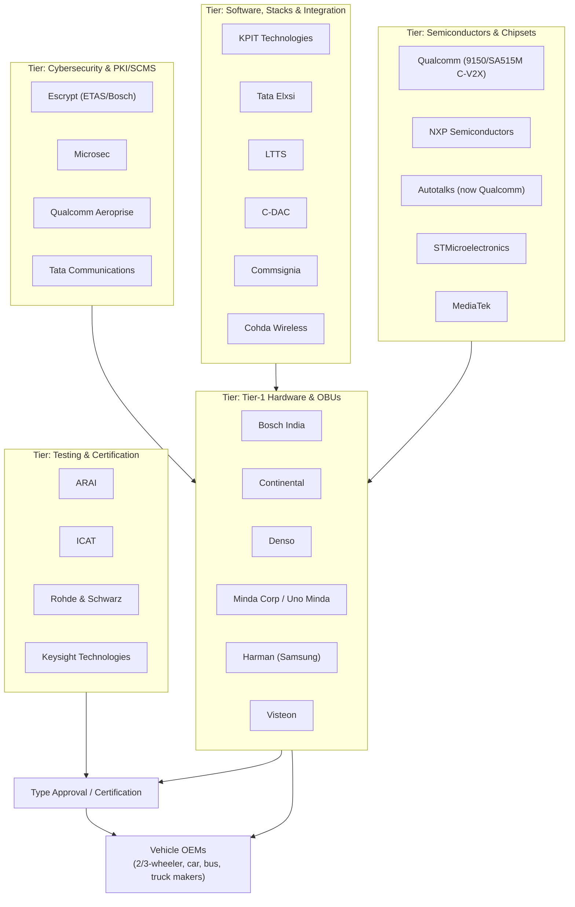
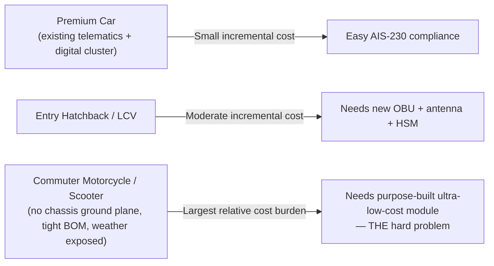
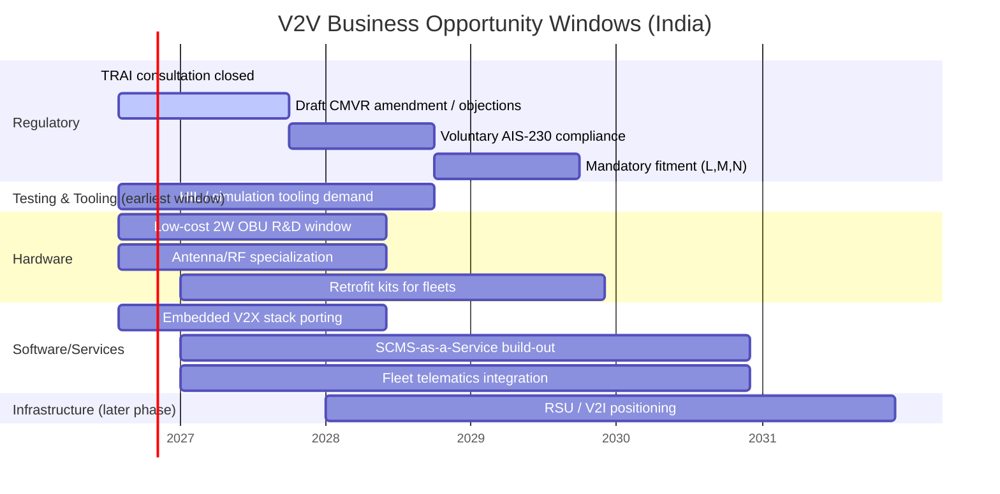

# V2V (AIS-230) — Business & Startup Opportunity Map

> Companion to [details.md](details.md) (policy/regulatory) and [system_architecture.md](system_architecture.md) (technical architecture). This document maps the supply chain, sizes the opportunity space, and lays out concrete business/startup plays with near-term relevance (2026–2028).

---

## 1. Why This Is a Big Market, Not Just a Compliance Cost

- **Volume**: AIS-230 covers **Categories L, M, and N** — two-wheelers, cars, buses, and trucks. India registers tens of millions of new vehicles annually, and two-wheelers alone are the largest single segment. No other country has mandated V2X down to the two-wheeler level at this scale — **India is set to become one of the highest-volume V2X hardware markets in the world** by unit count.
- **Forced refresh cycle**: every OEM must touch electrical/electronic architecture, ECUs, instrument clusters, and software — this isn't a bolt-on, it's a platform-level change across the entire industry within a ~2-year window (2027 voluntary → 2028 mandatory).
- **Recurring, not one-time, revenue**: certificates (PKI/SCMS) must be issued and rotated for the *life* of every vehicle; cybersecurity monitoring (AIS-189) and OTA updates are ongoing obligations — this creates durable software/service revenue layered on top of one-time hardware sales.

---

## 2. Supply Chain Map

**Structural gap this map exposes**: legacy global Tier-1s (Bosch, Continental, Denso) are built for the cost structure of cars — not ₹60,000–₹1,50,000 commuter motorcycles. That mismatch is precisely where Indian startups and mid-tier suppliers have room to compete, described in §3–5 below.

---

## 3. The Core Structural Opportunity: The "Category L Cost Gap"

Legacy Tier-1 components sized for cars are too expensive for two-wheelers and small commercial vehicles. **This cost gap is the single biggest opening for local innovation** — a large share of the addressable AIS-230 hardware volume (two-wheelers) currently has no fit-for-purpose, cost-engineered supplier.

---

## 4. Business & Startup Opportunities by Category

### A. Hardware & Manufacturing

| Opportunity | Description | Why Now |
|---|---|---|
| **Low-cost 2-wheeler OBU** | Ultra-compact, weatherproof (IP67/69K), low-power C-V2X module purpose-built for scooters/commuter motorcycles | No incumbent Tier-1 is optimized for this BOM point; 2028 mandate creates guaranteed demand |
| **Specialized antennas & RF filters** | Cost-effective 5.9 GHz automotive antennas for non-metal two-wheeler bodies and truck roofs | Standard shark-fin designs assume a car's metal ground plane — doesn't transfer to bikes |
| **Aftermarket commercial-vehicle retrofit kits** | Retrofit V2V onto existing fleet trucks/buses/school buses ahead of the new-vehicle-only mandate | Fleets and insurers will want safety credentials before 2028; mandate only covers *new* vehicles, leaving the entire existing fleet as a retrofit market |

### B. Software & Platform Services

| Opportunity | Description | Why Now |
|---|---|---|
| **Lightweight embedded V2X stacks** | Port standards-compliant (AIS-230 / IEEE 1609 / 3GPP Rel-14/15) collision-detection algorithms onto low-cost MCUs | Cost-sensitive OEMs need software that runs on cheaper silicon than premium-car reference designs assume |
| **SCMS / PKI security-as-a-service** | Manage certificate issuance, identity verification, and OTA certificate revocation for Indian OEMs | Every compliant vehicle needs this for its *entire life* — recurring revenue, high switching cost once integrated |
| **Fleet telematics integration** | Combine V2V safety data with existing GPS fleet tracking | Immediate cross-sell to India's large mining, long-haul trucking, and express-delivery fleet operators |

### C. Testing, Tooling & Infrastructure (Near-Term: 2026–2028)

| Opportunity | Description | Why Now |
|---|---|---|
| **V2X simulation & HIL testing tools** | Hardware-in-the-loop benches to validate AIS-230 compliance | Every Tier-1/Tier-2 supplier entering this space needs validation infrastructure *before* 2027's voluntary-compliance window opens |
| **Roadside Units (RSU) for smart infrastructure** | Smart-intersection units, toll-plaza transceivers, blind-curve beacons | Positions early movers for the V2I phase MoRTH has signaled as the likely next regulatory step |

---

## 5. Opportunity-Readiness Timeline

**Read this as sequencing guidance, not committed dates** — the underlying regulation is still a draft; treat the Gantt as relative ordering (testing/tooling first, hardware/software next, RSU/V2I last) rather than fixed calendar commitments.

---

## 6. Who Else Is Already in the Room

The TRAI consultation (Apr–Jun 2026) drew SIAM, ARAI, 5GAA, COAI, ASSOCHAM, Bosch, Qualcomm India, Harman, Ericsson India, Reliance Jio, Bharti Airtel, Vodafone Idea, Tata Communications, and C-DAC. Implications for a new entrant:

- **Telecom operators are stakeholders**, not just automakers — spectrum and possibly V2N backhaul partnerships may involve Jio/Airtel/Vi, relevant for anyone building V2N/cloud-connected features.
- **Global chipset/Tier-1 players are already engaged early** (Qualcomm, Bosch, Harman) — competing head-on at the premium-car tier is unattractive; the Category L cost gap (§3) and India-specific services (SCMS-as-a-service, fleet integration, retrofit) are the more defensible entry points for smaller players.
- **ARAI/ICAT will gate market entry** through type approval — early engagement with certification bodies is a practical prerequisite for any hardware business, not just a formality.

---

## 7. Cost & Pricing Dynamics to Watch

- OEMs will likely **absorb some cost initially, offset via localization, and pass the remainder through pricing** — as volumes scale, shared platforms should compress unit cost.
- Entry-level motorcycles, scooters, hatchbacks, and commercial vehicles face a **proportionately larger cost burden** than premium vehicles with existing connected hardware — reinforcing where the addressable "gap" opportunity sits (§3).
- Government may introduce **phased implementation, localization incentives, or tax support** for price-sensitive categories — worth monitoring during the consultation period as it could materially change unit economics for hardware plays.
- At mass-market volumes (millions of units), **even a small per-unit cost delta becomes commercially decisive** — component-level cost engineering (not just feature completeness) is a genuine competitive axis here, not a secondary concern.

---

## 8. Risk Factors for Any Business Entering This Space

| Risk | Mitigation Angle |
|---|---|
| **Regulation still in draft** — dates/specs may shift during consultation | Build modular designs that can absorb spec changes (e.g., abstract the security layer from the radio layer) |
| **Interoperability not yet finalized** | Engage early with ARAI/ICAT conformance test development rather than waiting for final spec publication |
| **Network-effect bootstrap problem** (see [details.md](details.md) §10) | Services that add value even with low V2V penetration (e.g., fleet telematics, retrofit kits for high-risk fleets) de-risk the early-adoption gap |
| **Global incumbents entering the same gap once mandate is confirmed** | Speed and category-L cost specialization are the realistic moats for smaller/local players — the window is largest *before* the mandate is finalized |
| **Cybersecurity/privacy rules still undefined** (AIS-189 coordination) | Architect PKI/SCMS offerings to be spec-agnostic where possible; don't hard-code assumptions about certificate format ahead of finalization |

---

## See Also
- [Policy & Regulatory Details](details.md)
- [System Architecture](system_architecture.md)
- [Gap Analysis, Product Design & Business Case](product_business_analysis.md) — deep dive: specific product concepts, BOM/cost breakdown, TAM/SAM/SOM, GTM and risk analysis
