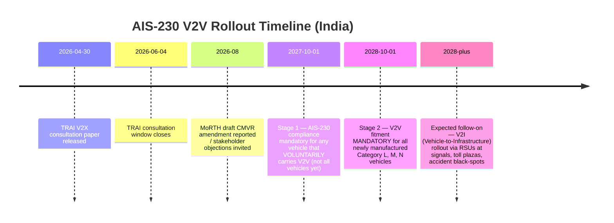
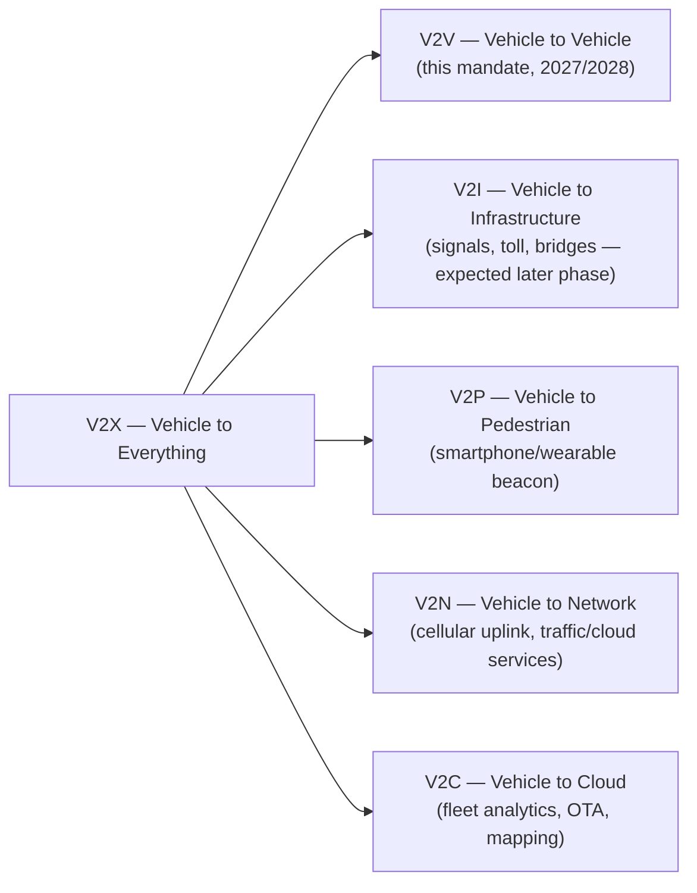

# India's V2V Mandate (AIS-230) — Policy & Regulatory Details

> Source basis: MoRTH draft amendment to the Central Motor Vehicles Rules, 1989 (reported Aug 2026); TRAI V2X consultation paper (30 Apr 2026 – 4 Jun 2026); AIS-230 draft standard; AIS-189 cybersecurity standard. This document consolidates and expands on the reported facts for internal research/planning use.

---

## 1. What Is Being Proposed

The Ministry of Road Transport and Highways (MoRTH) has proposed making **Vehicle-to-Vehicle (V2V) communication** mandatory on newly manufactured vehicles in India, via an amendment to the **Central Motor Vehicles Rules, 1989**, referencing the **AIS-230** automotive standard.

V2V lets nearby vehicles exchange small, frequent wireless messages — speed, location, heading, braking status, acceleration/deceleration, lane-change intent, projected trajectory — so that each vehicle (or its driver) can be warned about a hazard **before it is visible** to cameras, radar, or the human eye.

This is a shift from **passive safety** (seatbelts, airbags, crumple zones) → **active individual-vehicle safety** (ABS, ESC, AEB) → **network-based collision prevention**, where the road becomes a cooperative sensor network rather than a set of isolated vehicles.

---

## 2. Regulatory Timeline

| Milestone | Date | What Changes |
|---|---|---|
| Voluntary compliance window opens | **1 Oct 2027** | Any OEM that fits V2V ahead of the mandate must meet AIS-230 spec — prevents fragmented, non-interoperable early systems |
| Mandatory fitment | **1 Oct 2028** | All new Category L (2/3-wheelers), M (cars/buses), N (trucks/LCVs) vehicles must carry AIS-230-compliant V2V |
| V2I phase (expected, undated) | Post-2028 | Roadside Units (RSUs) at signals, bridges, toll plazas, accident-prone zones |

**Status:** Draft stage. MoRTH has invited objections/suggestions from stakeholders; the amendment is not yet finalized. Timelines and technical specifics (spectrum, message formats, certification bodies) can still change during consultation.

---

## 3. Vehicle Categories Covered

| Category | Vehicle Types | Why It Matters in India |
|---|---|---|
| **L** | Two-wheelers, scooters, motorcycles, three-wheelers | India's largest vehicle population segment; most cost-sensitive; highest fatality share among road users |
| **M** | Cars, SUVs, buses | Largest existing base of connected-car hardware; easiest to retrofit |
| **N** | LCVs, heavy trucks, goods vehicles | High-risk highway interactions with smaller vehicles; fleet-operator appetite for safety tech already exists |

Global V2X mandates (US, EU, China) have historically focused on **M/N only**. India including **Category L** from day one is unusual internationally and is the single biggest driver of both the safety upside and the cost/engineering challenge (see [system_architecture.md](system_architecture.md) §5 and [businessways.md](businessways.md) §2).

---

## 4. Core Safety Use Cases

| Use Case | Mechanism | Where It Matters Most in India |
|---|---|---|
| **Emergency Electronic Brake Light** | Hard-braking vehicle broadcasts a message through the traffic queue | Highway convoys, dense city traffic behind large trucks/buses |
| **Blind-spot / Intersection Collision Warning** | Vehicles exchange position/speed at uncontrolled junctions | Unsignalled intersections, common on Indian urban/semi-urban roads |
| **Wrong-Way Vehicle Alert** | Detects heading against permitted direction | Endemic wrong-side driving on highways and urban arterials |
| **Unsafe Lane-Change Warning** | Cross-checks closing speed of vehicle in target lane | Complements camera-based blind-spot monitors where sensor range is limited |
| **Forward Collision Risk** | Continuous relative-speed/distance calculation | Highway driving, dense stop-and-go traffic |
| **Emergency Vehicle Approach** | Priority broadcast from ambulance/fire/police | Congested cities where sirens are heard late or not at all |
| **Blind-Curve Hazard Warning** | Stalled vehicle/accident/queue broadcasts warning around a bend | Hill roads, highways — high relevance for India's terrain diversity |
| **Two-Wheeler Specific** | Motorcycle broadcasts presence even when visually hidden | Riders in blind spots of trucks/buses, at intersections, wrong-side riders |

---

## 5. Technology Choice: Why C-V2X

The reporting and TRAI consultation indicate India is converging on **Cellular V2X (C-V2X) using PC5 direct sidelink**, not DSRC (the older IEEE 802.11p standard used in early US pilots). Key reasons:

- **No cellular subscription/tower dependency** for basic safety messages — works even with zero network coverage, critical for rural/highway stretches.
- **Global semiconductor momentum** — Qualcomm, Autotalks (acquired by Qualcomm), NXP have all standardized on C-V2X; DSRC silicon is increasingly end-of-life.
- **Upgrade path to 5G-V2X (Rel-16+)** for future V2N/V2C cloud-connected features without replacing the radio.
- **Spectrum** — operates in the delicensed **5.875–5.925 GHz** band, consistent with global ITS-band allocations, easing chipset reuse and import costs.

Full technical treatment is in [system_architecture.md](system_architecture.md).

---

## 6. Interoperability — The System Only Works If Everyone Complies With the Same Spec

A motorcycle from one OEM must be able to talk to a bus from a different OEM. AIS-230 must therefore standardize, at minimum:

- Communication protocol (C-V2X PC5) and message sets (Basic Safety Message equivalent)
- Transmission frequency, minimum range, and latency bounds
- Positioning accuracy requirements
- Security certificate format and revocation process
- Conformance/interoperability test procedures across brands and vehicle categories

Without this, the market risks fragmenting into closed, manufacturer-specific networks — which would defeat the purpose of a *network* safety system. This is the single largest execution risk in the entire mandate.

---

## 7. Cybersecurity Requirements

Because every vehicle is now a broadcaster, V2V introduces new attack surfaces:

| Threat | Description | Required Mitigation |
|---|---|---|
| **Spoofed BSMs** | Fake vehicle broadcasting false speed/position | Cryptographic signing of every message (PKI) |
| **Impersonated emergency vehicles** | False priority broadcasts to clear traffic illegitimately | Certificate-based role authentication |
| **Phantom hazard flooding** | Fake "stalled vehicle" or "hard brake" messages to cause panic braking/DoS-like disruption | Plausibility checks, anomaly detection, certificate revocation |
| **Compromised OBU firmware** | Malicious code altering transmitted data | Secure boot, HSM-backed key storage, OTA-verified updates |

India already has **AIS-189** governing automotive cybersecurity, risk assessment, incident monitoring, and secure OTA update processes across the vehicle lifecycle. **AIS-230 (V2V) and AIS-189 (cybersecurity) must function as a coordinated pair**, not independent regulations — this is explicitly flagged as a coordination risk in the reporting.

---

## 8. Privacy Considerations

V2V requires **frequent broadcast of location, speed, and heading** — inherently sensitive data. To avoid becoming a mass vehicle-tracking system, the framework needs to define, at minimum:

- **Rotating pseudonymous identifiers** instead of static registration numbers/owner identity in every broadcast (standard SCMS practice globally)
- Data retention limits — whether historical movement/trajectory data can be stored at all
- Access control — who (law enforcement, OEM, insurer, third party) can access stored data, and under what legal process
- User rights — visibility into and deletion of non-safety data
- Alignment with India's broader data-protection framework (DPDP Act) for any data that leaves the vehicle

This is called out as an open policy question in the source reporting — the draft has not yet specified data-retention or access rules.

---

## 9. Stakeholder Landscape

The TRAI V2X consultation (Apr–Jun 2026) drew submissions from a wide cross-section, confirming this is **not purely an automotive issue** — it spans telecom spectrum policy, semiconductor supply, road infrastructure, and data governance:

| Category | Organizations |
|---|---|
| Automotive industry bodies | Society of Indian Automobile Manufacturers (SIAM), Automotive Research Association of India (ARAI) |
| Global V2X industry body | 5G Automotive Association (5GAA) |
| Telecom bodies/operators | Cellular Operators Association of India (COAI), Reliance Jio, Bharti Airtel, Vodafone Idea |
| Industry chamber | ASSOCHAM |
| Tier-1 / chipset / software | Bosch Global Software Technologies, Qualcomm India, Harman International |
| Telecom infra / networks | Ericsson India, Tata Communications |
| R&D | C-DAC |

**Expected industry asks during consultation:** clarity on the finalized communication technology, guaranteed spectrum availability, interoperability testing regime, cybersecurity certification process, implementation cost impact, and — specifically — feasibility of equipping low-cost two-wheelers without pricing them out of the mass market.

---

## 10. Implementation Challenges Specific to India

| Challenge | Why It's Hard |
|---|---|
| **Mixed traffic** | Cycles, pedestrians, animal-drawn carts, and non-connected legacy vehicles will share roads with V2V vehicles for 15+ years (vehicle life cycle) — cameras/radar remain essential throughout |
| **Poor lane discipline / weak road markings** | Reduces the reliability of some positioning-dependent use cases |
| **Dense urban canyons / tunnels** | GNSS multipath and signal blockage — lane-level accuracy is hard to guarantee everywhere |
| **Climate extremes** | Heat, dust, monsoon flooding — hardware must meet high ingress-protection and thermal ratings |
| **Long vehicle service life** | Trucks and buses often run 15–20+ years; retrofit and backward-compatible support strategy needed |
| **Aftermarket modification culture** | Common practice of aftermarket repairs/mods raises tamper and recertification questions |
| **Cost sensitivity at the Category L / entry-M tier** | The hardest and most consequential engineering problem — see [businessways.md](businessways.md) |
| **Network-effect bootstrap problem** | V2V value scales with the number of equipped vehicles; the first cohort of compliant vehicles (2027–2030) will mostly be talking to non-equipped traffic |

---

## 11. Relationship to the Broader V2X Ecosystem

V2V is one branch of a larger connected-vehicle taxonomy:

MoRTH's near-term focus is V2V; **V2I is reportedly planned as a later phase**, layering roadside units at traffic lights, bridges, toll plazas, work zones, and accident black-spots on top of the vehicle-side network established by 2028.

---

## 12. Auto Punditz Editorial View (Summarized)

- Greatest strength: addresses risk **before** it's visible to the driver — most valuable at blind intersections, on highways, around large commercial vehicles, and for vulnerable two-wheeler riders.
- Including Category L is what makes this relevant to Indian road conditions specifically, but it's also the hardest cost/engineering problem.
- Success depends less on the announcement and more on the fine print of AIS-230: the communication standard, spectrum framework, cybersecurity architecture, privacy safeguards, interoperability rules, and testing procedures.
- Alert quality matters — excessive or unreliable warnings risk drivers disabling or ignoring the system entirely (a well-documented failure mode in other ADAS rollouts).
- End-state framing: a shift from *"each vehicle protects itself"* to *"every connected vehicle contributes to the safety of the entire road network."*

---

## See Also
- [System Architecture](system_architecture.md) — technical stack, hardware, protocol, spectrum, security architecture
- [Business Opportunities](businessways.md) — supply chain, key players, startup/business opportunity map
- [Gap Analysis, Product Design & Business Case](product_business_analysis.md) — specific product concepts, BOM/cost analysis, TAM/SAM/SOM, GTM plan
