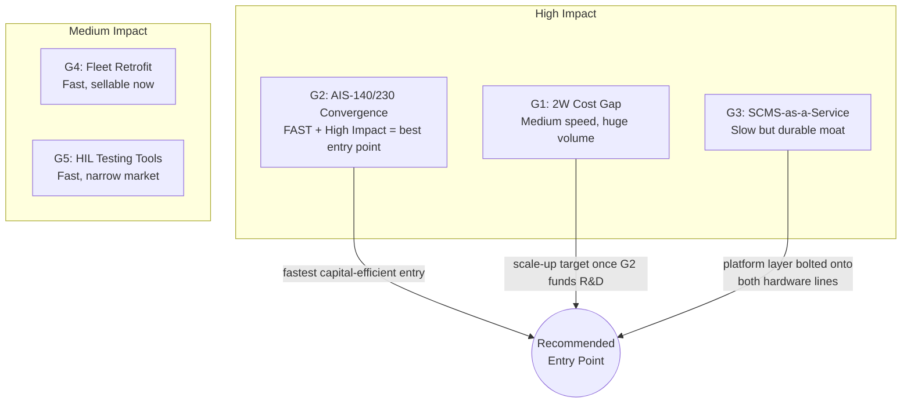
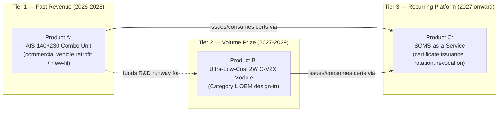
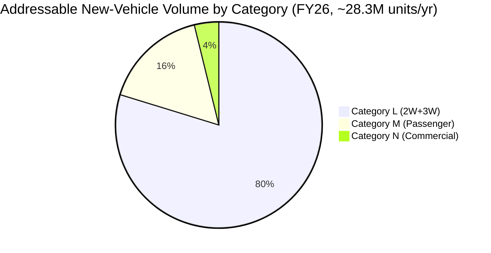
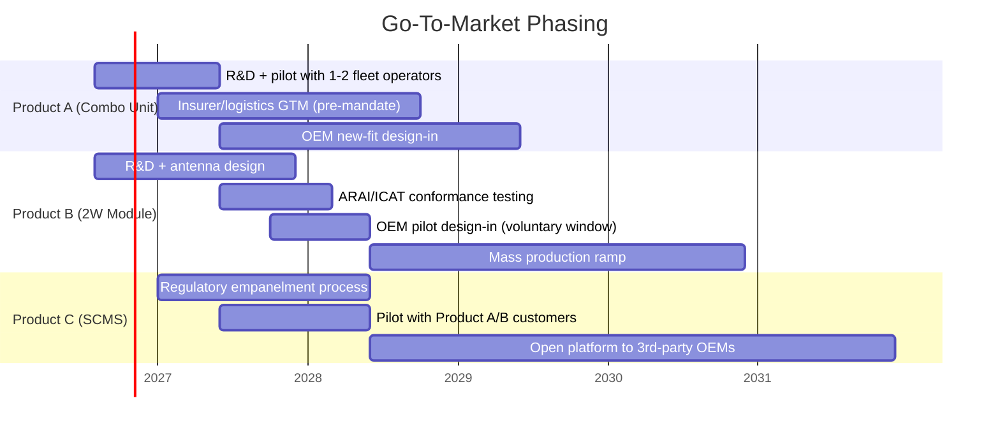

# AIS-230 V2V — Gap Analysis, Product Design & Business Case

> Companion to [details.md](details.md) (policy), [system_architecture.md](system_architecture.md) (technical stack), and [businessways.md](businessways.md) (opportunity map). This document goes one level deeper: it identifies specific whitespace gaps, designs concrete products against them, and builds out cost and business analysis (BOM, TAM/SAM/SOM, unit economics, GTM, risk) to assess viability.
>
> **Methodology note:** Figures below combine (a) verified 2025–26 data — SIAM wholesale volumes, published AIS-140 device pricing, published C-V2X module/chipset pricing — with (b) BA-style estimates built bottom-up from those data points. Every estimate is flagged as such and shown with its assumption, not presented as verified market research. Use this as a planning model to stress-test, not a citable market report.

---

## 1. Gap Analysis

Five gaps were evaluated. Each is scored on **Impact** (revenue/strategic potential) and **Time-to-Capture** (how soon a new entrant could realistically win it), since the regulatory clock (voluntary Oct 2027 → mandatory Oct 2028) makes speed itself a competitive variable.

| # | Gap | Why It's Open | Impact | Time-to-Capture |
|---|---|---|---|---|
| **G1** | **Category L (2-wheeler) cost/engineering gap** | No global Tier-1 (Bosch, Continental, Denso) has a product line-cost-engineered for a ₹60k–₹1.5L commuter motorcycle; their reference designs assume a car's power budget, metal chassis ground plane, and BOM tolerance | **Very High** — 22.5M units/year addressable | Medium (12–18 months to a certified, tooled product) |
| **G2** | **AIS-140 / AIS-230 convergence gap** ⭐ | India *already* mandates GPS+NavIC tracking devices (AIS-140) on commercial vehicles. Nobody has announced a combined AIS-140+AIS-230 unit that reuses the existing installed antenna mount, power tap, and NavIC receiver already sitting in ~5.8M+ commercial vehicles registered annually. This is the single most under-discussed synergy in the current market conversation. | High — retrofit + new-fitment combined market | **Fast** (existing AIS-140 install base + relationships = shortest path to revenue, pre-2028) |
| **G3** | **SCMS / PKI-as-a-Service gap** | Every named cybersecurity player in the current landscape (Escrypt, Microsec, Qualcomm Aeroprise, Tata Communications) is a global vendor or generic telecom security player — none has publicly positioned as an **India-domestic, AIS-230-specific Certificate Authority** with the government empanelment this will likely require | High — recurring, high-margin, multi-decade revenue per vehicle | Slow (12–24 months; needs regulatory empanelment, a real moat once achieved) |
| **G4** | **Pre-mandate fleet retrofit gap** | The mandate only covers *newly manufactured* vehicles from 2028. India's existing multi-million-unit truck/bus/LCV fleet gets nothing unless someone builds a retrofit product — but insurers, logistics majors, and school-bus operators have clear incentive to buy safety credentials early | Medium-High | Fast (sellable today as a voluntary safety/insurance product, independent of the mandate) |
| **G5** | **HIL / conformance testing tooling gap** | Every Tier-1/Tier-2 entering this space (dozens, once the mandate is confirmed) needs to validate against AIS-230 before ARAI/ICAT type approval — a picks-and-shovels play | Medium | Fast, but narrow customer base (sells to suppliers, not OEMs directly) |

### Gap Prioritization

**Conclusion:** G2 (AIS-140/230 convergence) is the fastest, most capital-efficient entry point because it rides on an *existing* mandate, distribution network, and hardware form factor. G1 (2-wheeler) is the largest prize but needs more R&D runway and OEM design-in time. G3 (SCMS-as-a-Service) is the best long-run margin layer and should be built as a platform that both hardware lines feed certificates through, rather than a standalone first product.

This leads to a **three-tier product portfolio**, detailed below.

---

## 2. Product Portfolio

### Product A — "Combo Unit": AIS-140 + AIS-230 Converged Telematics-Safety Device

**What it is:** A single device for commercial vehicles (Category N, and fleet buses in M) that does everything an AIS-140 tracker does today (GPS+NavIC location, panic button, tamper alert, government server integration) **plus** AIS-230 C-V2X safety broadcast/receive — sharing the antenna mount, power tap, enclosure, and installation labor of the existing mandated device.

| Spec | Detail |
|---|---|
| Target category | N (trucks, LCVs, buses), fleet-operated M (buses) |
| Core chips | C-V2X baseband (Qualcomm 9150-class or Autotalks CRATON2-class) + GNSS (GPS+NavIC, already required for AIS-140) + HSM + existing AIS-140 cellular/BLE stack |
| Form factor | Reuses AIS-140's existing shark-fin/roof-mount antenna housing; adds 5.9 GHz element to the same radome |
| Install path | Retrofit onto existing fleet (voluntary, insurer/logistics-driven) pre-2028; OEM-fitted as standard from 2028 |
| Differentiator | One install, one power tap, one vendor relationship — vs. fleet operators needing to source and install AIS-140 and AIS-230 devices separately from two different vendors |

### Product B — "SentryLink" (working name): Ultra-Low-Cost 2-Wheeler C-V2X Safety Module

**What it is:** A compact, IP67/69K-rated, low-power C-V2X module purpose-built for scooters and commuter motorcycles — the product the global Tier-1s are not building.

| Spec | Detail |
|---|---|
| Target category | L (motorcycles, scooters, 3-wheelers) |
| Form factor | Puck-sized (~60mm dia.), under-seat or headlamp-cowl mount, non-metal-body-compatible antenna |
| Power | Runs off 12V motorcycle electrical system, <1W average draw (safety-critical broadcast can't drain a kick-start battery) |
| Positioning | GPS + NavIC, targeting lane-level accuracy |
| Alert interface | Buzzer + LED on instrument cluster (cost-appropriate for entry segment) rather than a full digital cluster integration |
| Core chips | Integrated C-V2X SoC (baseband + app processor combined, to minimize part count) + GNSS + discrete HSM |
| Environmental rating | IP67/69K, -20°C to 85°C operating range, vibration-rated for 2W use |

### Product C — SCMS-as-a-Service Platform

**What it is:** A managed Security Credential Management System — certificate issuance, rotation, and revocation-as-a-service — sold to OEMs and Tier-1s (including, potentially, competitors' hardware) rather than built in-house by every manufacturer.

| Spec | Detail |
|---|---|
| Customer | Any AIS-230-compliant OEM/Tier-1 (not exclusive to Products A/B) |
| Revenue model | Per-vehicle-per-year subscription, billed to OEM or fleet operator, for the vehicle's operating life |
| Moat | Requires government empanelment (analogous to Controller of Certifying Authorities empanelment under the IT Act for digital signature CAs) — hard to replicate once secured, easy to defend |
| Dependency | Needs AIS-230's final security architecture (still draft — see [details.md](details.md) §7) before the certificate format can be finalized; build spec-agnostic where possible |

---

## 3. Cost Analysis

### 3.1 Grounding Data Points (Verified)

| Data Point | Value | Source Context |
|---|---|---|
| Quectel AG15 (Qualcomm 9150-based C-V2X module, low-volume/distributor price) | **$269 / unit** | Public distributor listing — reflects small-quantity, non-OEM pricing, not automotive high-volume pricing |
| Dual-mode DSRC/C-V2X module, chipset-level, current market | **$80–150 / unit** | Industry estimate at chipset/module level |
| NHTSA 2016 estimate: DSRC OBU cost, 2020 timeframe | **~$329–350 / vehicle**, declining to **$209–227 by 2058** | US regulatory impact analysis — dated, DSRC not C-V2X, but shows the expected cost decay curve shape |
| AIS-140 GPS+NavIC tracker, India, installed (2026) | **₹3,000–₹10,000** (~$36–$120) | Existing Indian mandated-hardware precedent — the single best sanity check for what the Indian market/regulator accepts as a mandated per-vehicle hardware cost |

**Read-through:** the AIS-140 precedent is the most India-relevant anchor. It shows the Indian regulatory/market system already tolerates a ₹3,000–₹10,000 mandated hardware cost per commercial vehicle. An AIS-230 device should land in a comparable or lower band once at automotive volume, since C-V2X silicon has matured significantly since the $269 distributor-channel price point above (which is a low-volume, non-automotive-OEM number).

### 3.2 Estimated BOM — Product B (2-Wheeler Module), at High Volume (2M+ units/year)

*Estimate only — built bottom-up from component category costs at automotive high-volume pricing, not a vendor quote.*

| Component | Est. Cost (USD) | Notes |
|---|---|---|
| C-V2X baseband/SoC (integrated app processor) | $10–16 | Highest-cost single component; scales down with volume and integration |
| GNSS receiver (GPS+NavIC, multi-constellation) | $3–6 | NavIC-capable chips have matured to commodity pricing |
| HSM / secure element | $2–4 | Automotive-grade crypto IC |
| RF front-end (PA, filters, switches) | $3–5 | 5.9 GHz band-specific |
| Antenna (compact, non-metal-body-compatible) | $1–2 | Custom design NRE amortized separately |
| PCB, passives, connectors | $3–5 | |
| Power management | $1–2 | Must tolerate 2W electrical noise |
| Enclosure (IP67/69K) | $3–6 | Weatherproofing adds real cost vs. car-mounted (cabin-protected) equivalents |
| Assembly, test, calibration | $3–5 | |
| **Total BOM (est.)** | **$29–51** | Midpoint ≈ **$40 (~₹3,500)** |

This midpoint (**~₹3,500 landed BOM**) sits comfortably inside the AIS-140 precedent band (₹3,000–₹10,000), which is a reassuring cross-check rather than a coincidence — both are mandated, safety-linked, GNSS-plus-radio devices sold into the same Indian automotive supply chain.

### 3.3 One-Time / NRE Costs (Estimate)

| Item | Est. Cost | Notes |
|---|---|---|
| Hardware R&D (2 years, small team) | $1.5–3M | Antenna design for non-metal chassis is the hardest and most novel piece |
| Embedded software / V2X stack | $1–2M | Can be reduced by licensing a stack (Commsignia, Cohda) vs. building from scratch |
| Tooling (injection molds, SMT line setup) | $0.5–1.5M | Scales with target volume/plant strategy |
| ARAI/ICAT type approval + conformance testing | $0.3–0.8M | Recurring per major hardware revision |
| HIL/simulation test bench (in-house or outsourced) | $0.2–0.5M | See G5 — could alternatively be bought as a service |
| **Total NRE (est.)** | **~$3.5–7.8M** | Before any manufacturing capex |

### 3.4 Cost Curve vs. Volume (Directional)

| Annual Volume | Est. BOM / Unit | Driver |
|---|---|---|
| 50K (pilot) | $70–90 | No volume discount, low tooling amortization |
| 500K | $50–60 | Chipset volume pricing tiers kick in |
| 2M+ | $29–51 | Full automotive-tier chipset pricing, tooling fully amortized |
| 10M+ (mature, multi-OEM) | $22–35 | Approaching Asian 2W-electronics commodity pricing (comparable to BT/WiFi combo module cost curves) |

---

## 4. Business Analysis

### 4.1 Bottom-Up Market Sizing

**Base volumes (FY 2025-26, SIAM):**

| Category | Segment | Annual Units |
|---|---|---|
| L | Two-wheelers | 21.7M |
| L | Three-wheelers | 0.84M |
| M | Passenger vehicles | 4.64M |
| N | Commercial vehicles | 1.08M |
| **Total** | | **~28.3M/year** |

This cross-checks against SIAM's reported total wholesale of 2,82,65,519 units in FY26 — the category breakdown accounts for essentially the entire market, which is a useful internal consistency check on the segment figures.

**TAM (hardware, once mandate is fully phased in from FY29 onward, recurring annually):**

| Category | Units/yr | Est. ASP to OEM | Annual TAM |
|---|---|---|---|
| L | 22.5M | $40 | ~$900M |
| M | 4.64M | $60 (less incremental cost — many already have telematics) | ~$278M |
| N | 1.08M | $70 (ruggedized, lower volume) | ~$76M |
| **Total hardware TAM** | | | **~$1.25B/year** |

Plus a **recurring SCMS/certificate-services TAM**, layered on the *installed base* (not just new sales) — at an estimated $1–2/vehicle/year, growing as the compliant fleet accumulates:

| Year post-mandate | Est. Installed Base | Services TAM (@ $1.5/vehicle/yr, est.) |
|---|---|---|
| Year 1 (FY29) | ~28M | ~$42M |
| Year 3 (FY31) | ~85M | ~$127M |
| Year 5 (FY33) | ~140M | ~$210M |

**SAM (realistic serviceable segment for a new entrant):** Category M is the least attractive segment for a new entrant — incumbent Tier-1s (Bosch, Continental, Harman) already hold OEM relationships there. The defensible SAM is:
- **Category L hardware** (~$900M TAM) — where G1's cost gap means incumbents are structurally disadvantaged
- **Category N retrofit + new-fit** via the AIS-140/230 combo angle (G2) — a market not captured in the "new vehicle" TAM above, since it includes the existing fleet
- **SCMS services**, sold horizontally across all categories regardless of who wins the hardware

**SOM (Year 3–4 realistic capture, est.):** Indian 2-wheeler OEM volume is concentrated — Hero MotoCorp, Honda Motorcycle & Scooter India, TVS, Bajaj, and Suzuki together account for the large majority of category L volume. A **single design win** with one mid-tier 2W OEM (e.g., ~2–3M units/year) at a blended $35–40 ASP represents **$70–120M in annual revenue potential** once ramped — realistic as a Year 3–4 outcome, not Year 1.

### 4.2 Revenue Model & Pricing Strategy

| Product | Model | Pricing Logic |
|---|---|---|
| Product A (Combo Unit) | One-time hardware sale + install, to fleet operators/OEMs | Price at a *discount* to buying AIS-140 + AIS-230 separately, to make the combo the obvious choice — e.g. ₹6,000 combo vs. ₹4,000+₹4,000 bought separately |
| Product B (2W Module) | One-time hardware sale to OEM, embedded in vehicle BOM | Priced to land inside the AIS-140 precedent band; OEM passes cost through to consumer pricing |
| Product C (SCMS) | Recurring per-vehicle-per-year subscription | Priced low enough to be a rounding error in OEM BOM (~$1–2/yr) but scales with the entire compliant vehicle base — classic razor/razorblade economics riding on Products A and B |

### 4.3 Unit Economics (Illustrative, Product B at Volume)

| Line | Value |
|---|---|
| BOM cost (2M+ volume) | ~$40 |
| Manufacturing/assembly overhead | ~$5 |
| Landed cost | ~$45 |
| ASP to OEM | ~$60–65 |
| **Gross margin** | **~30–35%** |
| SCMS attach (Product C, recurring) | +$1.5/yr per unit, ~80%+ margin (software) |

Hardware margin is deliberately modest (consistent with automotive Tier-1/Tier-2 norms); the SCMS attach is what converts this from a thin-margin hardware business into a durable, compounding one.

### 4.4 Phased Go-to-Market (Aligned to Regulatory Timeline)

### 4.5 Capital Requirements (Est.)

| Stage | Amount | Use |
|---|---|---|
| Seed | $2–4M | Product A prototype, pilot with 1–2 fleet operators, initial SCMS empanelment groundwork |
| Series A (2027) | $12–20M | Product B R&D completion, ARAI/ICAT certification, tooling for pilot-scale manufacturing |
| Series B (2028, pre-mandate ramp) | $25–40M | Manufacturing scale-up for mandatory-fitment volume, working capital for OEM supply contracts |

### 4.6 Competitive Positioning

| Competitor Type | Who | How This Portfolio Differs |
|---|---|---|
| Existing AIS-140 device makers | MapmyIndia, Intangles, SahajGPS, FleetX-ecosystem vendors | They are the most likely first movers into Product A (combo device) — real risk, not just an opportunity for a new entrant. **Speed is the moat here**, not technology; a startup should assume these players will attempt the convergence play once AIS-230 is finalized, and treat 2026–2027 as the window to move first or to approach them as a module supplier instead of a competitor |
| Global Tier-1s | Bosch, Continental, Denso, Harman | Structurally disadvantaged in Category L (G1) due to cost-engineering mismatch; dominant in Category M — do not compete there head-on |
| Chipset vendors | Qualcomm, NXP, Autotalks/Qualcomm | Potential component suppliers/partners, not direct competitors, unless they choose to go direct-to-module (as Autotalks/Qualcomm's SECTON add-on product suggests is already a strategy to watch) |
| Cybersecurity/PKI | Escrypt, Microsec, Tata Communications | No public India-specific AIS-230 SCMS empanelment yet — genuinely open as of this research |

### 4.7 Risk Register

| Risk | Severity | Mitigation |
|---|---|---|
| AIS-230 final spec differs materially from current draft | High | Architect hardware/software with a modular security and RF layer; avoid hard-coding assumptions ahead of finalization (echoes [businessways.md](businessways.md) §8) |
| Incumbent AIS-140 vendors move first on the combo product (G2) | High | Treat 2026–2027 as a sprint window; alternatively pivot to a module/component supply relationship with them rather than pure competition |
| 2-wheeler OEMs delay voluntary adoption, compressing the 2027→2028 pilot window | Medium | Don't depend on OEM pilot revenue to fund Series A — size the seed/Series A runway to survive a compressed pilot phase |
| SCMS empanelment process is slow, undefined, or restricted to specific players | Medium-High | Start regulatory engagement in parallel with hardware R&D, not after — this is the longest lead-time item in the whole plan |
| Two-wheeler antenna/RF design (non-metal chassis) underperforms in real-world testing | Medium | This is flagged as the hardest technical problem in [system_architecture.md](system_architecture.md) §7 — budget extra R&D contingency here specifically |
| Network-effect bootstrap — early compliant vehicles mostly talk to non-equipped traffic | Low-Medium | Doesn't block hardware revenue (mandate-driven), but should temper marketing claims about safety benefit in years 1–3 |

---

## 5. Recommendation

1. **Lead with Product A (AIS-140/230 combo)** — fastest path to revenue, rides an existing mandate and distribution channel, lowest capital requirement to first sale.
2. **Use Product A revenue and credibility to fund Product B (2-wheeler module)** — the larger, harder, more defensible prize once achieved, timed to the 2027 voluntary window so the product is proven before the 2028 mandatory cliff.
3. **Build Product C (SCMS-as-a-service) as a platform from day one**, even while Products A/B are still pre-revenue — the regulatory empanelment lead time is the longest pole in the tent and should not be started late.
4. **Do not compete head-on with global Tier-1s in Category M** — it's the least structurally advantaged segment for a new entrant.
5. **Treat 2026–2027 as a genuine race** on Gap G2 specifically — it is the one gap in this analysis where an incumbent adjacent player (existing AIS-140 vendors) could plausibly move first with fewer barriers than a new entrant faces.

---

## See Also
- [Policy & Regulatory Details](details.md)
- [System Architecture](system_architecture.md)
- [Business & Startup Opportunities (Overview)](businessways.md)
