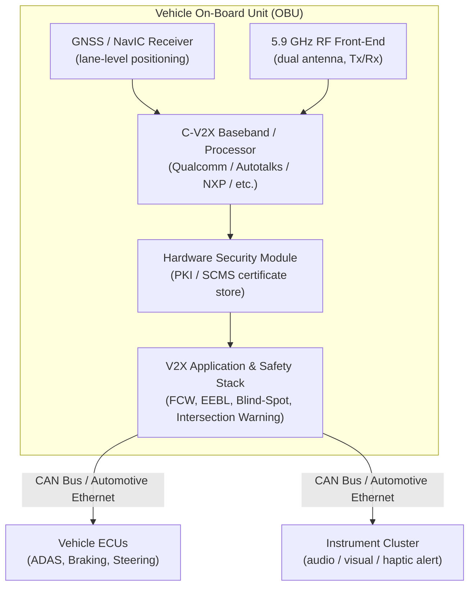
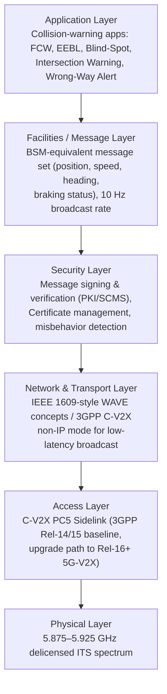
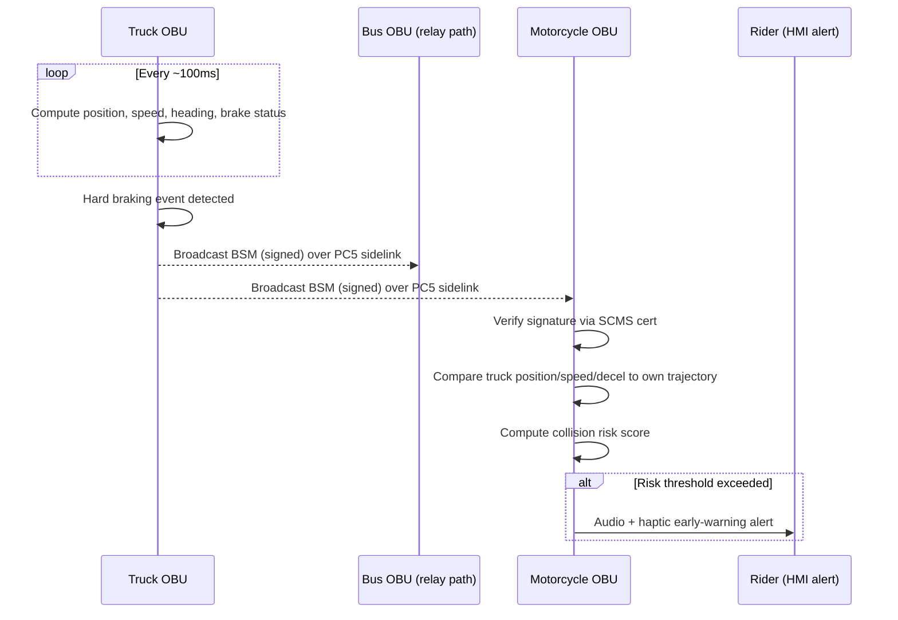
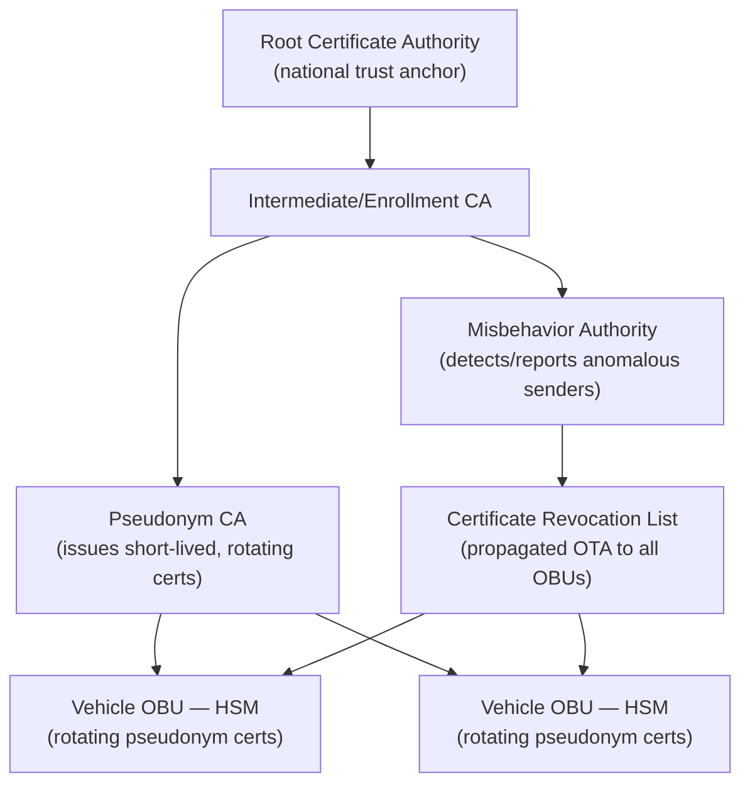
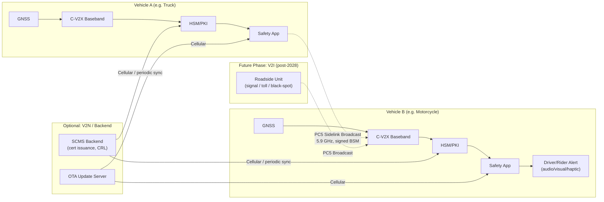

# AIS-230 V2V — System & Technical Architecture

> Companion to [details.md](details.md) (policy/regulatory) and [businessways.md](businessways.md) (business/market). This document covers the technical stack: radio technology, spectrum, in-vehicle hardware, protocol layers, message flow, and security architecture.

---

## 1. Technology Stack at a Glance

| Layer | Technology |
|---|---|
| Radio access | **C-V2X (Cellular V2X) — PC5 direct sidelink** |
| Spectrum | **5.875–5.925 GHz** (delicensed ITS band) |
| Positioning | GNSS: **GPS + NavIC**, lane-level (sub-meter) target accuracy |
| Message standard | Basic Safety Message (BSM)-equivalent, broadcast every ~100 ms |
| Higher-layer standards referenced | IEEE 1609 (WAVE stack concepts), 3GPP Release 14/15 (C-V2X baseline), SAE J2735-style message sets |
| Security | PKI / Security Credential Management System (SCMS), Hardware Security Module (HSM) |
| Vehicle-side network | CAN bus / Automotive Ethernet to ECUs, instrument cluster, ADAS |

**Why PC5 direct sidelink and not the cellular network (Uu interface):** basic safety messages must work with **zero cell coverage and zero subscription**, at latencies (<100 ms) and reliability that public cellular networks can't guarantee for life-safety broadcasts. The cellular network (Uu / V2N) is reserved for optional, non-latency-critical add-ons — traffic info, cloud analytics, OTA updates.

---

## 2. In-Vehicle Hardware Block Diagram

### Essential Hardware Components

| Component | Function | Notes |
|---|---|---|
| **On-Board Unit (OBU) / Telematics Control Unit (TCU)** | Main ECU running the V2X stack | Often integrated into existing telematics hardware in premium vehicles |
| **C-V2X Modem/Chipset** | Low-latency Tx/Rx of safety beacons over PC5 sidelink | Qualcomm 9150/SA515M-class, Autotalks, NXP chipsets |
| **High-precision GNSS receiver** | Sub-meter / lane-level positioning | GPS + NavIC dual-constellation for India-specific accuracy and resilience |
| **RF antennas** | Dual 5.9 GHz omnidirectional | Shark-fin module for cars/buses; compact integrated antenna for two-wheelers |
| **Secure Element / HSM** | Cryptographically signs every transmitted packet | Prevents spoofing/impersonation; anchors the SCMS trust chain |

---

## 3. Protocol Stack

- **Rel-14/15 C-V2X** is the practical baseline for Basic Safety Message broadcast (what AIS-230 targets first).
- **Rel-16+ (5G-V2X / NR-V2X)** is the upgrade path for higher-bandwidth use cases (sensor sharing, platooning, V2N cloud services) — expected in later phases, not the 2027/2028 mandate scope.

---

## 4. Message Exchange Flow (Sequence)

Example: Emergency Electronic Brake Light (EEBL) — a truck brakes hard and a following two-wheeler, hidden behind a bus, receives an early warning.

Because PC5 is **direct broadcast**, no cell tower or subscription is required in this path — the bus's presence doesn't block reception, it simply illustrates that line-of-sight isn't needed either (unlike camera/radar).

---

## 5. Security Architecture — PKI / SCMS

Key properties this architecture must deliver (per the source reporting's cybersecurity/privacy sections):

1. **Message authenticity** — every BSM is signed; receivers verify against a valid, unrevoked certificate before acting on it.
2. **Sender anonymity for privacy, accountability for security** — certificates are *pseudonymous and rotate frequently* (not tied to registration number/owner identity in the broadcast itself), but are still traceable through the CA chain under proper legal process if a vehicle is later found to be misbehaving.
3. **Revocation** — a compromised or misbehaving OBU's certificates can be revoked and the CRL pushed to the fleet, typically over the OTA/cellular back-channel (V2N), not the safety-critical PC5 path.
4. **Coordination with AIS-189** — secure boot, OTA update integrity, and incident monitoring required by AIS-189 must protect the same OBU that anchors the SCMS trust chain; the two standards are not independently sufficient.

---

## 6. Spectrum Context

| Band | Use | Notes |
|---|---|---|
| **5.875–5.925 GHz** | Direct V2V/V2X sidelink (PC5) | Delicensed ITS band, aligned with global allocations — eases chipset reuse/import |
| Licensed cellular bands (4G/5G) | Optional V2N backhaul | OTA updates, cloud analytics, non-safety-critical services; not required for baseline BSM exchange |

Spectrum allocation and guard-band interference management were explicit agenda items in TRAI's Apr–Jun 2026 V2X consultation, since the ITS band sits close to other licensed telecom allocations.

---

## 7. Category-Specific Engineering Constraints

| Category | Key Constraint | Design Implication |
|---|---|---|
| **L (two-wheelers)** | Extreme cost sensitivity, no metal chassis for antenna grounding, limited electrical power budget, weather exposure | Ultra-compact, low-power, IP67/69K-rated micro-OBU; non-metal-body-compatible antenna design |
| **M (cars/buses)** | Varies widely — premium models already have connected-car hardware; entry hatchbacks don't | Tiered BOM strategy: reuse existing telematics stack where present, new OBU where absent |
| **N (trucks/LCVs)** | Long duty cycles, harsh vibration/thermal environment, fleet-scale retrofit demand pre-2028 | Ruggedized automotive-grade components; retrofit-kit form factor for existing fleets |

---

## 8. Key Technology & Component Suppliers

| Layer | Companies |
|---|---|
| Semiconductors & chipsets | Qualcomm (9150/SA515M-class C-V2X chipsets), NXP Semiconductors, Autotalks (now part of Qualcomm), STMicroelectronics, MediaTek |
| Tier-1 hardware & OBUs | Bosch India, Continental, Denso, Minda Corporation (Spark Minda), Uno Minda, Harman (Samsung), Visteon |
| Software stacks & integration | KPIT Technologies, Tata Elxsi, L&T Technology Services (LTTS), C-DAC, Commsignia, Cohda Wireless |
| Cybersecurity / PKI-SCMS | Escrypt (ETAS/Bosch), Microsec, Qualcomm Aeroprise, Tata Communications |
| Testing & certification | ARAI, ICAT, Rohde & Schwarz, Keysight Technologies |

---

## 9. End-to-End System View

---

## See Also
- [Policy & Regulatory Details](details.md)
- [Business & Startup Opportunities](businessways.md)
- [Gap Analysis, Product Design & Business Case](product_business_analysis.md)
- [Blind Crossing (interactive simulation)](blind_crossing.html) — open in a browser: a 3D demo of the BSM broadcast/receive/predict/warn pipeline described above
- [Chain Brake (interactive simulation)](blind_braking.html) — open in a browser: a 3D demo of the same pipeline applied to a highway chain-reaction braking scenario
