# ACN-VTSP — Problem Statement, Solution Specification, Desired Outputs & Master SDLC Roadmap

<div align="center">

**Automated Cloud-Native Video Transcoding & Streaming Platform (`ACN-VTSP`)**  
*From Industry Problem Statement → Technical Solution → Exact Desired Outputs → Validated 8-Phase SDLC Execution Plan*

[](./README.md)
[](./flow2.html)
[](./ARCH.txt)

</div>

---

## Table of Contents

1. [Problem Statement: Why Traditional Video Platforms Break at Scale](#1-problem-statement-why-traditional-video-platforms-break-at-scale)
2. [What We Are Building: The Complete Solution & 9 Core Feature Pillars](#2-what-we-are-building-the-complete-solution--9-core-feature-pillars)
3. [Desired Outputs & Verifiable Deliverables Matrix (What "Done" Looks Like)](#3-desired-outputs--verifiable-deliverables-matrix-what-done-looks-like)
   - [3.1 Media & Storage Outputs (`Cloudflare R2 / MinIO`)](#31-media--storage-outputs-cloudflare-r2--minio)
   - [3.2 AI Enrichment & Metadata Outputs (`WebVTT`, `JSON`, `Qdrant`, `PostgreSQL`)](#32-ai-enrichment--metadata-outputs-webvtt-json-qdrant-postgresql)
   - [3.3 Real-Time Live, Whiteboard & Chat Outputs](#33-real-time-live-whiteboard--chat-outputs)
   - [3.4 Headless API, Webhooks & MCP Agent Outputs](#34-headless-api-webhooks--mcp-agent-outputs)
   - [3.5 Frontend & Mobile User Experience Outputs](#35-frontend--mobile-user-experience-outputs)
   - [3.6 Performance, Cost & SLA Target Benchmarks](#36-performance-cost--sla-target-benchmarks)
4. [Engineering Validation of Your 8-Phase SDLC Plan](#4-engineering-validation-of-your-8-phase-sdlc-plan)
5. [Master 8-Phase SDLC Execution Blueprint & Step-by-Step Checklist](#5-master-8-phase-sdlc-execution-blueprint--step-by-step-checklist)

---

## 1. Problem Statement: Why Traditional Video Platforms Break at Scale

Building a modern video platform today—whether for **EdTech, E-Commerce/Shoppable Video, Creator Communities, or Enterprise Media**—faces **7 critical engineering bottlenecks**:

| # | Core Problem | Why Current Approaches Fail | Business & Technical Impact |
| :-: | --- | --- | --- |
| **P1** | **Runaway Cloud Bandwidth & Idle Compute Costs** | Storing video on AWS S3 ($0.09/GB egress) and keeping dedicated CPU/GPU transcoding servers running 24/7 even when upload queues are empty. | Bandwidth and idle compute consume **70–85% of startup runway** before reaching scale. |
| **P2** | **Duplicate HLS & DASH Storage Overhead** | Traditional pipelines encode `.ts` chunks for Apple (HLS) and separate `.mp4` chunks for Android/Web (DASH), decoding the raw source video multiple times. | **2x storage cost** and **3x slower CPU transcoding** time per uploaded video. |
| **P3** | **Slow Time-to-Stream & Re-buffering on Mobile** | Waiting for 1080p encoding to finish before a video is playable, and lacking segment pre-fetching for 9:16 vertical shorts feeds. | Creators wait minutes to publish; viewers abandon streams due to **>2s startup delay**. |
| **P4** | **Expensive & High-Latency Live Streaming + Screen Sharing** | Using WebRTC SFUs for 10,000 passive viewers (massive server cost) or streaming 1080p video pixels just to share a teaching whiteboard. | Live sessions crash at scale or cost hundreds of dollars per hour; whiteboard lag ruins interactivity. |
| **P5** | **Slow or Expensive Live Chat Moderation** | Calling external LLM APIs (OpenAI/Anthropic) for every live chat message adds 400–800ms latency and high token bills, while simple regex misses toxic variations. | Toxic/profane messages slip through or chat feels laggy and expensive during viral streams. |
| **P6** | **Passive Video Consumption (No Interactive AI or Commerce)** | Videos are treated as "dead pixels"—viewers cannot ask timestamped questions, take auto-generated quizzes, switch dubbed audio tracks seamlessly, or click products worn in the video. | Low learner retention in EdTech and zero direct conversion in E-Commerce video streams. |
| **P7** | **Walled-Garden Lock-In (No Headless or AI Agent Access)** | Most platforms trap content inside their own UI without scoped API keys, signed webhooks, embeddable Web Components, or **Model Context Protocol (MCP)** support for AI agents. | Content owners cannot automate workflows via AI agents or embed protected streams on external sites. |

---

## 2. What We Are Building: The Complete Solution & 9 Core Feature Pillars

We are building **ACN-VTSP (Automated Cloud-Native Video Transcoding & Streaming Platform)**—a unified, zero-waste, AI-native video cloud that solves all 7 problems above through **Core Cloud-Native CMAF Streaming** plus **9 Production Feature Modules**:

```mermaid
mindmap
  root((ACN-VTSP<br/>Platform))
    Core Engine
      Direct 10MB S3/R2 Multipart Ingest
      KEDA Scale-to-Zero Spot CPU Pods
      Single-Decode FFmpeg CMAF (.m4s)
      Zero-Egress Cloudflare R2 + CDN (>95% Hit)
    1 & 9. Multi-Format Player & Studio
      Next.js 15 Web + Flutter Mobile
      16:9 Horizontal VOD + 9:16 Vertical Shorts
      360p / 720p / 1080p ABR + 0.25x-2x Speed
      Next-2-Video Segment Pre-fetching
    2. Headless, MCP & Live Calls
      Unkey Scoped API Keys + CORS Lock
      BullMQ HMAC-SHA256 Webhooks
      TypeScript MCP Server (SSE / Stdio)
      LiveKit WebRTC SFU (<300ms) + LL-HLS
    3. AI Transcripts, RAG Q&A & MCQs
      Faster-Whisper Word-Level WebVTT
      Qdrant 60s Sliding Window RAG ([04:12] Citations)
      LLM Auto-Generated JSON MCQ Quizzes
    4. Sub-5ms NLP Chat Moderation
      Go WebSocket Gateway
      0.1ms Aho-Corasick Trie Filter
      4ms In-Memory Int8 ONNX Detoxify
    5. Real-Time CRDT Whiteboard
      Excalidraw / Tldraw SDK
      Yjs CRDT Sync (<5 kbps Delta Updates)
      Redis Binary Snapshot for Late Joiners
    6. Multi-Language Audio & Subtitles
      NLLB-200 / SeamlessM4T Translated VTT
      Kokoro-82M / XTTS Dubbed .m4a Audio
      HLS #EXT-X-MEDIA Zero-Rebuffer Switch
    7. Shoppable Video & Product Pop-Ups
      1 FPS FFmpeg Keyframe Extraction
      YOLOv11 Bounding Boxes + CLIP Embeddings
      Merchant Qdrant Match -> products_overlay.json
    8. Custom Two-Tower Feed Engine
      ClickHouse Watch Telemetry Collector
      Two-Tower + Qdrant Candidate Generation
      Sub-20ms Redis ZSET Timeline Cache
```

### Summary of What Each Component Solves

1. **Core Cloud-Native Transcoding & Packaging:** Direct Presigned S3 Multipart upload bypasses backend RAM; KEDA scales Kubernetes Spot CPU workers from `0 → 50`; FFmpeg decodes once (`-filter_complex`) to emit unified `2s` `.m4s` CMAF segments for both Apple HLS (`.m3u8`) and Android/Web DASH (`.mpd`); stored on Cloudflare R2 (`$0` egress).
2. **Feature 1 & 9 — Multi-Format UI, Creator Studio, 16:9 & 9:16 Views, Speed & Quality Control:** Next.js 15 (Web) and Flutter (Mobile) apps supporting both horizontal `16:9` VOD and vertical `9:16` Shorts with instant `360p / 720p / 1080p` quality switching, `0.25x–2x` playback speed, WebP timeline scrubbing sprites, and resumable `tus.io`/S3 uploads.
3. **Feature 2 — Headless Distribution, Scoped API Keys, Webhooks, MCP Server & Video Calls:** Content owners generate `vid_live_...` scoped keys, embed `<acn-video-player>` on external domains, receive HMAC-signed BullMQ webhooks, expose 4 native MCP tools to AI agents over SSE, and host `<300ms` WebRTC video calls via LiveKit + MediaMTX LL-HLS for 10,000+ viewers.
4. **Feature 3 — AI Transcripts, Summaries, Timestamped RAG Q&A & Auto-MCQ Generator:** Faster-Whisper generates word-level `.vtt` captions; 60s chunks are embedded in Qdrant so viewers can ask questions and get clickable `[04:12]` timestamp citations; an LLM generates 5–10 structured MCQ quiz questions per video.
5. **Feature 4 — Sub-5ms NLP Live Chat Profanity & Toxicity Filtering:** Go WebSocket gateway runs a `0.1ms` Aho-Corasick Trie filter followed by a `4ms` in-memory quantized `Int8 ONNX Detoxify` model—blocking/shadow-banning toxic messages (`score >= 0.75`) before Redis Pub/Sub broadcast with zero external API cost.
6. **Feature 5 — Real-Time Collaborative Whiteboard (`<5 kbps`):** Excalidraw/Tldraw synced via Yjs CRDT binary deltas (`Uint8Array`) over WebSockets/DataChannels with Redis state snapshots for late joiners—eliminating heavy screen-share video bandwidth.
7. **Feature 6 — Multi-Language Subtitle & Dubbed Audio Tracks:** NLLB-200 translates `.vtt` subtitles and Kokoro-82M/XTTS synthesizes dubbed `.m4a` audio tracks attached via `#EXT-X-MEDIA:TYPE=AUDIO` so switching languages never re-buffers video chunks.
8. **Feature 7 — AI Product Detection & Shoppable Video Pop-Ups:** Offline 1 FPS frame extraction + `YOLOv11` bounding boxes + `CLIP` embeddings matched against the creator's product catalog in Qdrant (`cosine >= 0.85`), compiled into `products_overlay.json` for interactive clickable player pop-ups.
9. **Feature 8 — Custom Two-Tower Recommendation Feed:** ClickHouse ingests watch time, completion rate, and skips; Two-Tower vectors query Qdrant candidates and pre-compute ranked timelines into Redis ZSETs for `<20ms` home and Shorts feed loads.

---

## 3. Desired Outputs & Verifiable Deliverables Matrix (What "Done" Looks Like)

Use this section as your **Single Source of Truth for Acceptance Testing**. Every subsystem has concrete, inspectable artifacts and outputs that prove it is working properly.

### 3.1 Media & Storage Outputs (`Cloudflare R2 / MinIO`)

When a raw video (`input.mp4`, either `16:9` or `9:16`) is uploaded for `video_id = vid_8842`, the transcoding & packaging pipeline **MUST** produce the following exact objects inside `s3://acn-vtsp-processed-media/videos/vid_8842/`:

| Output Artifact Path | Format / Codec | Expected Content & Verification Criteria |
| --- | --- | --- |
| `master.m3u8` | HLS Master Manifest | Contains `#EXT-X-STREAM-INF` for `360p`, `720p`, `1080p`, `#EXT-X-MEDIA:TYPE=AUDIO` for `en`, `hi`, `es`, and `TYPE=SUBTITLES`. |
| `manifest.mpd` | MPEG-DASH Manifest | XML MPD referencing the **exact same** `init.mp4` and `seg_*.m4s` CMAF chunks as `master.m3u8`. |
| `video_h264/{360p,720p,1080p}/init.mp4` | CMAF Init Header | Fragmented MP4 initialization box (`ftyp` + `moov`). |
| `video_h264/{360p,720p,1080p}/seg_000.m4s` | CMAF Media Segment | 2.0-second keyframe-aligned (`-g 48`) `.m4s` chunks (`moof` + `mdat`) with `Cache-Control: public, max-age=31536000, immutable`. |
| `video_av1/{360p,720p,1080p}/seg_*.m4s` | AV1 CMAF Segments | Automatically generated by tiered Spot worker once `videos.view_count >= 500` (~45% smaller file size). |
| `thumbnails/poster.webp` & `spritesheet.webp` | WebP + VTT | Cover image + timeline hover sprite sheet paired with `spritesheet.vtt` spatial coordinates (`#xywh=x,y,w,h`). |

---

### 3.2 AI Enrichment & Metadata Outputs (`WebVTT`, `JSON`, `Qdrant`, `PostgreSQL`)

For every uploaded video, the Spot GPU AI workers **MUST** produce the following structured artifacts:

#### Output 1: Word-Level Multi-Language Subtitles (`captions/en.vtt`, `captions/hi.vtt`, `captions/es.vtt`)

```vtt
WEBVTT
Kind: captions
Language: en

00:00:01.120 --> 00:00:04.480
Welcome to our cloud-native distributed systems masterclass.

00:00:04.520 --> 00:00:08.900
Today we will inspect how CMAF segments eliminate duplicate storage.
```

#### Output 2: Timestamped RAG Q&A Streaming Response (`POST /api/v1/videos/:videoId/ask`)

```json
{
  "video_id": "vid_8842",
  "question": "How does the platform avoid encoding twice for Apple and Android?",
  "answer": "The pipeline uses Common Media Application Format (CMAF) fragmented MP4 (.m4s) chunks [00:04], allowing both Apple HLS (.m3u8) and Android/Web MPEG-DASH (.mpd) manifests to reference the exact same byte segments [01:18].",
  "citations": [
    { "label": "00:04", "timestamp_sec": 4.5, "chunk_id": "chk_01", "score": 0.92 },
    { "label": "01:18", "timestamp_sec": 78.0, "chunk_id": "chk_02", "score": 0.89 }
  ]
}
```

#### Output 3: Auto-Generated MCQ Quiz JSON (`GET /api/v1/videos/:videoId/mcqs` & `video_mcqs` Table)

```json
{
  "video_id": "vid_8842",
  "mcqs": [
    {
      "id": "mcq_301",
      "difficulty": "MEDIUM",
      "question_text": "Why are query strings stripped from .m4s segment requests at the CDN edge?",
      "options": [
        "To compress video resolution to 360p",
        "So all viewers share the exact same CDN cache key using Signed Cookies",
        "To disable HTTPS encryption on mobile networks",
        "To force WebRTC fallback on every segment"
      ],
      "correct_option_index": 1,
      "explanation": "Signed HTTP Cookies authenticate the viewer without mutating the segment URL, preserving a >95% CDN cache hit ratio.",
      "explanation_timestamp_sec": 142.5
    }
  ]
}
```

#### Output 4: Shoppable Product Detection Sidecar (`metadata/products_overlay.json`)

```json
[
  {
    "timestamp_start": 42.0,
    "timestamp_end": 47.5,
    "product_id": "prod_991",
    "title": "Wireless Noise-Canceling Headphones",
    "price": "$129",
    "similarity_score": 0.91,
    "bbox": [0.62, 0.31, 0.15, 0.22],
    "checkout_url": "https://store.example.com/item/991"
  }
]
```

---

### 3.3 Real-Time Live, Whiteboard & Chat Outputs

| Subsystem | Input Action | Expected Output & Behavior |
| --- | --- | --- |
| **LiveKit WebRTC Stage** | Up to 50 co-hosts join `live/{roomId}` | Sub-300ms bidirectional audio/video WebRTC tracks routed via LiveKit SFU. |
| **MediaMTX LL-HLS Broadcast** | 10,000+ viewers open `live/{roomId}` | Composite stream output as Low-Latency HLS (`0.5s` partial segments) cached at CDN edge (`1s` playlist TTL). |
| **Yjs CRDT Whiteboard** | Host draws vector stroke on Tldraw/Excalidraw | Binary `Uint8Array` CRDT delta (`< 5 kbps`) broadcast to all peers in `< 30ms`; compressed state snapshot saved in Redis (`yjs:room:{id}`) for late joiners. |
| **Go + ONNX Chat Gateway** | Viewer sends chat message over WSS | **Clean (`score < 0.75`):** Broadcast to room via Redis Pub/Sub in `< 5ms`.<br>**Toxic (`score >= 0.75`):** Blocked/masked in `< 5ms` (`0.1ms` Trie + `4ms` Int8 ONNX Detoxify) and logged to PostgreSQL `moderation_logs`. |

---

### 3.4 Headless API, Webhooks & MCP Agent Outputs

1. **HMAC-Signed Webhook Payload (`POST` to Creator's Webhook Endpoint):**
   - Headers: `X-Platform-Event: video.transcode.ready`, `X-Platform-Signature: sha256=8f3c...`, `X-Platform-Timestamp: 1760745600`
   - Body: JSON containing `video_id`, `status: "READY"`, `master_m3u8_url`, `duration_sec`, `aspect_ratio: "16:9"`.
2. **MCP Server Tool Discovery & Execution (`services/mcp-server` via SSE/Stdio):**
   - Exposes 4 callable tools to Claude Desktop / Cursor / custom AI agents:
     1. `upload_video_from_url({ source_url, title, channel_id })` → Returns `{ video_id, status: "INGESTING" }`
     2. `search_channel_videos({ query, limit })` → Returns ranked videos + exact matching `[mm:ss]` transcript snippets
     3. `get_video_summary_and_mcqs({ video_id })` → Returns executive summary, chapters, and structured MCQ JSON
     4. `generate_signed_playback_url({ video_id, expires_in_sec, allowed_domain })` → Returns signed HLS URL + `<acn-video-player>` HTML snippet

---

### 3.5 Frontend & Mobile User Experience Outputs

| View / Screen | Key Interactive Capabilities & Visual Outputs |
| --- | --- |
| **16:9 Watch Page (`watch/[videoId]`)** | Adaptive `360p/720p/1080p` selector, `0.25x–2x` speed control, multi-language audio/subtitle menu, WebP hover scrubber, live bounding-box **Shoppable Product Pop-Ups**, **RAG Q&A Sidebar** with clickable `[04:12]` seek links, and **Interactive MCQ Quiz Tab**. |
| **9:16 Vertical Shorts (`shorts`)** | Full-viewport vertical swipe player that automatically pre-fetches `master.m3u8` + `init.mp4` + `seg_000.m4s` (`~400KB`) of the **next 2 videos** in the feed for `<300ms` zero-spinner playback. |
| **Creator Studio (`studio/*`)** | Resumable 10MB chunked S3 Multipart drag-and-drop uploader with real-time DAG progress bar (`Uploading → 360p Streamable → HD Complete → AI Enriched`), Merchant Product Catalog uploader, and Unkey API Key / Webhook manager. |
| **Live Collab Room (`live/[roomId]`)** | Split/toggle view with WebRTC co-hosting stage (or LL-HLS player), synchronized Yjs collaborative whiteboard canvas, and ONNX-moderated live chat with toxicity badge feedback. |

---

### 3.6 Performance, Cost & SLA Target Benchmarks

| Metric | Target Benchmark | How It Is Achieved |
| --- | :---: | --- |
| **First-Frame Startup Time (TTFF)** | `< 300 ms` | Fast-startup ABR (`360p/720p` first segment) + Next-2-Video `init.mp4` + `seg_000.m4s` pre-fetching. |
| **Time to Progressive Playback (`360p`)** | `< 5 seconds` | Single-decode FFmpeg flips video status to `STREAMABLE` as soon as `360p` finishes while HD continues. |
| **CDN Cache Hit Ratio** | `> 95%` | Immutable `.m4s` chunks (`365d` TTL) + Signed HTTP Cookies (no per-user query strings on segments). |
| **CDN Bandwidth Egress Fee** | `$0.00 / GB` | Cloudflare R2 object storage paired with Cloudflare CDN zero-egress architecture. |
| **Idle Transcoding & GPU Compute Cost** | `$0.00 / hour` | KEDA `ScaledObject` with `minReplicaCount: 0` on preemptible Kubernetes Spot CPU/GPU nodes. |
| **Live WebRTC Co-Hosting Latency** | `< 300 ms` | Self-hosted LiveKit SFU over UDP/TURN. |
| **Live Whiteboard Sync Bandwidth** | `< 5 kbps` | Yjs CRDT binary vector stroke deltas (`Uint8Array`) instead of pixel screen-sharing. |
| **Live Chat Moderation Latency** | `< 5 ms / msg` | `0.1ms` Go Aho-Corasick Trie + `4.0ms` local in-memory quantized `Int8 ONNX Detoxify` sidecar. |
| **Personalized Home/Shorts Feed Load** | `< 20 ms` | Pre-computed Two-Tower candidate timelines served from Redis `ZSET` cache. |

---

## 4. Engineering Validation of Your 8-Phase SDLC Plan

### Is your 8-Phase SDLC Plan correct?

> [!IMPORTANT]
> **Verdict: YES — Your 8-Phase SDLC Plan is ~95% architecturally spot-on and follows the exact right bottom-up dependency order** (`Infra → Storage/DB → Core Ingest API → CMAF Transcoder → Parallel AI Workers → Live/Whiteboard/Chat → Headless MCP/Feed → Web/Mobile/Embed Frontends`).

To make your execution **100% frictionless with zero integration blockers**, here are **4 minor refinements** integrated into the Master Execution Blueprint below:

1. **Add Protobuf / Event Contract Generation in Phase 2 (`packages/proto-contracts`):**
   - Because **Go** (`api-gateway-go`, `transcoder-cmaf`), **Python** (`ai-*` GPU workers), and **TypeScript** (`webhook-dispatcher`, `mcp-server`) all communicate over Kafka (`video.ingest.object_created`, `video.transcode.ready`, `video.ai.completed`), defining the shared JSON/Protobuf event schemas in Phase 2 prevents payload mismatches in Phases 4–7.
2. **Include Webhook Dispatcher (`services/webhook-dispatcher`) Alongside Phase 4 / Phase 7:**
   - As soon as `transcoder-cmaf` flips a video to `STREAMABLE` or `READY` in Phase 4, it emits an event that triggers both the Frontend Studio progress bar and the **BullMQ HMAC Webhook Dispatcher**. Wiring `webhook-dispatcher` early lets you test end-to-end event delivery right away.
3. **Include Dubbed Audio (`Kokoro-82M / XTTS`) + Manifest Patching in Phase 5 (`ai-asr-translation`):**
   - When `ai-asr-translation` finishes generating multi-language `.vtt` subtitles and dubbed `.m4a` audio tracks, it must run `manifest_patcher.py` to append `#EXT-X-MEDIA:TYPE=AUDIO` and `TYPE=SUBTITLES` tags into `master.m3u8` so the player can switch languages without re-buffering.
4. **Build a Minimal Upload/Player Smoke Test Harness Early (End of Phase 4):**
   - Before waiting until Day 20 (Phase 8) to see video playback, use a simple HTML/curl test script at the end of Phase 4 to upload a 20MB test MP4 via presigned URLs and play the resulting `master.m3u8` in `flow2.html` or a browser HLS tester.

---

## 5. Master 8-Phase SDLC Execution Blueprint & Step-by-Step Checklist

```mermaid
flowchart LR
    P1["Phase 1 (Day 1)<br/>Infra & Docker Stack"] --> P2["Phase 2 (Days 2-3)<br/>DB, Qdrant, ClickHouse<br/>& Event Contracts"]
    P2 --> P3["Phase 3 (Days 4-6)<br/>Go API Gateway,<br/>S3 Ingest & DRM Keys"]
    P3 --> P4["Phase 4 (Days 7-9)<br/>FFmpeg CMAF Worker<br/>& KEDA Spot Scaler"]
    P4 --> P5["Phase 5 (Days 10-13)<br/>Spot GPU AI Workers:<br/>Whisper, RAG, MCQ, YOLO"]
    P5 --> P6["Phase 6 (Days 14-16)<br/>LiveKit SFU, MediaMTX,<br/>Yjs Board & ONNX Chat"]
    P6 --> P7["Phase 7 (Days 17-19)<br/>TypeScript MCP Server,<br/>Webhooks & Feed Engine"]
    P7 --> P8["Phase 8 (Days 20-22)<br/>Next.js 15, Flutter App<br/>& <acn-video-player> SDK"]
```



---

### Phase 1: Infrastructure & Environment Setup (Day 1)

*Goal: Stand up local polyglot storage, messaging, and cloud configurations.*

- [ ] **1.1 Local Infrastructure Stack (`docker-compose.yml`):**
  - Spin up local instances of **PostgreSQL 16**, **Qdrant** (Vector DB), **Redis Cluster**, **ClickHouse**, **Apache Kafka (KRaft mode)**, **MinIO** (local S3/Cloudflare R2 drop-in replacement with `acn-vtsp-raw` and `acn-vtsp-processed-media` buckets), and **LiveKit SFU + MediaMTX**.
- [ ] **1.2 Cloud Baseline (`infra/terraform/`):**
  - Configure **Cloudflare R2** buckets, CDN cache rules (`*.m4s` immutable 365-day TTL, `.m3u8` 1s live TTL), Origin Shield, and DNS records.
  - Provision Kubernetes cluster (EKS/GKE) with Spot CPU (`c6i.xlarge` / `c3-standard-4`) and Spot GPU (`g4dn.xlarge` T4 / `g2-standard-4` L4) node groups.
- **Phase 1 Exit Criterion:** `docker compose ps` shows all 8 foundation containers healthy; MinIO buckets `acn-vtsp-raw` and `acn-vtsp-processed-media` are accessible.

---

### Phase 2: Database, Core Storage Layer & Event Contracts (Days 2–3)

*Goal: Initialize data models, vector collections, telemetry tables, and shared event schemas.*

- [ ] **2.1 PostgreSQL Migrations (`db/postgres/`):**
  - Create tables: `users`, `channels`, `videos`, `video_renditions`, `video_mcqs`, `api_keys`, `merchant_products`, `product_detections`, and `moderation_logs`.
- [ ] **2.2 Qdrant Vector Collections (`db/qdrant/`):**
  - Initialize `transcript_chunks` (`1024-dim` or `768-dim` cosine similarity, indexed payload fields: `video_id`, `channel_id`, `start_time`, `end_time`).
  - Initialize `merchant_products` (`512-dim` CLIP visual embeddings, indexed by `channel_id`) and `video_embeddings` (Two-Tower candidate vectors).
- [ ] **2.3 ClickHouse Telemetry Tables (`db/clickhouse/`):**
  - Create `watch_events` and `qos_metrics` tables with Materialized Views aggregating real-time view counts, completion rates, and skip ratios.
- [ ] **2.4 Shared Event Contracts (`packages/proto-contracts/`):**
  - Define Kafka topics & schemas: `video.ingest.object_created`, `video.transcode.progressive_ready`, `video.transcode.completed`, `video.ai.completed`.
- **Phase 2 Exit Criterion:** All SQL migrations, Qdrant collections, ClickHouse views, and Kafka topics are created via `make db-init`.

---

### Phase 3: Core API Gateway & Ingestion Pipeline (Days 4–6)

*Goal: Enable secure authentication, scoped API keys, chunked direct-to-S3 video uploads, and AES-128 stream protection.*

- [ ] **3.1 Build `api-gateway-go` (`services/api-gateway-go/`):**
  - Implement **Clerk / Keycloak OAuth2/OIDC** JWT middleware (15-minute access tokens) and **Unkey / SHA-256** scoped API key validation (`video:read`, `video:upload`, `stream:live`) with CORS origin whitelisting.
  - Build S3/R2 Multipart Upload endpoints:
    - `POST /api/v1/uploads/init` → Creates `videos` row (`status = UPLOADING`) & returns `upload_id` + presigned URLs for 10MB chunks.
    - `POST /api/v1/uploads/:videoId/complete` → Completes S3 multipart upload on Raw R2 bucket and publishes `video.ingest.object_created` to Kafka.
  - Implement the **HLS AES-128 Key Server** endpoint (`GET /api/v1/keys/:videoId`) and **Signed HTTP Cookie** issuer so authorized viewers receive decryption keys and edge cache cookies.
- **Phase 3 Exit Criterion:** A 50MB `.mp4` file can be uploaded in five 10MB chunks directly to `acn-vtsp-raw` via presigned URLs, and a `video.ingest.object_created` event appears in Kafka.

---

### Phase 4: Autoscaled CMAF Transcoding Worker (Days 7–9)

*Goal: Process raw video uploads into adaptive CMAF HLS & DASH streams automatically with progressive playback.*

- [ ] **4.1 Build `transcoder-cmaf` (`workers/transcoder-cmaf/`):**
  - Write the Go Kafka consumer listening to `video.ingest.object_created`.
  - Run `ffprobe` to detect aspect ratio (`16:9` horizontal vs `9:16` vertical Shorts).
  - Execute the **Single-Decode FFmpeg `-filter_complex` pipeline** outputting `360p`, `720p`, and `1080p` fragmented MP4 (`.m4s`) CMAF segments (`2s` keyframes, `-g 48 -sc_threshold 0`) + `master.m3u8` + `manifest.mpd`.
  - **Progressive Flagging:** As soon as `360p` finishes (~3 seconds), upload `360p/` + `master.m3u8` to Processed R2 and flip `videos.status = STREAMABLE` while `720p`, `1080p`, and WebP sprite sheets finish in the background.
  - Add the secondary **Tiered AV1/HEVC Worker** handler triggered when `view_count >= 500`.
- [ ] **4.2 Deploy KEDA Spot Autoscaler (`infra/keda/transcoder-scaledobject.yaml`):**
  - Configure KEDA to scale `transcoder-cmaf` Spot CPU pods from `0 → 50` based on Kafka consumer lag.
- **Phase 4 Exit Criterion:** Uploading a raw `.mp4` automatically produces `master.m3u8`, `manifest.mpd`, `360p/720p/1080p` `.m4s` segments, and `spritesheet.webp` in `acn-vtsp-processed-media`, playable in any HLS/DASH player within seconds.

---

### Phase 5: Parallel Spot GPU AI Enrichment Pipeline (Days 10–13)

*Goal: Generate multi-language transcripts & dubbed audio, timestamped RAG Q&A, MCQ quizzes, and shoppable product overlays.*

- [ ] **5.1 AI ASR, Translation & Dubbing (`workers/ai-asr-translation/`):**
  - Strip 16kHz mono `.wav` via FFmpeg; run **Faster-Whisper (`large-v3-turbo`)** on Spot GPU to emit word-level `captions/en.vtt`.
  - Translate `.vtt` into target languages (`hi.vtt`, `es.vtt`) via **NLLB-200 / SeamlessM4T** and synthesize dubbed `.m4a` audio tracks via **Kokoro-82M / XTTS**.
  - Patch `master.m3u8` with `#EXT-X-MEDIA:TYPE=AUDIO` and `TYPE=SUBTITLES` renditions.
- [ ] **5.2 Timestamped RAG Q&A & Auto-MCQ Generator (`workers/ai-rag-mcq/`):**
  - Chunk transcript into 60-second sliding windows with `start_time` and `end_time`, embed via BGE-M3/Text-Embedding, and upsert into **Qdrant** (`transcript_chunks`).
  - Run **vLLM (`Llama-3.3-70B`) / Gemini 2.5 Flash** structured-output prompt to generate video summary, chapters, and 5–10 MCQs stored in PostgreSQL `video_mcqs`.
- [ ] **5.3 Shoppable Video Product Detector (`workers/ai-shoppable-cv/`):**
  - Extract 1 frame per second (`fps=1`), detect product bounding boxes with **YOLOv11**, extract **CLIP / SigLIP** visual embeddings, match against `merchant_products` in Qdrant (`cosine >= 0.85`), and write `metadata/products_overlay.json` to Processed R2.
- **Phase 5 Exit Criterion:** Every processed video has multi-language `.vtt` & `.m4a` tracks, answers RAG questions with `[mm:ss]` citations, serves 5–10 MCQs, and outputs `products_overlay.json`.

---

### Phase 6: Live Streaming, Collaborative Whiteboard & Sub-5ms NLP Chat (Days 14–16)

*Goal: Support sub-300ms WebRTC co-hosting, 10k+ viewer LL-HLS broadcast, `<5 kbps` CRDT drawing, and `<5ms` ONNX chat moderation.*

- [ ] **6.1 Dual-Path Live Video (`services/live-orchestrator/` + LiveKit + MediaMTX):**
  - Configure **LiveKit SFU** for multi-party WebRTC co-hosting (`<300ms` latency, up to 50 speakers).
  - Configure LiveKit Egress / WHIP ingest into **MediaMTX** to output **Low-Latency HLS (LL-HLS)** with `0.5s` parts cached via CDN for 10,000+ viewers.
- [ ] **6.2 Real-Time Collaborative Whiteboard (`services/whiteboard-yjs-sync/`):**
  - Build the Node.js/TypeScript **Yjs CRDT WebSocket Server** syncing Tldraw/Excalidraw binary stroke deltas (`Uint8Array` `<5 kbps`) and persisting compressed snapshots in Redis for late joiners.
- [ ] **6.3 Sub-5ms NLP Chat Moderation Gateway (`services/chat-moderation-ws/`):**
  - Build the Go WebSocket gateway running **Stage 1:** Aho-Corasick Trie/Regex filter (`0.1ms`) and **Stage 2:** In-memory quantized **Int8 ONNX Runtime (`Detoxify` multilingual)** inference (`4.0ms`).
  - Broadcast clean messages (`score < 0.75`) via Redis Pub/Sub; shadow-ban/mask toxic messages (`score >= 0.75`) and log asynchronously to PostgreSQL.
- **Phase 6 Exit Criterion:** Live room supports WebRTC co-hosting, LL-HLS playback, lag-free Yjs whiteboard sync across browsers, and blocks toxic chat messages in `<5ms`.

---

### Phase 7: Headless MCP Server, Webhooks & Recommendation Engine (Days 17–19)

*Goal: Expose platform capabilities to AI agents, fire signed webhooks, and power the sub-20ms personalized feed.*

- [ ] **7.1 Event-Driven Webhook Engine (`services/webhook-dispatcher/`):**
  - Build the **BullMQ + Redis** worker dispatching `X-Platform-Signature` (HMAC-SHA256) webhooks (`video.upload.completed`, `video.transcode.ready`, `video.ai.transcript_ready`, `live.stream.started`, `product.Popup.clicked`) with exponential backoff.
- [ ] **7.2 Model Context Protocol Server (`services/mcp-server/`):**
  - Build the TypeScript MCP Server over **Streamable HTTP / SSE & Stdio** authenticated via Unkey API keys, exposing `upload_video_from_url`, `search_channel_videos`, `get_video_summary_and_mcqs`, and `generate_signed_playback_url`.
- [ ] **7.3 Two-Tower Recommendation Engine (`services/feed-recommender/`):**
  - Ingest watch-time, completion %, and skip telemetry into **ClickHouse**, query **Qdrant** for similar video candidates, and pre-compute ranked feed IDs into **Redis `ZSET` timelines** for `<20ms` feed reads.
- **Phase 7 Exit Criterion:** An MCP client (e.g., Claude Desktop / Cursor / MCP Inspector) can invoke all 4 tools over SSE, webhooks verify via HMAC-SHA256, and `GET /api/v1/feed` responds in `<20ms` from Redis.

---

### Phase 8: Frontends & Headless SDK Integration (Days 20–22)

*Goal: Build the Next.js 15 Web Platform, Flutter Mobile App, and `<acn-video-player>` Web Component.*

- [ ] **8.1 Next.js 15 Web Platform & Creator Studio (`apps/web-nextjs/`):**
  - **Home & 9:16 Shorts Feed:** Personalized feed + vertical swipe Shorts player with **next-2-video segment pre-fetching** (`master.m3u8` + `init.mp4` + `seg_000.m4s`).
  - **16:9 Watch Page:** Vidstack CMAF player (`360p/720p/1080p`, `0.25x–2x` speed, multi-audio switcher, WebP sprite scrubber), **Shoppable Product Pop-Up Overlay**, **Timestamped RAG Q&A Drawer**, and **Interactive MCQ Quiz Modal**.
  - **Live Collaboration Room:** Unified stage for LiveKit WebRTC calls / LL-HLS stream, Yjs Tldraw Whiteboard, and ONNX-moderated live chat.
  - **Creator Studio:** Resumable 10MB chunked S3 Multipart uploader, Merchant Product Catalog manager, and Unkey API Key / Webhook / MCP dashboard.
- [ ] **8.2 Flutter Cross-Platform Mobile App (`apps/mobile-flutter/`):**
  - Build iOS/Android app using `MediaKit` / `BetterPlayer`, vertical Shorts pre-cache controller, shoppable stack overlays, RAG/MCQ bottom sheets, and `livekit_client`.
- [ ] **8.3 Headless Embed Player SDK (`packages/embed-player/`):**
  - Package the standalone `<acn-video-player video-id="..." token="..."></acn-video-player>` Web Component with domain-locked token handshake.
- **Phase 8 Exit Criterion:** Full end-to-end user journey works seamlessly across Web, Mobile, External Embeds, and AI Agents.

---

### Immediate Next Action: Start Phase 1

Open your terminal in `S:\Project_26\ACN_VTSP26\VideoStreaming\ACN_VTSP\` and initialize the foundation stack:

```powershell
# 1. Start the local polyglot infrastructure stack
docker compose up -d

# 2. Verify all storage, vector, messaging, and live containers are healthy
docker compose ps
```

