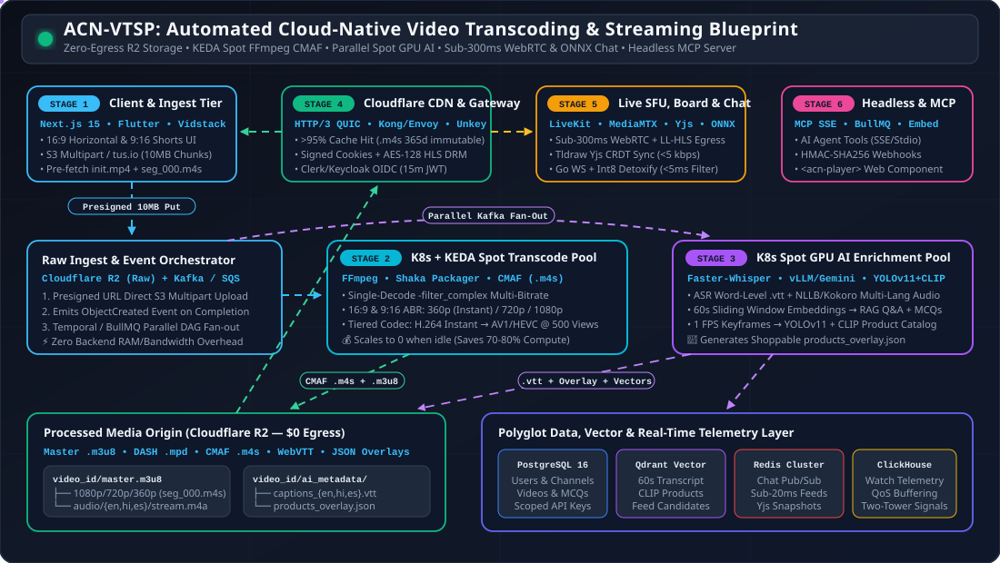
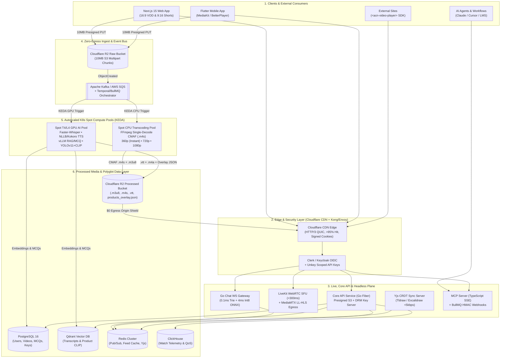
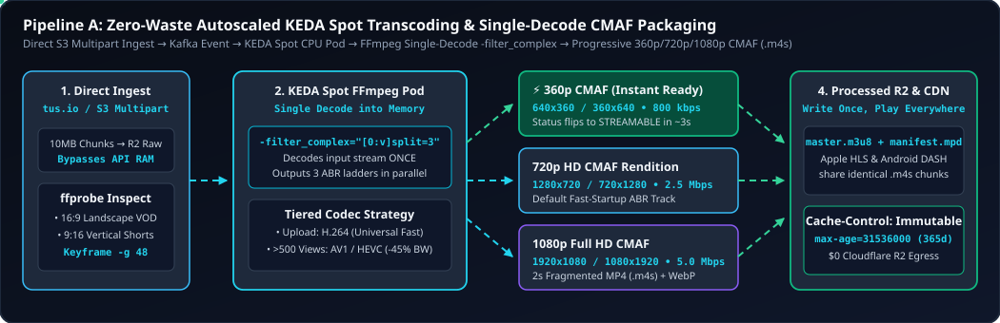
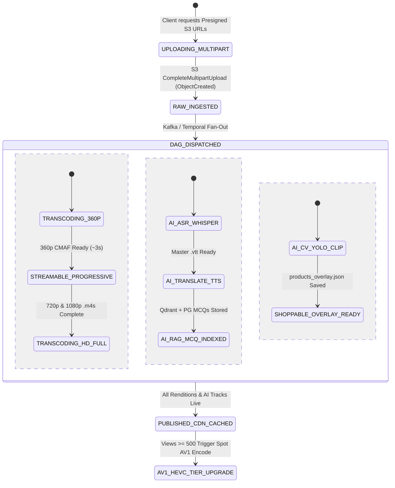
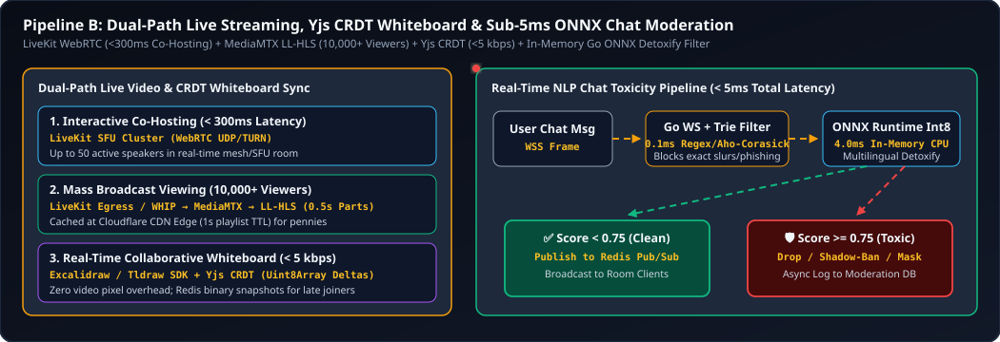
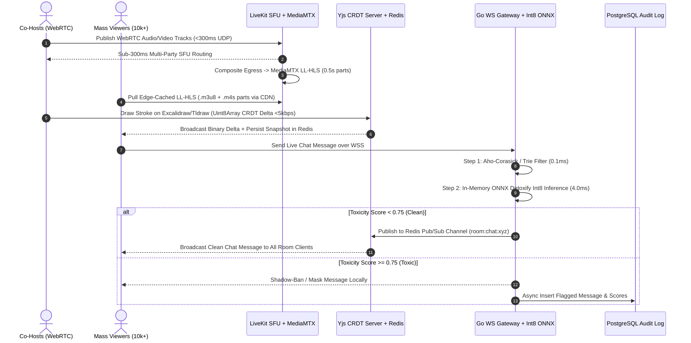
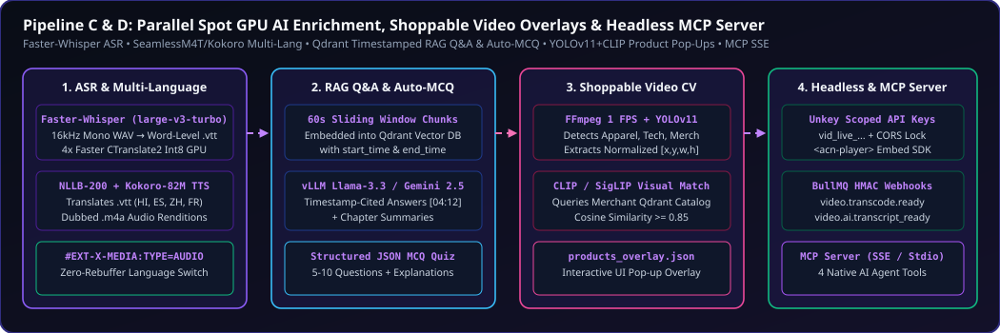
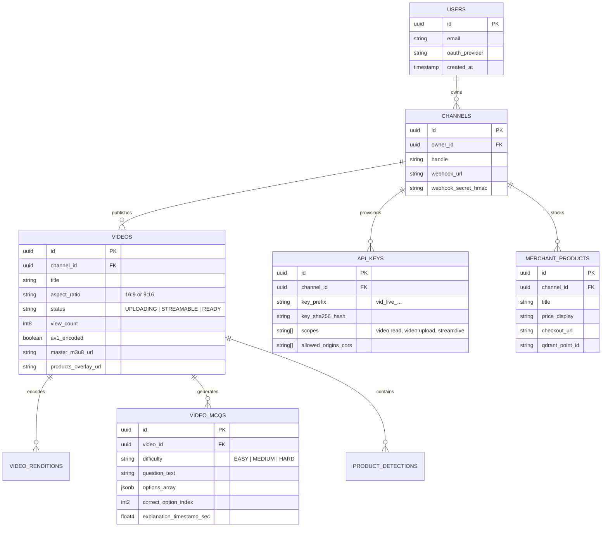

# ACN-VTSP — Automated Cloud-Native Video Transcoding & Streaming Platform

<div align="center">



**Zero-Egress Cloud-Native Streaming • KEDA Spot FFmpeg CMAF • Parallel Spot GPU AI Enrichment • Sub-300ms WebRTC & Yjs Whiteboard • <5ms ONNX Chat Moderation • Headless MCP Server**

[](./flow2.html)
[](./ARCH.txt)
[](./flow.txt)
[](#pipeline-a-automated-cloud-native-transcoding--packaging-zero-waste-compute)
[](#pipeline-d-headless-distribution-api-keys-webhooks--mcp-server)

</div>

---

This production-grade system architecture is designed for an **Automated Cloud-Native Video Transcoding & Streaming Platform (ACN-VTSP)** optimized for low infrastructure cost, sub-second interactivity, adaptive streaming, and AI-native extensibility.

---

## Table of Contents

1. [End-to-End System Architecture Blueprint](#1-end-to-end-system-architecture-blueprint)
   - [Animated System Architecture Overview](#11-animated-system-architecture-overview)
   - [Master ASCII Architecture Blueprint (`ARCH.txt`)](#12-master-ascii-architecture-blueprint-archtxt)
   - [End-to-End Mermaid Topology Diagram](#13-end-to-end-mermaid-topology-diagram)
2. [Master Tech Stack Matrix (Mapped to Your 9 Features)](#2-master-tech-stack-matrix-mapped-to-your-9-features)
3. [Core Subsystem & Pipeline Designs (With Animations & Diagrams)](#3-core-subsystem--pipeline-designs)
   - [Pipeline A: Automated Cloud-Native Transcoding & Packaging (Zero-Waste Compute)](#pipeline-a-automated-cloud-native-transcoding--packaging-zero-waste-compute)
   - [Pipeline B: Live Streaming, Video Calls, Real-Time Whiteboard & NLP Chat](#pipeline-b-live-streaming-video-calls-real-time-whiteboard--nlp-chat)
   - [Pipeline C: Parallel AI Pipeline (Transcripts, RAG Q&A, MCQs, Multi-Language & Shoppable Video)](#pipeline-c-parallel-ai-pipeline-transcripts-rag-qa-mcqs-multi-language--shoppable-video)
   - [Pipeline D: Headless Distribution, API Keys, Webhooks & MCP Server](#pipeline-d-headless-distribution-api-keys-webhooks--mcp-server)
   - [Pipeline E: Custom Two-Tower Recommendation Engine & Sub-20ms Feed](#pipeline-e-custom-two-tower-recommendation-engine--sub-20ms-feed)
4. [Engineering for Zero-Latency Buffering, Cost, Caching & Security](#4-engineering-for-zero-latency-buffering-cost-caching--security)
5. [Interactive Architecture Flow Explorer (`flow2.html`)](#5-interactive-architecture-flow-explorer)
6. [Complete Production Monorepo Folder Structure (Frontend, Backend, AI, Infra)](#6-complete-production-monorepo-folder-structure-frontend-backend-ai-infra)
   - [6.1 Workspace Root & Repository Tree](#61-workspace-root--repository-tree)
   - [6.2 Frontend Applications (`apps/web-nextjs`, `apps/mobile-flutter`, `packages/embed-player`)](#62-frontend-applications-web-mobile--headless-embed-sdk)
   - [6.3 Backend Microservices (`services/`)](#63-backend-microservices-go-nodejs-typescript-mcp)
   - [6.4 Autoscaled Worker Pools (`workers/` — FFmpeg CMAF & Spot GPU AI)](#64-autoscaled-worker-pools-ffmpeg-cmaf--spot-gpu-ai)
   - [6.5 Cloud Storage Layout (`Cloudflare R2` Processed Bucket Structure)](#65-cloud-storage-layout-cloudflare-r2-processed-bucket-structure)
   - [6.6 Database, Vector & Telemetry Schemas (`PostgreSQL`, `Qdrant`, `Redis`, `ClickHouse`)](#66-database-vector--telemetry-schemas)
   - [6.7 Kubernetes, KEDA & Local Development Setup](#67-kubernetes-keda--local-development-setup)

---

## 1. End-to-End System Architecture Blueprint

### 1.1 Animated System Architecture Overview

The animated SVG blueprint below illustrates real-time media chunk ingest, parallel Kafka event fan-out to KEDA Spot CPU transcoders and Spot GPU AI workers, zero-egress R2 storage, and edge delivery:


### 1.2 Master ASCII Architecture Blueprint ([`ARCH.txt`](./ARCH.txt))

```text
[CLIENTS & EXTERNAL CONSUMERS]
 ├── Web App (Next.js) & Mobile App (Flutter) ──► 16:9 Horizontal & 9:16 Vertical Shorts UI
 ├── External Platforms / Social Embeds ────────► REST / GraphQL API + Signed Embed Player
 └── AI Agents / External Workflows ────────────► Model Context Protocol (MCP) Server (SSE/Stdio)
                        │
                        ▼
[EDGE & SECURITY LAYER: Cloudflare CDN + API Gateway (Kong / Envoy)]
 ├── AuthN/AuthZ: Clerk/Keycloak (JWT/OAuth2) + Unkey (Scoped API Keys & Rate Limiting)
 └── Edge Caching:HLS/DASH Segment Caching (.m4s / .m3u8) + Signed URLs/Cookies
                        │
        ┌───────────────┼───────────────────────────────┬──────────────────────────────┐
        ▼               ▼                               ▼                              ▼
[1. VOD UPLOAD]  [2. LIVE & COLLABORATION]      [3. CORE BACKEND & APIs]      [4. AI & FEED SERVICES]
Multipart S3     ├── LiveKit SFU (WebRTC)       ├── API Service (Go / Node)   ├── Feed Engine (Two-Tower + Redis)
Direct Ingest    │   Sub-300ms Video Calls      ├── Webhook Engine (BullMQ)   ├── RAG Q&A & MCQ Generator
        │        ├── MediaMTX (WHIP/RTMP►LL-HLS)└── MCP Server (TypeScript)   └── Multi-Lingual Translation
        ▼        ├── Yjs CRDT Sync Server
[RAW BUCKET]     │   (Real-Time Whiteboard)
Cloudflare R2    └── Go Chat Gateway + ONNX
        │            (Real-Time NLP Toxicity Filter)
        ▼
[EVENT BUS: Apache Kafka / AWS SQS + EventBridge]
        │
        ├───────────────────────────────────────────────┐
        ▼                                               ▼
[TRANSCODING WORKER POOL (K8s + KEDA Spot Nodes)]    [AI ENRICHMENT GPU POOL (K8s Spot T4/L4 GPUs)]
 ├── FFmpeg CMAF Packager (H.264 / HEVC / AV1)        ├── Audio Extract ──► Faster-Whisper (ASR + Timestamps)
 ├── ABR Ladder: 360p, 720p, 1080p (16:9 & 9:16)      ├── LLM Worker ─────► Summary, Chapters, MCQ Quizzes
 └── Thumbnail & Sprite Sheet Generator (WebP)        ├── TTS/Translate ──► Multi-Language VTT & Audio Tracks
        │                                             └── Frame Sampler ──► YOLOv11 + CLIP (Product Detection)
        ▼                                                                           │
[PROCESSED MEDIA BUCKET (Cloudflare R2)] ◄──────────────────────────────────────────┘
 (Master .m3u8, CMAF .m4s chunks, Multi-lang .vtt, Shoppable Product JSON MetadataTracks)
        │
        ▼
[DATA & STATE STORAGE LAYER]
 ├── PostgreSQL (Users, Channels, Videos, Subscriptions, API Keys, Product Catalog, MCQ Bank)
 ├── Qdrant / pgvector (Timestamped Transcript Embeddings for Video Q&A and Semantic Search)
 ├── Redis Cluster (Live Chat Pub/Sub, User Watch Progress, Feed Cache, Rate Limiter)
 └── ClickHouse (Real-Time Watch Telemetry, QoS Buffering Metrics, View Counts, Feed Signals)
```

### 1.3 End-to-End Mermaid Topology Diagram



---

## 2. Master Tech Stack Matrix (Mapped to Your 9 Features)

| Feature / Requirement | Exact Tech Stack | Architectural & Cost/Latency Rationale |
| --- | --- | --- |
| **Core: Cloud-Native Transcoding & Streaming** | **FFmpeg** + **Shaka Packager** on **Kubernetes (KEDA)** Spot CPU Nodes, **CMAF** (HLS + DASH), **Cloudflare R2** | KEDA scales Spot workers to zero when idle (cuts compute cost by **70–80%**). CMAF encodes `.m4s` chunks once for both Apple (HLS) and Android/Web (DASH). Cloudflare R2 charges **zero egress fees** to CDN. |
| **1 & 9. UI, Creator Studio, 16:9 & 9:16 Views, Speed/Quality Control** | **Next.js (Web)** + **Flutter (Mobile)**, **Vidstack** or **Video.js** (Web), **BetterPlayer / MediaKit** (Flutter), **tus.io** / S3 Multipart | Resumable chunked uploads via `tus.io`/S3 Multipart prevent failed large uploads. Custom player reads CMAF `.m3u8` master manifests for instant **360p/720p/1080p** switching and **0.25x–2x** playback speed. |
| **2. Headless Sharing, API Keys, Webhooks, MCP Server & Video Calls** | **Go (Fiber)** or **Node.js (Fastify)** API, **Model Context Protocol (MCP) SDK**, **Unkey** (API keys), **Svix / BullMQ** (Webhooks), **LiveKit** (WebRTC SFU) | MCP server exposes tools (`upload_video`, `query_video_transcript`, `get_embed_stream`) to AI agents and external apps. LiveKit SFU handles multi-party WebRTC video calls at **under 300ms latency**. |
| **3. Transcripts, Summaries, RAG Q&A & MCQ Tests** | **Faster-Whisper (CTranslate2)**, **vLLM / Llama-3.3-70B** or **Gemini 2.5 Flash**, **Qdrant** (or `pgvector`), **WebVTT** | Faster-Whisper runs 4x faster than standard Whisper on Spot GPUs, producing word-level `.vtt` timestamps. Chunks are embedded in Qdrant for timestamp-cited Q&A and structured JSON MCQ generation. |
| **4. NLP Live Chat Profanity & Toxicity Filtering** | **Go WebSocket Gateway** + **Redis Pub/Sub** + **ONNX Runtime** (`Detoxify` / multilingual MiniLM quantized int8) | Runs in-memory ONNX inference directly inside the chat microservice in **under 5ms per message** without expensive external LLM API calls, blocking/masking toxic chat before Redis broadcast. |
| **5. Real-Time Board Sharing (Live Sessions)** | **Excalidraw / Tldraw SDK** + **Yjs (CRDT)** over **WebSockets / LiveKit Data Channels** | Instead of streaming heavy screen-share video pixels, Yjs syncs vector stroke coordinates via Conflict-Free Replicated Data Types (CRDTs) using **less than 5 kbps** with zero lag. |
| **6. Multi-Language Support** | **HLS Alternate Audio Renditions** (`#EXT-X-MEDIA:TYPE=AUDIO`), **WebVTT** subtitle tracks, **SeamlessM4T / NLLB-200** | Decouples audio and subtitle tracks from video chunks in the HLS manifest. Switching languages only swaps the lightweight audio/text stream without re-buffering video. |
| **7. Product Detection & Shopping Pop-Ups** | **FFmpeg Scene/Keyframe Extractor** (1 FPS) + **YOLOv11 + CLIP** + **Timed Metadata Track (WebVTT / JSON)** | Detects products offline during upload processing, matches embeddings against the merchant catalog in Qdrant, and saves bounding-box + timestamp coordinates into a JSON sidecar file rendered by the UI overlay. |
| **8. Custom Recommendation Feed** | **ClickHouse** (Event Collector) + **Milvus/Qdrant** (Candidate Generation) + **Redis** (Pre-computed User Timelines) | Tracks watch-time, completion rate, and skips in ClickHouse; queries vector similarity of watched videos + trending scores; caches ranked feed IDs in Redis for **sub-20ms** home feed loads. |

---

## 3. Core Subsystem & Pipeline Designs

### Pipeline A: Automated Cloud-Native Transcoding & Packaging (Zero-Waste Compute)



1. **Direct-to-Storage Ingest:** Client requests a presigned URL from the API Gateway and uploads the raw video in 10MB chunks directly to the **Raw R2/S3 Bucket** (bypasses backend servers to save bandwidth and RAM).
2. **Event Trigger & Orchestration:** Upload completion emits an `ObjectCreated` event to **Kafka / AWS SQS**. A **Temporal.io** or **BullMQ** workflow orchestrator splits the job into parallel DAG tasks: *Transcoding*, *Audio/ASR*, and *Visual CV Detection*.
3. **Autoscaled Spot Transcoding (KEDA + Kubernetes):**
   - KEDA monitors queue depth and spins up Spot CPU pods running a custom Go/Python wrapper around **FFmpeg**.
   - **Aspect Ratio Detection:** `ffprobe` inspects input dimensions. Horizontal videos (`16:9`) scale to `1920x1080`, `1280x720`, `640x360`. Vertical Shorts (`9:16`) scale to `1080x1920`, `720x1280`, `360x640`.
   - **Single-Command Multi-Bitrate CMAF Output:** FFmpeg decodes the source video **once** into memory, splits it via `-filter_complex`, and encodes all 3 resolutions simultaneously into **2-second fragmented MP4 (`.m4s`) CMAF segments** with keyframe alignment (`-g 48 -sc_threshold 0`).
   - **Progressive Playback Ready:** As soon as the `360p` rendition finishes (usually within seconds), the video status flips to `STREAMABLE` while `720p` and `1080p` finish in the background.

#### Single-Decode FFmpeg CMAF Command Reference

```bash
ffmpeg -hide_banner -y -i input_raw.mp4 \
  -filter_complex \
  "[0:v]split=3[v1][v2][v3]; \
   [v1]scale=w=640:h=360:force_original_aspect_ratio=decrease,pad=640:360:(ow-iw)/2:(oh-ih)/2[v360]; \
   [v2]scale=w=1280:h=720:force_original_aspect_ratio=decrease,pad=1280:720:(ow-iw)/2:(oh-ih)/2[v720]; \
   [v3]scale=w=1920:h=1080:force_original_aspect_ratio=decrease,pad=1920:1080:(ow-iw)/2:(oh-ih)/2[v1080]" \
  -map "[v360]" -c:v:0 libx264 -b:v:0 800k -maxrate:v:0 856k -bufsize:v:0 1200k -g 48 -sc_threshold 0 \
  -map "[v720]" -c:v:1 libx264 -b:v:1 2500k -maxrate:v:1 2675k -bufsize:v:1 3750k -g 48 -sc_threshold 0 \
  -map "[v1080]" -c:v:2 libx264 -b:v:2 5000k -maxrate:v:2 5350k -bufsize:v:2 7500k -g 48 -sc_threshold 0 \
  -map a:0 -c:a aac -b:a 128k -ac 2 \
  -f hls -hls_time 2 -hls_playlist_type vod \
  -hls_segment_type fmp4 \
  -hls_fmp4_init_filename "init_%v.mp4" \
  -hls_segment_filename "stream_%v/seg_%03d.m4s" \
  -master_pl_name "master.m3u8" \
  -var_stream_map "v:0,agroup:aud v:1,agroup:aud v:2,agroup:aud a:0,agroup:aud,default:yes,language:en" \
  "stream_%v/playlist.m3u8"
```

#### Video Lifecycle State Machine (Mermaid)



---

### Pipeline B: Live Streaming, Video Calls, Real-Time Whiteboard & NLP Chat



- **Dual-Path Live Architecture:**
  - **Interactive Video Calls & Co-Hosting (Under 300ms Latency):** Powered by a self-hosted **LiveKit SFU** cluster. Up to 50 active speakers/participants connect via **WebRTC**.
  - **Mass Broadcast Viewing (10,000+ Viewers):** LiveKit Egress (or OBS via WHIP/RTMP) pipes the composite stream into **MediaMTX / GPAC**, outputting **Low-Latency HLS (LL-HLS)** with partial segments (`0.5s` parts) cached via Cloudflare CDN so mass viewers cost pennies in bandwidth.
- **Real-Time Whiteboard Sync:**
  - Built on **Tldraw / Excalidraw** synced via a **Yjs WebSocket Server** (or LiveKit reliable Data Channels).
  - Late joiners receive a compressed binary state snapshot from Redis; live strokes stream as tiny delta updates (`Uint8Array`) using **less than 5 kbps**.
- **Real-Time NLP Chat Moderation Pipeline ([`flow.txt`](./flow.txt)):**

```text
User Sends Chat ──► Go WebSocket Node ──► Fast Regex/Trie Filter (0.1ms: blocks exact slurs/links)
                                              │ (Pass)
                                              ▼
                                   Local ONNX Runtime Sidecar (4ms: Multilingual Detoxify Int8)
                                              │
                      ┌───────────────────────┴───────────────────────┐
                Score < 0.75 (Clean)                            Score >= 0.75 (Toxic)
                      ▼                                               ▼
           Publish to Redis Pub/Sub                        Drop / Shadow-ban / Mask
           Broadcast to Room Clients                       Log to Moderation DB
```

#### Sequence Diagram: Live Co-Hosting, Yjs Whiteboard & Sub-5ms Chat Moderation



---

### Pipeline C: Parallel AI Pipeline (Transcripts, RAG Q&A, MCQs, Multi-Language & Shoppable Video)



Executed asynchronously on **Spot GPU workers** triggered by the same upload event:

1. **Transcripts & Multi-Language Tracks:**
   - FFmpeg strips the audio track as a lightweight 16kHz mono `.wav`.
   - **Faster-Whisper (`large-v3-turbo`)** generates the master `.vtt` caption file with word-level timestamps.
   - Translation worker translates `.vtt` into target languages (Hindi, Spanish, Mandarin, etc.) and optionally runs **Kokoro-82M / XTTS** to generate dubbed `.m4a` audio tracks registered inside the master `.m3u8` manifest (`#EXT-X-MEDIA:TYPE=AUDIO`).
2. **Summaries, RAG Q&A & Auto-MCQ Generator:**
   - Transcript is chunked into 60-second sliding windows with `start_time` and `end_time` metadata and embedded into **Qdrant**.
   - **RAG Q&A Flow:** When a student/viewer asks a question in the player sidebar, the backend queries Qdrant filtered by `video_id`, retrieves the exact timestamped chunks, and streams an LLM answer with clickable `[04:12]` timestamp citations.
   - **MCQ Engine:** An LLM structured-output prompt processes the full transcript once on upload to generate 5–10 multiple-choice questions (with difficulty tags, 4 options, correct answer index, and explanation timestamp) stored in PostgreSQL.
3. **AI Product Detection & Shoppable Pop-Ups:**
   - FFmpeg extracts 1 frame per second (`fps=1`).
   - **YOLOv11** detects fashion/electronics/merchandise bounding boxes; **CLIP / SigLIP** extracts visual embeddings of each cropped box and queries the creator's linked Product Catalog in **Qdrant**.
   - High-confidence matches (`cosine similarity >= 0.85`) are compiled into a static `products_overlay.json` stored alongside the video:

```json
[
  {
    "timestamp_start": 42.0,
    "timestamp_end": 47.5,
    "product_id": "prod_991",
    "title": "Wireless Noise-Canceling Headphones",
    "price": "$129",
    "bbox": [0.62, 0.31, 0.15, 0.22],
    "checkout_url": "https://store.example.com/item/991"
  }
]
```

   - The frontend video player listens to `timeupdate` events and renders interactive, clickable product pop-ups over the video without modifying the video pixels.

---

### Pipeline D: Headless Distribution, API Keys, Webhooks & MCP Server

To let content owners distribute videos across their own websites, apps, and AI workflows:

- **Scoped API Keys & Embed SDK:**
  - Creators generate scoped keys (`vid_live_...`) via **Unkey** or custom SHA-256 hashed keys in PostgreSQL with permissions (`video:read`, `video:upload`, `stream:live`) and **Allowed Origin CORS/Domain Whitelisting**.
  - External platforms embed via a lightweight `<acn-video-player video-id="xyz" token="..."></acn-video-player>` Web Component or headless HLS stream URL.
- **Event-Driven Webhooks:**
  - Powered by **BullMQ + Redis** with exponential backoff and HMAC-SHA256 payload signatures (`X-Platform-Signature`).
  - Fires real-time events to creator servers: `video.upload.completed`, `video.transcode.ready`, `video.ai.transcript_ready`, `live.stream.started`, `product.Popup.clicked`.
- **Model Context Protocol (MCP) Server:**
  - Built with the official **TypeScript/Python MCP SDK** over **Streamable HTTP / SSE**, authenticating via the creator's API key.
  - **Exposed MCP Tools:**
    - `upload_video_from_url`: Ingests a video directly from a remote URL or social link.
    - `search_channel_videos`: Semantic search across all creator videos and transcripts.
    - `get_video_summary_and_mcqs`: Pulls transcript, summary, and quiz JSON for LMS/blog generation.
    - `generate_signed_playback_url`: Returns a time-limited HLS stream or iframe embed code for external publishing.

---

### Pipeline E: Custom Two-Tower Recommendation Engine & Sub-20ms Feed

```mermaid
flowchart LR
    Player["Web / Mobile Player<br/>Watch Time, Completion %, Skips"] -->|"Batched Heartbeats"| CH[("ClickHouse<br/>Real-Time Event Telemetry")]
    CH -->|"User & Video Signals"| TwoTower["Two-Tower Embedding Model<br/>(User Tower + Video Tower)"]
    TwoTower -->|"ANN Vector Search"| Qdrant[("Qdrant Vector DB<br/>Candidate Generation")]
    Qdrant -->|"Top 200 Candidates"| Ranker["LightGBM / Feature Ranker<br/>(Freshness + Completion + Affinity)"]
    Ranker -->|"Pre-computed Feed IDs"| Redis[("Redis Timeline Cache<br/>ZSET user:feed:{id}")]
    Redis -->|"Sub-20ms Home & Shorts Feed"| Client["Next.js / Flutter Feed UI"]
```



---

## 4. Engineering for Zero-Latency Buffering, Cost, Caching & Security

| Pillar | Production Implementation Strategy |
| --- | --- |
| **Zero-Latency & Smooth Buffering** | 1. **Pre-Fetch First Segment:** When rendering the custom feed (especially 9:16 vertical scroll), the client pre-fetches the `.m3u8` manifest and the first `init.mp4` + `segment_000.m4s` (`~400KB`) of the *next* 2 videos in the viewport.<br><br>2. **BBR Congestion Control:** Enable TCP BBR and HTTP/3 (QUIC) on the CDN edge to prevent packet-loss stalls on mobile networks.<br><br>3. **Fast Startup ABR:** Configure player ABR to start on `720p` (or `360p` on slow 4G) for instant first-frame rendering in **under 300ms**, upgrading to `1080p` on segment 2. |
| **Caching Strategy (>95% Hit Ratio)** | 1. **CDN Edge:** Cache immutable `.m4s` video chunks for `365 days` (`Cache-Control: public, max-age=31536000, immutable`). Cache live `.m3u8` playlists for `1 second`.<br><br>2. **Origin Shield:** Enable Cloudflare Tiered Cache / Origin Shield so uncached segment requests collapse into a single origin fetch.<br><br>3. **Query String Stripping:** Use **Signed HTTP Cookies** or path-based tokens instead of unique query strings per viewer on `.m4s` segments so all users share the exact same CDN cache key. |
| **Cost Optimization** | 1. **Zero-Egress Object Storage:** Store all raw and transcoded chunks in **Cloudflare R2** or **Backblaze B2** paired with Cloudflare CDN (**\$0 bandwidth egress** vs AWS S3's \$0.09/GB).<br><br>2. **Tiered Encoding:** Encode every upload to H.264 immediately for universal playback; only trigger heavy **AV1 / HEVC** encoding (which cuts bandwidth by 45%) once a video crosses **500 views**.<br><br>3. **K8s Spot Instances:** Run all FFmpeg and AI GPU workers on preemptible Spot nodes; checkpoint job progress per rendition. |
| **Security, AuthN & AuthZ** | 1. **Identity:** OAuth2/OIDC with short-lived **15-minute Access JWTs** and rotating **HttpOnly Refresh Tokens**.<br><br>2. **Stream Protection:** CDN validates an **HMAC-SHA256 Signed Token** (bound to viewer IP subnet + expiration timestamp) before serving `.m3u8` manifests.<br><br>3. **Content Encryption:** Enable **HLS AES-128 Envelope Encryption** (or Widevine/FairPlay CENC DRM for premium content) where the decryption key endpoint (`/api/v1/keys/:videoId`) verifies user authorization before returning the 16-byte key. |

---

## 5. Interactive Architecture Flow Explorer

Step through the six core operational stages in our standalone interactive visualizer **[`flow2.html`](./flow2.html)** (open directly in any browser to click through nodes, inspect live animated SVG edges, and toggle dark/light themes):

> [!TIP]
> **Launch Interactive Visualizer:** Open [`flow2.html`](./flow2.html) in Chrome/Edge/Firefox to interactively step through Stages 1–6 with real-time animated SVG path pulsing and node inspection.

### Interactive Stage Specification Matrix (Synchronized with [`flow2.html`](./flow2.html))

| Stage | Operational Stage Name | Protocol | Target Latency | Payload Format | Active Architecture Nodes & Data Flow Description |
| :---: | --- | --- | --- | --- | --- |
| **1** | **Direct Multipart Ingest** | `S3 Multipart` | `< 45ms TTFB` | `10MB Chunks` | **Nodes [1 → 4, 2]:** Client (Next.js / Flutter) uploads 10MB chunks via Presigned S3 URLs directly to Raw Cloudflare R2 Bucket, bypassing backend CPU. Emits `ObjectCreated` event to Kafka/SQS. |
| **2** | **Autoscaled CMAF Transcoding** | `KEDA / HLS` | `1.2s / Segment` | `CMAF (.m4s)` | **Nodes [2 → 3 → 4]:** KEDA scales Kubernetes Spot CPU workers. FFmpeg decodes once and outputs `360p`, `720p`, and `1080p` CMAF (`.m4s`) segments + `.m3u8` master playlist to Processed R2 Bucket. |
| **3** | **Parallel GPU AI Enrichment** | `gRPC / TensorRT` | `< 350ms Inference` | `Vector & JSON` | **Nodes [4 ↔ 3]:** Spot GPU workers run Faster-Whisper for word-level WebVTT transcripts, NLLB/TTS for multi-language, LLM + Qdrant embeddings for RAG Q&A, and YOLOv11 + CLIP at 1 FPS for product overlays. |
| **4** | **Zero-Latency CDN & ABR Playback** | `HTTPS / LL-HLS` | `< 12ms Edge` | `1080p60 Stream` | **Nodes [4 → 5 → 1]:** Cloudflare CDN caches immutable `.m4s` chunks with Signed Cookies (>95% cache hit). Video player pre-fetches initial segments, adapts bitrate dynamically, and overlays timed product pop-ups. |
| **5** | **Live WebRTC, Whiteboard & NLP Chat** | `WebRTC / WSS / Yjs` | `< 280ms P2P` | `CRDT / ONNX JSON` | **Nodes [1 ↔ 5]:** LiveKit SFU handles sub-300ms WebRTC calls and pipes LL-HLS for mass viewers. Yjs CRDT syncs Tldraw whiteboard strokes (`<5kbps`). Go WebSocket gateway runs Int8 ONNX Detoxify before Redis broadcast. |
| **6** | **Headless API, Webhooks & MCP Server** | `MCP SSE / REST` | `< 85ms SSE` | `HMAC JSON / SSE` | **Nodes [6 → 5, 4]:** External apps and AI agents authenticate via Unkey scoped API keys to query the MCP Server (SSE), embed streams with domain-locked tokens, and receive HMAC-signed BullMQ webhooks on pipeline events. |

---

## 6. Complete Production Monorepo Folder Structure (Frontend, Backend, AI, Infra)

Below is the complete, production-ready repository and folder structure for `ACN_VTSP`, organizing **Web & Mobile Frontends**, **Headless Web Component SDK**, **Go & Node/TypeScript Microservices**, **Spot CPU FFmpeg & Spot GPU AI Worker Pools**, **Database Migrations**, and **Kubernetes/KEDA Infrastructure**.

### 6.1 Workspace Root & Repository Tree

```text
ACN_VTSP/
├── README.md                                   # Complete Architecture, Diagrams, Animations & Engineering Guide
├── ARCH.txt                                    # Master End-to-End ASCII System Architecture Blueprint
├── flow.txt                                    # Sub-5ms Go + ONNX Live Chat Moderation Pipeline Blueprint
├── flow2.html                                  # Interactive 6-Stage SVG Architecture Flow Visualizer (Luminous UI)
├── assets/                                     # Animated SVG Diagrams for Markdown & Documentation
│   ├── architecture-animated.svg               # End-to-End Animated System Architecture SVG
│   ├── transcoding-cmaf-pipeline.svg           # Pipeline A: Single-Decode FFmpeg CMAF Ladder Animated SVG
│   ├── live-webrtc-onnx-chat.svg               # Pipeline B: LiveKit WebRTC, Yjs CRDT & ONNX Chat Animated SVG
│   └── ai-enrichment-rag-shoppable.svg         # Pipeline C & D: Spot GPU AI, Shoppable CV & MCP Animated SVG
│
├── turbo.json                                  # Turborepo / Monorepo Build & Task Orchestration
├── pnpm-workspace.yaml                         # Workspace Package Definitions (apps/*, packages/*, services/*)
├── docker-compose.yml                          # Local Dev Stack (Postgres, Qdrant, Redis, ClickHouse, Kafka, MinIO/R2, LiveKit)
├── Makefile                                    # Unified Build, Test, Protobuf Gen & K8s Deploy Targets
│
├── apps/                                       # ================= FRONTEND APPLICATIONS =================
│   ├── web-nextjs/                             # 1. Next.js 15 Web Platform & Creator Studio (App Router)
│   └── mobile-flutter/                         # 2. Flutter Cross-Platform Mobile App (iOS & Android)
│
├── packages/                                   # ================= SHARED SDKs & LIBRARIES ================
│   ├── embed-player/                           # <acn-video-player> Web Component for External Websites
│   ├── proto-contracts/                        # gRPC Protobuf & Kafka Event Schemas (Go, TS, Python, Dart)
│   └── ui-design-system/                       # Shared Tailwind Tokens, Player Controls & Canvas Overlays
│
├── services/                                   # ================= CORE BACKEND MICROSERVICES =============
│   ├── api-gateway-go/                         # Core REST/GraphQL API, S3 Multipart Signer, AES-128 Key Server (Go Fiber)
│   ├── chat-moderation-ws/                     # Real-Time Chat WS Gateway + 0.1ms Trie + 4ms Int8 ONNX Sidecar (Go)
│   ├── whiteboard-yjs-sync/                    # Real-Time Collaborative Board CRDT Server + Redis Snapshots (Node/TS)
│   ├── live-orchestrator/                      # LiveKit Room Controller, WHIP/RTMP Ingest & MediaMTX LL-HLS Egress
│   ├── webhook-dispatcher/                     # Event-Driven BullMQ + Redis HMAC-SHA256 Webhook Engine (Node/Fastify)
│   ├── mcp-server/                             # Model Context Protocol (MCP) Server over Streamable HTTP/SSE & Stdio (TS)
│   └── feed-recommender/                       # Two-Tower Candidate Generator + ClickHouse Collector + Redis Timeline API
│
├── workers/                                    # ================= AUTOSCALED K8s SPOT WORKERS ============
│   ├── transcoder-cmaf/                        # KEDA Spot CPU Worker: ffprobe + FFmpeg Single-Decode CMAF + Shaka + WebP
│   ├── ai-asr-translation/                     # KEDA Spot GPU Worker: Faster-Whisper (.vtt) + NLLB-200 + Kokoro-82M (.m4a)
│   ├── ai-rag-mcq/                             # KEDA Spot GPU Worker: 60s Sliding Window Qdrant Indexer + vLLM RAG & MCQs
│   └── ai-shoppable-cv/                        # KEDA Spot GPU Worker: 1 FPS Sampler + YOLOv11 + CLIP -> products_overlay.json
│
├── db/                                         # ================= DATA & STORAGE SCHEMAS =================
│   ├── postgres/                               # PostgreSQL 16 Migrations (Users, Channels, Videos, MCQs, API Keys, Moderation)
│   ├── qdrant/                                 # Qdrant Vector Collection Configs (transcript_chunks, merchant_products, videos)
│   ├── clickhouse/                             # ClickHouse Telemetry Tables & Materialized Views (watch_events, qos_metrics)
│   └── redis/                                  # Redis Lua Scripts (Sliding-Window Rate Limiter, Feed ZSET Cache, Yjs State)
│
└── infra/                                      # ================= CLOUD-NATIVE INFRASTRUCTURE ============
    ├── k8s/                                    # Kubernetes Base Manifests, Namespaces, Ingress (Kong/Envoy)
    ├── keda/                                   # KEDA ScaledObjects for Kafka Queue Depth -> Spot CPU & GPU Node Pools
    ├── helm/                                   # Helm Charts for LiveKit SFU, MediaMTX, Qdrant, ClickHouse & Core Services
    └── terraform/                              # Cloudflare R2 + CDN Cache Rules, EKS/GKE Spot Node Groups, Kafka Cluster
```

---

### 6.2 Frontend Applications (Web, Mobile & Headless Embed SDK)

```text
apps/
├── web-nextjs/                                 # Next.js 15 (React 19, TypeScript, Tailwind CSS, Vidstack Player)
│   ├── src/
│   │   ├── app/
│   │   │   ├── (public)/
│   │   │   │   ├── page.tsx                    # Sub-20ms Personalized Home Feed (16:9 Grid + Shorts Shelf)
│   │   │   │   ├── watch/[videoId]/page.tsx    # 16:9 Watch Page: CMAF Player, RAG Q&A Drawer, Interactive MCQ Tab
│   │   │   │   ├── shorts/page.tsx             # 9:16 Vertical Scroll Feed with Next-2-Video Segment Pre-Fetching
│   │   │   │   └── live/[roomId]/page.tsx      # Dual-Mode Live View: WebRTC Stage (<300ms) or LL-HLS + Whiteboard + Chat
│   │   │   ├── (studio)/
│   │   │   │   ├── studio/upload/page.tsx      # Resumable tus.io / S3 10MB Chunked Multipart Uploader + Live DAG Progress
│   │   │   │   ├── studio/catalog/page.tsx     # Merchant Product Catalog Manager (Syncs Product Images to CLIP/Qdrant)
│   │   │   │   └── studio/developers/page.tsx  # Unkey Scoped API Key Generator, CORS Whitelist, Webhook & MCP Inspector
│   │   ├── components/
│   │   │   ├── player/
│   │   │   │   ├── CmafVideoPlayer.tsx         # Vidstack / HLS.js Wrapper: 360p/720p/1080p ABR, 0.25x-2x Speed, Multi-Audio
│   │   │   │   ├── ShoppableProductOverlay.tsx # Renders Bounding-Box Pop-Ups from products_overlay.json on timeupdate
│   │   │   │   ├── MultiLangTrackSwitcher.tsx  # Zero-Rebuffer #EXT-X-MEDIA Audio & WebVTT Subtitle Selector
│   │   │   │   └── SpriteSheetScrubber.tsx     # Instant WebP Thumbnail Preview on Timeline Hover
│   │   │   ├── ai-learning/
│   │   │   │   ├── TimestampRagChat.tsx        # Sidebar RAG Q&A with Clickable [04:12] Video Seek Citations
│   │   │   │   └── InteractiveMcqQuiz.tsx      # Auto-Graded MCQ Assessment Modal with Explanation Timestamp Jump
│   │   │   └── live-collab/
│   │   │       ├── LiveKitStage.tsx            # Multi-Party WebRTC Co-Hosting Grid (Up to 50 Speakers)
│   │   │       ├── YjsWhiteboardCanvas.tsx     # Tldraw / Excalidraw Canvas Synced via Yjs CRDT (<5 kbps)
│   │   │       └── ModeratedLiveChat.tsx       # High-Frequency WebSocket Chat Client with Toxicity Status Feedback
│   │   └── lib/
│   │       ├── prefetch-engine.ts              # Pre-fetches master.m3u8 + init.mp4 + seg_000.m4s (~400KB) for next 2 Shorts
│   │       └── multipart-uploader.ts           # Parallel S3 Presigned Part Uploader with Checksum & Retry
│   └── package.json
│
├── mobile-flutter/                             # Flutter 3.x Cross-Platform App (iOS & Android)
│   ├── lib/
│   │   ├── main.dart                           # App Entry, Riverpod State & Deep-Link Router
│   │   ├── features/
│   │   │   ├── feed/                           # Home Feed & Vertical 9:16 Shorts PageView with Segment Pre-Cache
│   │   │   ├── player/                         # MediaKit / BetterPlayer CMAF Controller, Speed (0.25x-2x), Audio Switcher
│   │   │   ├── shoppable_overlay/              # Flutter Stack Overlay rendering clickable product cards over video
│   │   │   ├── rag_quiz_sheet/                 # BottomSheet for Timestamped AI Q&A and Interactive MCQ Tests
│   │   │   ├── live_session/                   # livekit_client WebRTC + Yjs CRDT CustomPainter Whiteboard + WS Chat
│   │   │   └── creator_upload/                 # Background Chunked Multipart Uploader Service
│   └── pubspec.yaml
│
└── packages/embed-player/                      # Standalone Headless Web Component (<acn-video-player>)
    ├── src/
    │   ├── acn-video-player.ts                 # Custom Element bundling lightweight HLS CMAF engine + Product Overlays
    │   └── token-handshake.ts                  # Validates Scoped Embed Token & Domain Origin Lock
    └── package.json
```

---

### 6.3 Backend Microservices (Go, Node.js, TypeScript MCP)

```text
services/
├── api-gateway-go/                             # High-Throughput Core API Service (Go 1.23 + Fiber)
│   ├── cmd/server/main.go                      # Entrypoint, Graceful Shutdown, OpenTelemetry Tracing
│   ├── internal/
│   │   ├── auth/                               # Clerk/Keycloak JWT Validator + Unkey Scoped API Key Middleware
│   │   ├── ingest/                             # S3/R2 Multipart Upload Initiation, Presigned Part URLs, Kafka Producer
│   │   ├── drm/                                # HLS AES-128 16-Byte Key Endpoint (/api/v1/keys/:videoId) & Signed Cookies
│   │   ├── rag/                                # Qdrant Hybrid Search + Streaming SSE LLM Citations ([mm:ss])
│   │   └── catalog/                            # CRUD for Videos, Channels, MCQs, and Merchant Products
│   └── go.mod
│
├── chat-moderation-ws/                         # Sub-5ms NLP Live Chat Moderation Gateway (Go + ONNX Runtime CGO)
│   ├── cmd/chatgw/main.go                      # Epoll/Gorilla WebSocket Server + Redis Pub/Sub Bridge
│   ├── internal/
│   │   ├── filter_trie/                        # Stage 1 (0.1ms): Aho-Corasick Trie & Regex Filter for Slurs/Phishing Links
│   │   ├── onnx_detoxify/                      # Stage 2 (4.0ms): In-Memory Quantized Int8 Multilingual MiniLM/Detoxify
│   │   ├── pubsub/                             # Redis Cluster Pub/Sub Fan-out for Clean Messages (Score < 0.75)
│   │   └── audit/                              # Async Batch Writer to PostgreSQL Moderation Log for Toxic Messages (>= 0.75)
│   ├── models/detoxify_multilingual_int8.onnx  # Quantized ONNX Model Weights Loaded into Shared Memory
│   └── Dockerfile
│
├── whiteboard-yjs-sync/                        # Real-Time Collaborative Whiteboard Server (TypeScript / Node.js)
│   ├── src/
│   │   ├── server.ts                           # WebSocket Upgrade & Room Authorization
│   │   ├── crdt-room-manager.ts                # Yjs Document Sync (Uint8Array Delta Broadcasts < 5 kbps)
│   │   └── redis-persistence.ts                # Compresses & Saves Y.encodeStateAsUpdate Binary Snapshots for Late Joiners
│   └── package.json
│
├── webhook-dispatcher/                         # Reliable Event Webhook Engine (Node.js + BullMQ + Redis)
│   ├── src/
│   │   ├── worker.ts                           # Consumes Pipeline Events & Dispatches HTTP POSTs with Exponential Backoff
│   │   ├── signer.ts                           # Generates X-Platform-Signature (HMAC-SHA256 Timestamped Payload Hash)
│   │   └── events.ts                           # Schemas: video.upload.completed, video.transcode.ready, product.Popup.clicked
│   └── package.json
│
├── mcp-server/                                 # Model Context Protocol Server for AI Agents (TypeScript MCP SDK)
│   ├── src/
│   │   ├── index.ts                            # Streamable HTTP / SSE & Stdio Transport Entrypoint + Unkey Auth
│   │   └── tools/
│   │       ├── upload-video-from-url.ts        # Tool: Ingests remote video URL directly into Raw R2 pipeline
│   │       ├── search-channel-videos.ts        # Tool: Semantic Qdrant search across creator transcripts & metadata
│   │       ├── get-video-summary-and-mcqs.ts   # Tool: Fetches structured summary, chapters, and MCQ quiz JSON
│   │       └── generate-signed-playback-url.ts # Tool: Issues time-limited HMAC HLS URL or <acn-video-player> embed snippet
│   └── package.json
│
└── feed-recommender/                           # Custom Recommendation Engine (Python FastAPI + Go Serving Layer)
    ├── src/
    │   ├── telemetry_consumer.py               # Streams watch-time, completion %, and skip events into ClickHouse
    │   ├── two_tower_inference.py              # Computes User & Video Embeddings -> Queries Qdrant Candidate Pool
    │   └── timeline_cacher.go                  # Ranks candidates & populates Redis ZSET timelines for sub-20ms reads
    └── Dockerfile
```

---

### 6.4 Autoscaled Worker Pools (FFmpeg CMAF & Spot GPU AI)

```text
workers/
├── transcoder-cmaf/                            # KEDA Autoscaled Spot CPU Transcoding Worker (Go + FFmpeg 7 + Shaka)
│   ├── cmd/worker/main.go                      # Kafka/SQS Consumer with Per-Rendition Spot Preemption Checkpointing
│   ├── internal/
│   │   ├── prober/ffprobe.go                   # Detects 16:9 Horizontal vs 9:16 Vertical Shorts & Frame Rate
│   │   ├── encoder/cmaf_pipeline.go            # Single-Decode -filter_complex -> 360p, 720p, 1080p 2s .m4s Segments
│   │   ├── encoder/tiered_av1.go               # Secondary AV1 / HEVC Encoder triggered when video crosses 500 views
│   │   ├── sprites/webp_generator.go           # Generates WebP Thumbnail & Timeline Scrubber Sprite Sheets + VTT
│   │   └── uploader/r2_sync.go                 # Progressive Upload: Flips status to STREAMABLE as soon as 360p finishes
│   └── Dockerfile                              # Alpine + Custom-Compiled FFmpeg (libx264, libx265, libsvtav1, shaka)
│
├── ai-asr-translation/                         # KEDA Autoscaled Spot GPU Audio & Multi-Language Worker (Python + CUDA)
│   ├── src/
│   │   ├── worker.py                           # Extracts 16kHz mono .wav -> Orchestrates Whisper + Translation + TTS
│   │   ├── transcribe_whisper.py               # Faster-Whisper (large-v3-turbo CTranslate2 Int8) -> Word-Level master.vtt
│   │   ├── translate_vtt.py                    # NLLB-200 / SeamlessM4T -> Translated .vtt (Hindi, Spanish, Mandarin, etc.)
│   │   ├── dub_tts.py                          # Kokoro-82M / XTTS -> Synthesizes dubbed .m4a audio tracks
│   │   └── manifest_patcher.py                 # Registers #EXT-X-MEDIA:TYPE=AUDIO & SUBTITLES into master.m3u8
│   └── Dockerfile.gpu
│
├── ai-rag-mcq/                                 # KEDA Autoscaled Spot GPU LLM & Vector Indexing Worker
│   ├── src/
│   │   ├── chunker_embedder.py                 # 60s Sliding Window Transcript Chunker -> BGE-M3 / Text-Embedding -> Qdrant
│   │   ├── summary_chapters.py                 # vLLM (Llama-3.3-70B) / Gemini 2.5 Flash -> Executive Summary & Chapters
│   │   └── mcq_generator.py                    # Structured JSON Output: 5-10 MCQs (Difficulty, 4 Options, Answer, [mm:ss] Ref)
│   └── Dockerfile.gpu
│
└── ai-shoppable-cv/                            # KEDA Autoscaled Spot GPU Computer Vision Product Detector
    ├── src/
    │   ├── frame_sampler.py                    # FFmpeg 1 FPS Keyframe Extractor (fps=1)
    │   ├── yolo_detector.py                    # YOLOv11 Object Detection -> Normalized Bounding Boxes [x, y, w, h]
    │   ├── clip_matcher.py                     # CLIP / SigLIP Visual Embedding -> Queries Merchant Catalog in Qdrant (>=0.85)
    │   └── overlay_compiler.py                 # Merges consecutive frame hits into products_overlay.json in Processed R2
    └── Dockerfile.gpu
```

---

### 6.5 Cloud Storage Layout (`Cloudflare R2` Processed Bucket Structure)

Every processed video in the **Zero-Egress Cloudflare R2 Processed Media Bucket** follows a deterministic, immutable key hierarchy so Cloudflare CDN achieves a **>95% cache hit ratio**:

```text
s3://acn-vtsp-processed-media/
└── videos/
    └── {video_id}/
        ├── master.m3u8                         # HLS Master Playlist (Links Video ABR, Multi-Lang Audio & VTT Subtitles)
        ├── manifest.mpd                        # MPEG-DASH Manifest (Points to the exact same .m4s CMAF chunks!)
        ├── encryption.keyinfo                  # HLS AES-128 Key URI (/api/v1/keys/{video_id}) & Initialization Vector
        │
        ├── video_h264/                         # Immediate Upload Encoding (Universal Compatibility)
        │   ├── 360p/                           # 640x360 (16:9) or 360x640 (9:16 Shorts) — Ready in ~3s (STREAMABLE)
        │   │   ├── init.mp4
        │   │   ├── playlist.m3u8
        │   │   └── seg_000.m4s ... seg_N.m4s   # 2-Second Keyframe-Aligned CMAF Chunks (Cache-Control: immutable, 365d)
        │   ├── 720p/                           # 1280x720 (16:9) or 720x1280 (9:16 Shorts) — Fast-Startup Default
        │   │   ├── init.mp4
        │   │   ├── playlist.m3u8
        │   │   └── seg_000.m4s ... seg_N.m4s
        │   └── 1080p/                          # 1920x1080 (16:9) or 1080x1920 (9:16 Shorts) — Full HD
        │       ├── init.mp4
        │       ├── playlist.m3u8
        │       └── seg_000.m4s ... seg_N.m4s
        │
        ├── video_av1/                          # Tiered Encoding (Triggered Automatically at >= 500 Views, -45% Bandwidth)
        │   └── {360p,720p,1080p}/seg_*.m4s
        │
        ├── audio/                              # Decoupled HLS Alternate Audio Renditions (#EXT-X-MEDIA:TYPE=AUDIO)
        │   ├── en/                             # Original Extracted AAC Audio
        │   │   ├── init.mp4
        │   │   ├── playlist.m3u8
        │   │   └── seg_000.m4s ...
        │   ├── hi/                             # AI Dubbed Hindi Audio Track (Kokoro-82M / XTTS)
        │   └── es/                             # AI Dubbed Spanish Audio Track
        │
        ├── captions/                           # Word-Level Timestamped WebVTT Subtitle Tracks
        │   ├── en.vtt                          # Master Faster-Whisper large-v3-turbo Transcript
        │   ├── hi.vtt                          # NLLB-200 Translated Hindi Subtitles
        │   └── es.vtt                          # NLLB-200 Translated Spanish Subtitles
        │
        ├── thumbnails/                         # Instant Visual Scrubbing Assets
        │   ├── poster.webp                     # High-Res Video Cover Poster
        │   ├── spritesheet.webp                # Grid of Timeline Preview Frames
        │   └── spritesheet.vtt                 # Spatial-Temporal Coordinates for Player Scrubber Hover
        │
        └── metadata/                           # AI Interactive Sidecar Tracks
            ├── products_overlay.json           # YOLOv11 + CLIP Bounding Boxes, Timestamps, Prices & Checkout URLs
            └── chapters_summary.json           # AI-Generated Chapters & Key Takeaways
```

---

### 6.6 Database, Vector & Telemetry Schemas



---

### 6.7 Kubernetes, KEDA & Local Development Setup

#### KEDA Spot Autoscaling Specification (`infra/keda/transcoder-scaledobject.yaml`)

```yaml
apiVersion: keda.sh/v1alpha1
kind: ScaledObject
metadata:
  name: cmaf-transcoder-spot-scaler
  namespace: acn-media-workers
spec:
  scaleTargetRef:
    name: transcoder-cmaf-worker
  pollingInterval: 5
  cooldownPeriod: 60
  minReplicaCount: 0          # Scales completely to ZERO when no uploads are queued (70-80% cost savings)
  maxReplicaCount: 50         # Burst scales up to 50 Spot CPU pods during peak upload spikes
  triggers:
    - type: kafka
      metadata:
        bootstrapServers: kafka-cluster.acn-infra.svc:9092
        consumerGroup: cmaf-transcoder-group
        topic: video.ingest.object_created
        lagThreshold: "2"
```

#### Quick-Start Commands (Local Development & Interactive Architecture Preview)

```powershell
# 1. Open the Interactive 6-Stage Architecture Flow Visualizer in your browser
Start-Process "S:\Project_26\ACN_VTSP26\VideoStreaming\ACN_VTSP\flow2.html"

# 2. Launch Local Polyglot Infrastructure (PostgreSQL, Qdrant, Redis, ClickHouse, Kafka, MinIO R2, LiveKit)
docker compose up -d

# 3. Start Core Backend API (Go Fiber), Chat Moderation Gateway (Go + ONNX), and MCP Server (SSE)
make dev-services

# 4. Start Next.js 15 Web App & Creator Studio
pnpm --filter web-nextjs dev
```

