# 📹 Automated Cloud-Native Video Transcoding and Streaming Platform

## Complete Project Documentation

> **Enterprise-grade video processing platform with automated transcoding, adaptive streaming, and cloud-native architecture.**

---

## 📑 Table of Contents

1. [Project Overview](#1-project-overview)
2. [Vision & Mission](#2-vision--mission)
3. [Problem Statement & Solution](#3-problem-statement--solution)
4. [Target Market & User Personas](#4-target-market--user-personas)
5. [Technology Stack](#5-technology-stack)
6. [System Architecture](#6-system-architecture)
7. [Database Schema](#7-database-schema)
8. [API Design](#8-api-design)
9. [Authentication & Security](#9-authentication--security)
10. [Video Processing Pipeline](#10-video-processing-pipeline)
11. [Streaming Architecture](#11-streaming-architecture)
12. [Storage Architecture](#12-storage-architecture)
13. [Queue System & Background Jobs](#13-queue-system--background-jobs)
14. [Caching Strategy](#14-caching-strategy)
15. [Monitoring & Logging](#15-monitoring--logging)
16. [Deployment & DevOps](#16-deployment--devops)
17. [UI/UX Design](#17-uiux-design)
18. [Project Structure](#18-project-structure)
19. [Development Roadmap](#19-development-roadmap)
20. [Coding Standards & Guidelines](#20-coding-standards--guidelines)
21. [Environment Configuration](#21-environment-configuration)
22. [Quick Start Guide](#22-quick-start-guide)

---

## 1. Project Overview

### What is this project?

The **Automated Cloud-Native Video Transcoding and Streaming Platform** is a comprehensive solution for video content management. It allows users to upload videos in any format, automatically transcodes them into multiple resolutions, and streams them using HLS adaptive streaming technology.

### Core Capabilities

| Feature | Description |
|---------|-------------|
| **Automated Transcoding** | Upload any video format, get HLS adaptive streaming automatically |
| **Multi-resolution Output** | 240p, 360p, 480p, 720p, 1080p, 4K |
| **Enterprise Security** | RBAC, JWT authentication, audit trails, encryption |
| **Real-time Monitoring** | Prometheus metrics, Grafana dashboards, Loki logs |
| **Developer APIs** | RESTful API with comprehensive Swagger documentation |
| **Scalable Storage** | S3-compatible with MinIO (dev) / Cloudflare R2 (prod) |
| **Smart Queue System** | Priority-based job processing with retries and exponential backoff |

### Key Metrics & Targets

| Metric | Target |
|--------|--------|
| API Response Time (p95) | < 100ms |
| Video Transcoding Time | < 2x video duration |
| Concurrent Uploads | 1000+ |
| Uptime | 99.9% |
| Error Rate | < 0.1% |
| Test Coverage | > 80% |

---

## 2. Vision & Mission

### Vision Statement

> To become the leading cloud-native video processing platform that enables content creators, enterprises, and developers to seamlessly transcode, store, and stream video content at any scale with enterprise-grade reliability, security, and performance.

### Mission Statement

> We build a fully automated, scalable, and developer-friendly video transcoding and streaming platform that eliminates the complexity of video processing while providing broadcast-quality adaptive streaming capabilities through a modern cloud-native architecture.

### Strategic Goals

| Phase | Timeline | Focus |
|-------|----------|-------|
| Phase 1: Foundation | Q1 2024 | Core transcoding, auth, video library, HLS streaming |
| Phase 2: Scale | Q2 2024 | Chunked upload, analytics, webhooks, performance |
| Phase 3: Enterprise | Q3 2024 | Audit logging, custom profiles, rate limiting, security |
| Phase 4: Innovation | Q4 2024 | AI subtitles, watermarking, DRM, Kubernetes |

---

## 3. Problem Statement & Solution

### Current Challenges

| Challenge | Impact |
|-----------|--------|
| Complex Video Processing | Developers spend weeks implementing transcoding pipelines |
| Scalability Issues | Existing solutions fail under high concurrent load |
| Cost Inefficiency | Over-provisioning of resources for variable workloads |
| Poor Developer Experience | Fragmented APIs, inconsistent documentation |
| Limited Format Support | Missing support for modern codecs and adaptive streaming |
| No Observability | Lack of monitoring and debugging capabilities |
| Security Gaps | Inadequate authentication, authorization, and data protection |

### Our Solution

```
User Uploads Video → Automatic Validation → Queue Processing Job
                                                    ↓
                                              FFmpeg Transcoding
                                              (240p to 4K)
                                                    ↓
                                              HLS Segments Generated
                                                    ↓
                                              Stored in Object Storage
                                                    ↓
                                              Adaptive Streaming via Video.js
```

### Competitive Advantages

| Advantage | Description |
|-----------|-------------|
| Open Source Friendly | No vendor lock-in, self-hostable |
| Developer First | API-first design, comprehensive docs |
| Cost Effective | Optimized resource usage, competitive pricing |
| Cloud Native | Container-first, Kubernetes ready |
| Extensible | Plugin architecture, custom workflows |

---

## 4. Target Market & User Personas

### Target Segments

| Segment | Characteristics |
|---------|-----------------|
| Content Creators | YouTubers, streamers, educators uploading educational content |
| Media Companies | News, entertainment, corporate communications |
| E-learning Platforms | Online course providers, training organizations |
| Developers | Building video features into applications |

### User Personas

```
┌─────────────────┐     ┌─────────────────┐     ┌─────────────────┐     ┌─────────────────┐
│  Content Creator│     │ Platform Admin  │     │    Developer    │     │ Enterprise User │
├─────────────────┤     ├─────────────────┤     ├─────────────────┤     ├─────────────────┤
│ • Simple upload │     │ • Manage users  │     │ • Integrate API │     │ • Security      │
│ • Quick process │     │ • Monitor system│     │ • Needs docs    │     │ • Compliance    │
│ • Basic analytics│    │ • Configure     │     │ • Wants SDKs    │     │ • Audit trails  │
└─────────────────┘     └─────────────────┘     └─────────────────┘     └─────────────────┘
```

### Role-Based Access Control (RBAC)

| Role | Permissions |
|------|-------------|
| **USER** | video:upload, video:view, video:update, video:delete, profile:view, profile:update |
| **ADMIN** | USER permissions + user:view, user:update, stats:view, job:view, job:cancel |
| **SUPER_ADMIN** | All permissions including user:manage, system:config, audit:view |

---

## 5. Technology Stack

### Architecture Overview

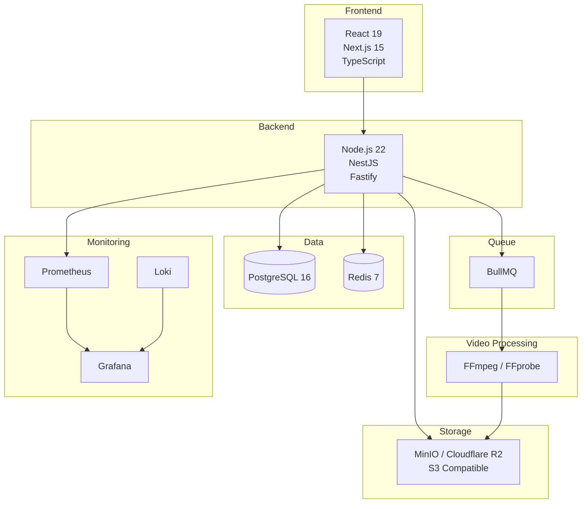

### Frontend Stack

| Technology | Version | Purpose |
|------------|---------|---------|
| React | 19.x | UI library |
| Next.js | 15.x | React framework with SSR/SSG |
| TypeScript | 5.x | Type safety |
| Tailwind CSS | 3.x | Utility-first CSS framework |
| shadcn/ui | latest | Component library |
| Radix UI | latest | Accessible UI primitives |
| Framer Motion | latest | Animation library |
| TanStack Query | latest | Server state management |
| Zustand | latest | Client state management |
| React Hook Form | latest | Form state management |
| Zod | latest | Schema validation |
| Axios | latest | HTTP client |
| Video.js | 8.x | Video player |
| React Dropzone | latest | File upload component |
| Recharts | latest | Data visualization |
| Lucide React | latest | Icon library |

### Backend Stack

| Technology | Version | Purpose |
|------------|---------|---------|
| Node.js | 22.x LTS | Runtime environment |
| NestJS | 10.x | Backend framework |
| Fastify | 5.x | Web server (2x faster than Express) |
| TypeScript | 5.x | Type safety |
| Prisma ORM | 5.x | Database ORM |
| Swagger | latest | API documentation |
| JWT | latest | Token-based authentication |
| Passport.js | latest | Authentication middleware |
| bcrypt | latest | Password hashing |
| class-validator | latest | DTO validation |
| Multer | latest | File upload handling |
| Sharp | latest | Image processing |

### Database & Infrastructure

| Technology | Version | Purpose |
|------------|---------|---------|
| PostgreSQL | 16.x | Primary database |
| Redis | 7.x | Cache and session store |
| Docker | latest | Containerization |
| Docker Compose | latest | Local orchestration |
| NGINX | latest | Reverse proxy, HLS streaming |
| MinIO | latest | Object storage (S3 compatible) |
| Cloudflare R2 | latest | Production object storage |

### Video Processing

| Technology | Version | Purpose |
|------------|---------|---------|
| FFmpeg | 7.x | Video transcoding |
| FFprobe | 7.x | Metadata extraction |

### Monitoring & DevOps

| Technology | Version | Purpose |
|------------|---------|---------|
| Prometheus | latest | Metrics collection |
| Grafana | latest | Metrics visualization |
| Loki | latest | Log aggregation |
| Pino | latest | Structured logging |
| pnpm | 9.x | Package manager |
| GitHub Actions | latest | CI/CD pipeline |

### Why These Technologies?

| Choice | Reason |
|--------|--------|
| **Node.js 22 + NestJS** | Performance, rich ecosystem, TypeScript support, Clean Architecture |
| **Fastify over Express** | 2x faster, built-in JSON schema validation, native structured logging |
| **PostgreSQL** | JSONB support, full-text search, ACID compliance, proven at scale |
| **Redis + BullMQ** | In-memory performance, pub/sub, robust job queue with retries |
| **MinIO** | S3-compatible, local development, no vendor lock-in, Kubernetes native |
| **pnpm** | Disk efficiency, fast installation, workspace protocol support |

---

## 6. System Architecture

### High-Level Architecture

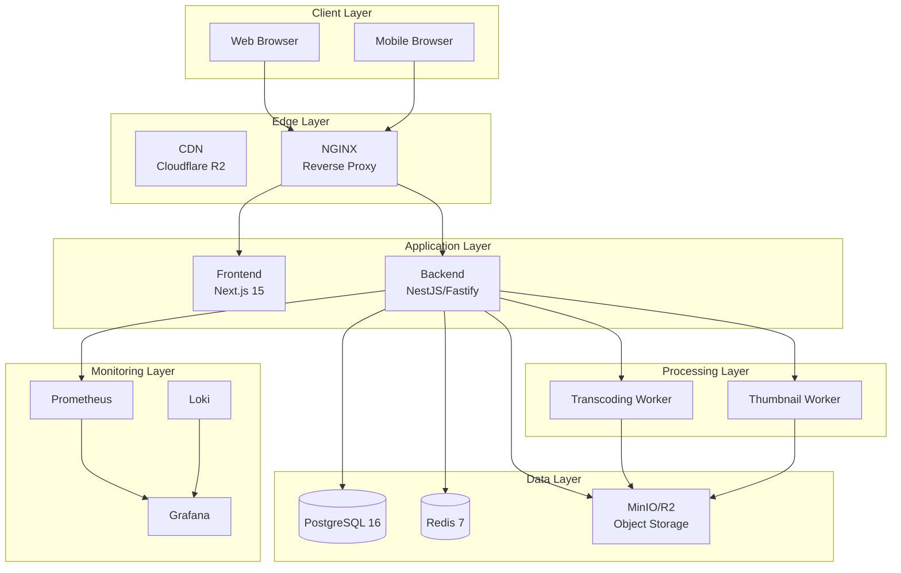

### Architectural Patterns

#### Clean Architecture (4-Layer)

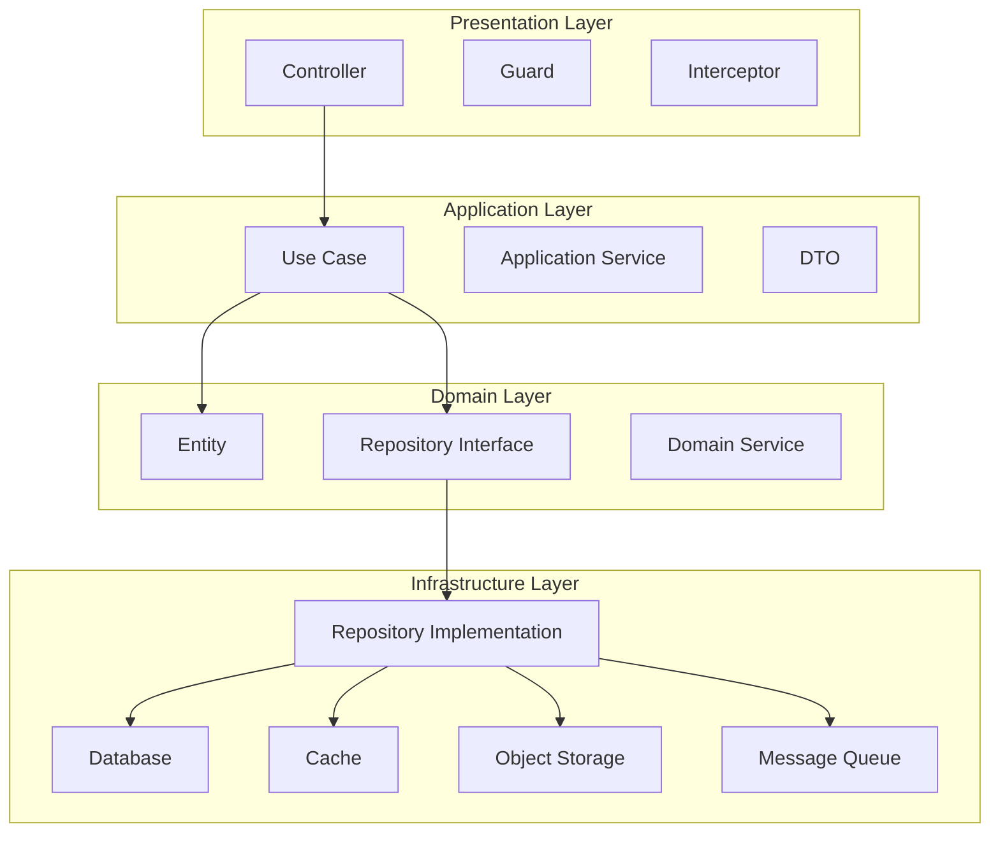

| Layer | Responsibility |
|-------|---------------|
| **Domain** | Business logic, entities, value objects, domain services |
| **Application** | Use cases, application services, DTOs |
| **Infrastructure** | External implementations, database, file storage, messaging |
| **Presentation** | Controllers, resolvers, API handlers |

#### Modular Monolith

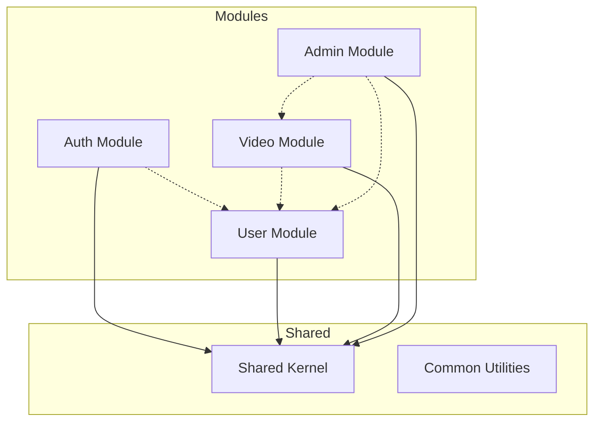

> **Design Decision**: Start with modular monolith for faster development, with clear migration path to microservices.

#### Event-Driven Architecture

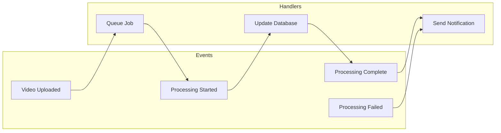

### Architecture Principles

| Principle | Implementation |
|-----------|----------------|
| Cloud Native | Container-first, 12-factor app |
| API First | All features accessible via REST API |
| Security First | Authentication, authorization, encryption |
| Scalable | Horizontal scaling, stateless services |
| Maintainable | Clean architecture, modular monolith |
| Observable | Metrics, logs, tracing |
| Resilient | Retry mechanisms, circuit breakers |

### SOLID Principles

| Principle | Application |
|-----------|-------------|
| Single Responsibility | Each module handles one business capability |
| Open/Closed | Extensions through interfaces, not modifications |
| Liskov Substitution | All implementations are substitutable |
| Interface Segregation | Small, focused interfaces |
| Dependency Inversion | Depend on abstractions, not concretions |

---

## 7. Database Schema

### Entity Relationship Diagram

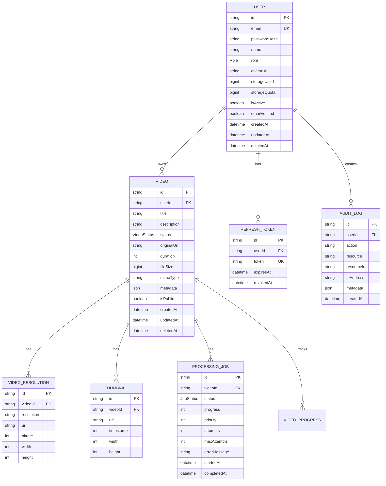

### Database Tables

| Table | Purpose |
|-------|---------|
| `users` | User accounts with roles and storage quotas |
| `videos` | Video metadata and status |
| `video_resolutions` | Transcoded resolution variants |
| `thumbnails` | Generated thumbnail images |
| `processing_jobs` | Background job tracking |
| `video_progress` | User watch progress |
| `refresh_tokens` | JWT refresh tokens |
| `storage_quotas` | User storage limits |
| `audit_logs` | Security audit trail |

### Enums

```typescript
enum Role {
  USER
  ADMIN
  SUPER_ADMIN
}

enum VideoStatus {
  PENDING
  PROCESSING
  COMPLETED
  FAILED
  CANCELLED
}

enum JobStatus {
  PENDING
  PROCESSING
  COMPLETED
  FAILED
  CANCELLED
}
```

### Key Design Decisions

| Decision | Reason |
|----------|--------|
| Soft Delete | Maintain data for audit and recovery |
| JSONB for Metadata | Flexible, queryable video metadata |
| cuid() for IDs | Collision-resistant, sortable |
| Indexes on userId, status, createdAt | Fast queries for common operations |

---

## 8. API Design

### Base URL

```
https://api.videostreaming.com/api/v1
```

### Standard Response Format

```typescript
// Success Response
{
  "data": T,
  "meta": {
    "timestamp": "2024-01-15T10:30:00Z",
    "requestId": "req_123456"
  }
}

// Error Response
{
  "error": {
    "code": "VALIDATION_ERROR",
    "message": "Invalid input data",
    "details": [...]
  },
  "meta": {
    "timestamp": "2024-01-15T10:30:00Z",
    "requestId": "req_123456"
  }
}

// Paginated Response
{
  "data": T[],
  "pagination": {
    "page": 1,
    "limit": 20,
    "total": 100,
    "totalPages": 5,
    "hasNext": true,
    "hasPrev": false
  },
  "meta": { ... }
}
```

### Authentication Endpoints

| Method | Endpoint | Description |
|--------|----------|-------------|
| POST | `/api/v1/auth/register` | Register new user |
| POST | `/api/v1/auth/login` | Login user |
| POST | `/api/v1/auth/refresh` | Refresh access token |
| POST | `/api/v1/auth/logout` | Logout user |
| POST | `/api/v1/auth/forgot-password` | Request password reset |
| POST | `/api/v1/auth/reset-password` | Reset password |

### Video Endpoints

| Method | Endpoint | Description |
|--------|----------|-------------|
| GET | `/api/v1/videos` | List user videos (with pagination, search, filter) |
| POST | `/api/v1/videos` | Upload video (multipart/form-data) |
| GET | `/api/v1/videos/{id}` | Get video details |
| PATCH | `/api/v1/videos/{id}` | Update video metadata |
| DELETE | `/api/v1/videos/{id}` | Delete video |
| GET | `/api/v1/videos/{id}/status` | Get processing status |

### User Endpoints

| Method | Endpoint | Description |
|--------|----------|-------------|
| GET | `/api/v1/users/profile` | Get user profile |
| PATCH | `/api/v1/users/profile` | Update profile |

### Admin Endpoints

| Method | Endpoint | Description |
|--------|----------|-------------|
| GET | `/api/v1/admin/users` | List all users |
| GET | `/api/v1/admin/stats` | Get system statistics |
| GET | `/api/v1/admin/jobs` | List processing jobs |

### HTTP Status Codes

| Code | Usage |
|------|-------|
| 200 | Successful GET, PUT, PATCH |
| 201 | Successful POST (resource created) |
| 204 | Successful DELETE (no content) |
| 400 | Bad request (validation error) |
| 401 | Unauthorized (missing/invalid token) |
| 403 | Forbidden (insufficient permissions) |
| 404 | Resource not found |
| 409 | Conflict (duplicate resource) |
| 413 | Payload too large |
| 415 | Unsupported media type |
| 429 | Rate limit exceeded |
| 500 | Internal server error |
| 503 | Service unavailable |

### Rate Limiting

| Endpoint | Limit | Window |
|----------|-------|--------|
| `/auth/*` | 10 | 1 minute |
| `/videos` (upload) | 100 | 1 minute |
| `/videos/*` | 1000 | 1 minute |
| `/admin/*` | 500 | 1 minute |

### API Example: Upload Video

```bash
curl -X POST https://api.videostreaming.com/api/v1/videos \
  -H "Authorization: Bearer $TOKEN" \
  -F "file=@video.mp4" \
  -F "title=My Video" \
  -F "description=Video description"
```

```typescript
// React with TanStack Query
const uploadMutation = useMutation({
  mutationFn: (file: File) => {
    const formData = new FormData();
    formData.append('file', file);
    formData.append('title', title);
    return axios.post('/api/v1/videos', formData, {
      headers: { 'Content-Type': 'multipart/form-data' },
    });
  },
});
```

---

## 9. Authentication & Security

### Authentication Flow

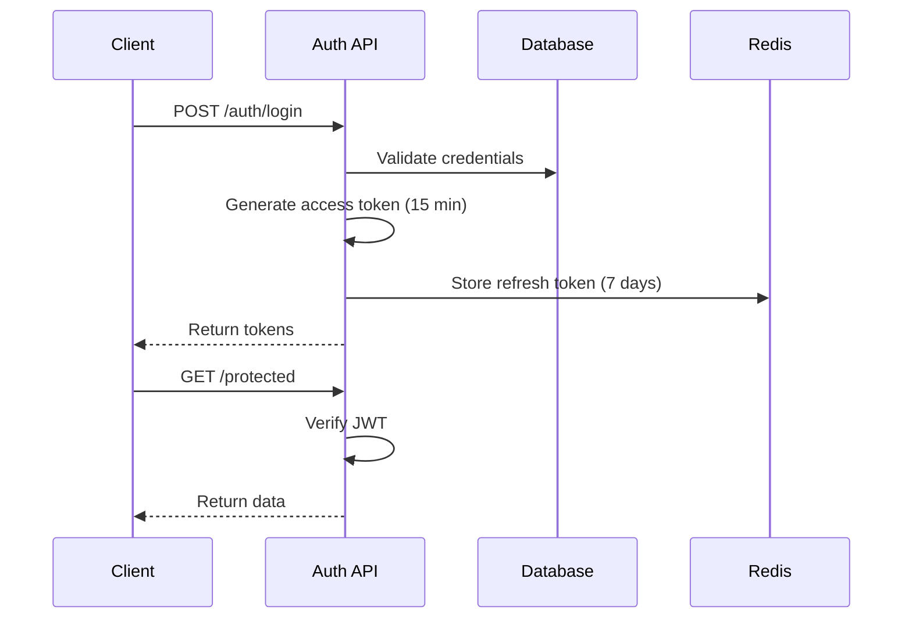

### JWT Token Configuration

| Parameter | Value |
|-----------|-------|
| Algorithm | HS256 |
| Access Token Expiry | 15 minutes |
| Refresh Token Expiry | 7 days |
| Issuer | video-streaming-platform |
| Token Storage | Access: in-memory, Refresh: HttpOnly cookie |
| Token Blacklist | Redis with TTL |

### Password Security

| Rule | Requirement |
|------|-------------|
| Hashing | bcrypt with cost factor 12 |
| Minimum Length | 8 characters |
| Maximum Length | 128 characters |
| Uppercase | At least 1 |
| Lowercase | At least 1 |
| Number | At least 1 |
| Special Character | At least 1 |

### Security Layers

```
┌─────────────────────────────────────────────────────┐
│              Network Security                        │
│         TLS 1.3, Firewall, CORS                      │
├─────────────────────────────────────────────────────┤
│           Application Security                       │
│      Input Validation, Auth, Rate Limiting          │
├─────────────────────────────────────────────────────┤
│              Data Security                           │
│        Encryption, Backup, RBAC                      │
├─────────────────────────────────────────────────────┤
│           Infrastructure Security                    │
│      Container Security, Access Control              │
└─────────────────────────────────────────────────────┘
```

### STRIDE Threat Analysis

| Threat | Mitigation |
|--------|------------|
| Spoofing | JWT tokens, email verification |
| Tampering | Input validation, checksums |
| Repudiation | Audit logs, signed URLs |
| Information Disclosure | Encryption, RBAC |
| Denial of Service | Rate limiting, resource limits |
| Elevation of Privilege | Role-based access, least privilege |

### Security Headers

| Header | Value |
|--------|-------|
| Strict-Transport-Security | max-age=31536000; includeSubDomains |
| X-Content-Type-Options | nosniff |
| X-Frame-Options | DENY |
| X-XSS-Protection | 1; mode=block |
| Content-Security-Policy | default-src 'self' |
| Referrer-Policy | strict-origin-when-cross-origin |

### Compliance

- **GDPR**: Data portability, right to deletion, consent
- **SOC 2**: Audit logs, access control, encryption, monitoring
- **OWASP Top 10**: Compliance with all security best practices

---

## 10. Video Processing Pipeline

### Transcoding Pipeline Overview

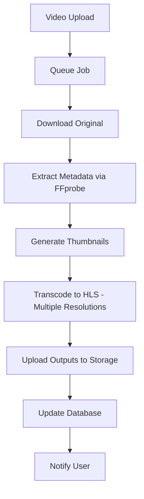

### Processing Steps

#### Step 1: Metadata Extraction
```bash
ffprobe -v quiet -print_format json -show_format -show_streams input.mp4
```

#### Step 2: Thumbnail Generation
```bash
ffmpeg -ss 10 -i input.mp4 -vframes 1 -q:v 2 thumbnail_10s.jpg
ffmpeg -ss 30 -i input.mp4 -vframes 1 -q:v 2 thumbnail_30s.jpg
ffmpeg -ss 60 -i input.mp4 -vframes 1 -q:v 2 thumbnail_60s.jpg
```

#### Step 3: HLS Transcoding
```bash
ffmpeg -i input.mp4 \
  -vf scale=1280:720 \
  -c:v libx264 \
  -preset fast \
  -crf 23 \
  -c:a aac \
  -b:a 192k \
  -hls_time 10 \
  -hls_playlist_type event \
  -hls_segment_filename "segment_%03d.ts" \
  output.m3u8
```

### Transcoding Profiles (Bitrate Ladder)

| Resolution | Dimensions | Video Bitrate | Audio Bitrate | Total | CRF | Profile | Level |
|------------|------------|---------------|---------------|-------|-----|---------|-------|
| 240p | 426x240 | 400 kbps | 64 kbps | 464 kbps | 28 | Baseline | 3.0 |
| 360p | 640x360 | 800 kbps | 96 kbps | 896 kbps | 26 | Main | 3.1 |
| 480p | 854x480 | 1200 kbps | 128 kbps | 1328 kbps | 24 | Main | 3.1 |
| 720p | 1280x720 | 2400 kbps | 192 kbps | 2592 kbps | 23 | Main | 4.0 |
| 1080p | 1920x1080 | 4800 kbps | 256 kbps | 5056 kbps | 22 | High | 4.2 |
| 4K | 3840x2160 | 12000 kbps | 384 kbps | 12384 kbps | 20 | High | 5.2 |

### Supported Input Formats

| Format | Extension | Codec |
|--------|-----------|-------|
| MP4 | .mp4 | H.264, H.265 |
| MOV | .mov | H.264, ProRes |
| AVI | .avi | H.264 |
| MKV | .mkv | H.264, H.265 |
| WebM | .webm | VP8, VP9 |
| FLV | .flv | H.264 |

### Video Status State Machine

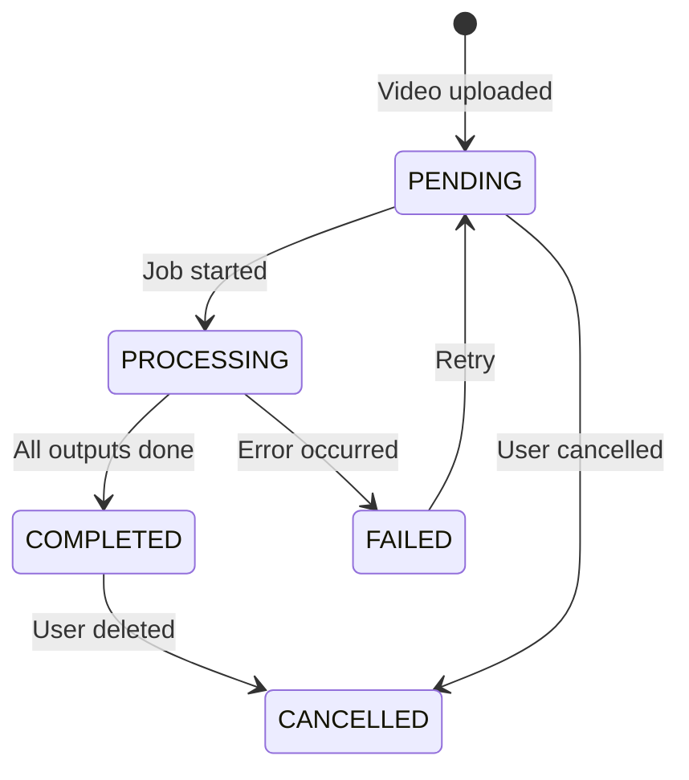

### Progress Tracking

```typescript
// Progress updates during processing
await job.updateProgress(10);  // Metadata extracted
await job.updateProgress(25);  // Download complete
await job.updateProgress(50);  // Thumbnails done
await job.updateProgress(75);  // Transcoding done
await job.updateProgress(100); // All done
```

### Hardware Acceleration (Future)

```bash
# NVIDIA GPU
ffmpeg -hwaccel cuda -i input.mp4 -c:v h264_nvenc output.mp4

# Intel Quick Sync
ffmpeg -hwaccel qsv -i input.mp4 -c:v h264_qsv output.mp4
```

---

## 11. Streaming Architecture

### Streaming Flow

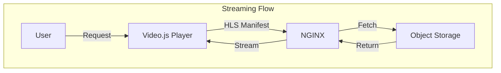

### HLS Protocol

#### Master Manifest (master.m3u8)
```m3u8
#EXTM3U
#EXT-X-VERSION:3
#EXT-X-INDEPENDENT-SEGMENTS

#EXT-X-STREAM-INF:BANDWIDTH=2400000,RESOLUTION=1280x720,CODECS="avc1.42001e,mp4a.40.2"
720p/master.m3u8

#EXT-X-STREAM-INF:BANDWIDTH=1200000,RESOLUTION=854x480,CODECS="avc1.42001e,mp4a.40.2"
480p/master.m3u8

#EXT-X-STREAM-INF:BANDWIDTH=800000,RESOLUTION=640x360,CODECS="avc1.42001e,mp4a.40.2"
360p/master.m3u8
```

#### Segment Manifest
```m3u8
#EXTM3U
#EXT-X-VERSION:3
#EXT-X-TARGETDURATION:10
#EXT-X-MEDIA-SEQUENCE:0

#EXTINF:10.0,
segment_0.ts
#EXTINF:10.0,
segment_1.ts
#EXT-X-ENDLIST
```

### Adaptive Streaming (Quality Selection)

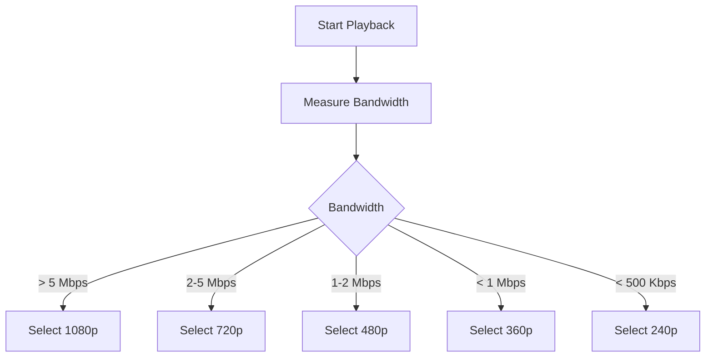

### Video.js Player Configuration

```typescript
import videojs from 'video.js';

const player = videojs('my-video', {
  autoplay: false,
  controls: true,
  preload: 'auto',
  fluid: true,
  html5: {
    hls: {
      enableWorker: true,
      smoothQualityChange: true,
    },
  },
});
```

### Player Features

| Feature | Description |
|---------|-------------|
| Quality Selector | Manual resolution selection |
| Auto Quality | Adaptive based on bandwidth |
| Fullscreen | Fullscreen mode support |
| Captions | Subtitle support (future) |
| Picture-in-Picture | PiP support |

### Cache Strategy

| Content | Cache TTL |
|---------|-----------|
| HLS Manifest | 1 hour |
| Video Segments | 24 hours |
| Thumbnails | 7 days |
| Preview GIF | 7 days |

---

## 12. Storage Architecture

### Storage Overview

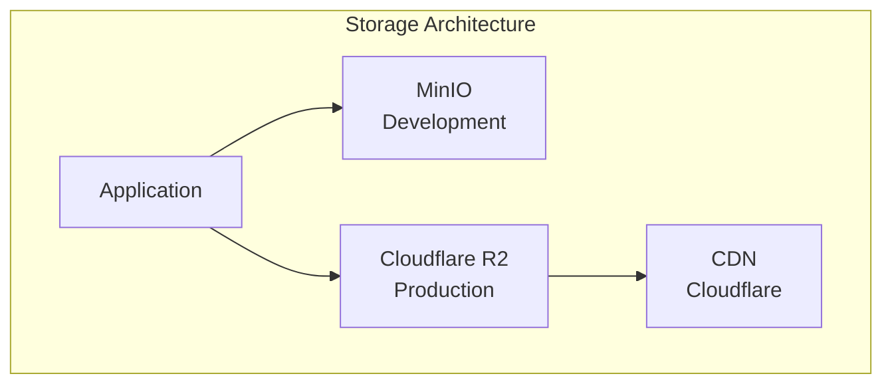

### File Organization

```
{video-id}/
├── original.mp4
├── metadata.json
├── thumbnails/
│   ├── 10s.jpg
│   ├── 30s.jpg
│   └── 60s.jpg
├── preview.gif
├── hls/
│   ├── 240p/
│   │   ├── master.m3u8
│   │   ├── segment_0.ts
│   │   └── segment_1.ts
│   ├── 360p/
│   ├── 480p/
│   ├── 720p/
│   ├── 1080p/
│   └── 4k/
└── dash/
    └── (future)
```

### Storage Paths

| Type | Path Pattern |
|------|--------------|
| Original | `{videoId}/original.mp4` |
| Metadata | `{videoId}/metadata.json` |
| Thumbnail | `{videoId}/thumbnails/{timestamp}s.jpg` |
| Preview | `{videoId}/preview.gif` |
| HLS Manifest | `{videoId}/hls/{resolution}/master.m3u8` |
| HLS Segment | `{videoId}/hls/{resolution}/segment_{index}.ts` |

### Upload Optimization

| Strategy | Implementation |
|----------|----------------|
| Multipart Upload | 50MB chunks |
| Parallel Upload | 4 concurrent chunks |
| Resume Support | Upload ID tracking |

### Backup Strategy

| Data | Frequency | Retention |
|------|-----------|-----------|
| Database | Daily | 30 days |
| Original Videos | Never | Permanent |
| Transcoded Videos | Never | Permanent |
| Thumbnails | Never | Permanent |

---

## 13. Queue System & Background Jobs

### Queue Architecture

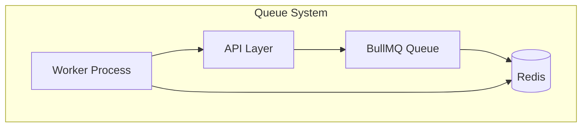

### Job Types

| Queue | Purpose |
|-------|---------|
| `transcode` | Video transcoding jobs |
| `thumbnail` | Thumbnail generation jobs |
| `metadata` | Metadata extraction jobs |
| `cleanup` | Cleanup jobs |

### Job Lifecycle

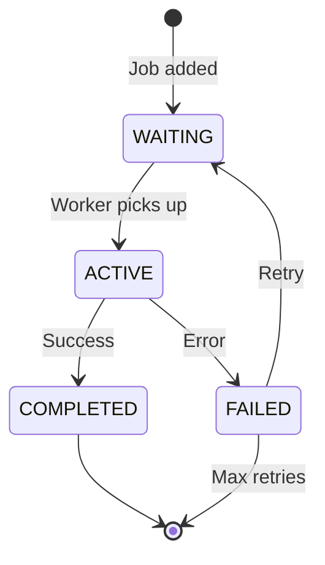

### Priority System

| Priority | Use Case |
|----------|----------|
| 1 | Critical system jobs |
| 5 | Admin user videos |
| 10 | Paid tier users |
| 20 | Free tier users |
| 50 | Default |

### Retry Strategy (Exponential Backoff)

| Attempt | Delay |
|---------|-------|
| 1 | 1 second |
| 2 | 2 seconds |
| 3 | 4 seconds |

### Worker Implementation

```typescript
import { Worker } from 'bullmq';

const transcodeWorker = new Worker(
  'transcode',
  async (job) => {
    const { videoId, resolutions } = job.data;
    
    await job.updateProgress(10);
    const video = await downloadVideo(videoId);
    
    await job.updateProgress(25);
    const metadata = await extractMetadata(video.path);
    
    await job.updateProgress(50);
    for (const resolution of resolutions) {
      await transcodeToHLS(video.path, resolution);
    }
    
    await job.updateProgress(90);
    await uploadOutputs(videoId);
    
    await job.updateProgress(100);
    return { success: true };
  },
  {
    concurrency: 4,
    removeOnFail: false,
  }
);
```

### Auto-Scaling

| Metric | Threshold | Action |
|--------|-----------|--------|
| Queue depth > 100 | Scale up | Add worker |
| Queue depth < 10 | Scale down | Remove worker |
| CPU > 80% | Scale up | Add instance |

---

## 14. Caching Strategy

### Cache Layers

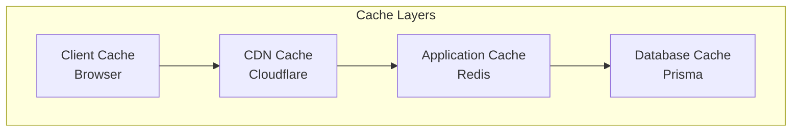

### Cache TTL Configuration

| Data Type | TTL | Layer |
|-----------|-----|-------|
| User profile | 5 minutes | Client |
| Video list | 1 minute | Client |
| API responses | 30 seconds | React Query |
| HLS segments | 24 hours | CDN |
| Thumbnails | 7 days | CDN |
| Session data | 7 days | Redis |
| Rate limit counters | 1 minute | Redis |
| Processing status | 1 hour | Redis |
| Video metadata | 1 hour | Redis |

### Cache Key Naming

| Pattern | Example |
|---------|---------|
| User | `user:{id}` |
| Video | `video:{id}` |
| Video list | `user:{id}:videos` |
| Processing status | `video:{id}:status` |
| Rate limit | `rate:{userId}:{endpoint}` |

### Cache Hit Ratio Targets

| Layer | Target |
|-------|--------|
| Redis | > 80% |
| CDN | > 90% |
| Client | > 70% |

---

## 15. Monitoring & Logging

### Monitoring Stack

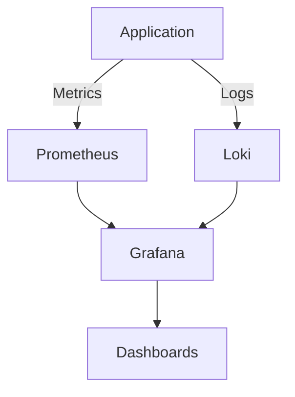

### Application Metrics

| Metric | Type | Description |
|--------|------|-------------|
| http_requests_total | Counter | Total HTTP requests |
| http_request_duration_seconds | Histogram | Request duration |
| video_processing_duration_seconds | Histogram | Processing time |
| queue_jobs_total | Gauge | Jobs in queue |
| cache_hit_ratio | Gauge | Cache hit ratio |

### Business Metrics

| Metric | Type | Description |
|--------|------|-------------|
| videos_uploaded_total | Counter | Total videos uploaded |
| videos_processed_total | Counter | Total videos processed |
| storage_used_bytes | Gauge | Total storage used |
| active_users | Gauge | Active users |

### Log Structure

```json
{
  "level": "info",
  "time": "2024-01-15T10:30:00.000Z",
  "msg": "Video transcoding started",
  "reqId": "req_123456",
  "userId": "user_abc123",
  "videoId": "video_xyz789",
  "metadata": {
    "resolution": "720p",
    "format": "mp4"
  }
}
```

### Alert Rules

| Alert | Condition | Severity |
|-------|-----------|----------|
| HighErrorRate | > 5% errors | Critical |
| HighQueueDepth | > 100 jobs | Warning |
| LowDiskSpace | < 10% free | Critical |
| HighCPU | > 80% for 5m | Warning |

### Dashboards

| Dashboard | Contents |
|-----------|----------|
| System | CPU, memory, disk, network |
| Application | Request rate, error rate, response time, queue depth |
| Business | Videos uploaded, processed, storage used, active users |

---

## 16. Deployment & DevOps

### CI/CD Pipeline

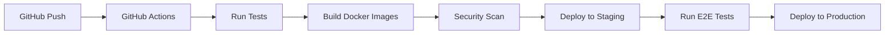

### Development Environment

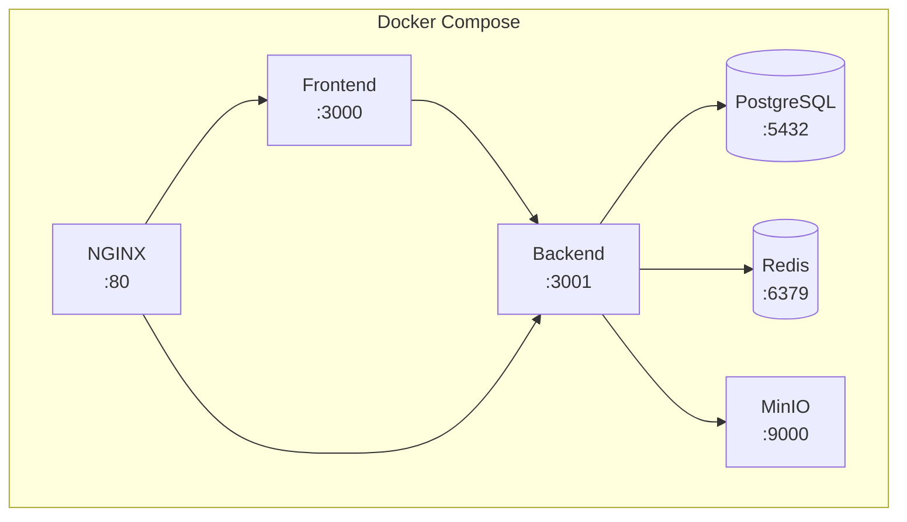

### Production Environment

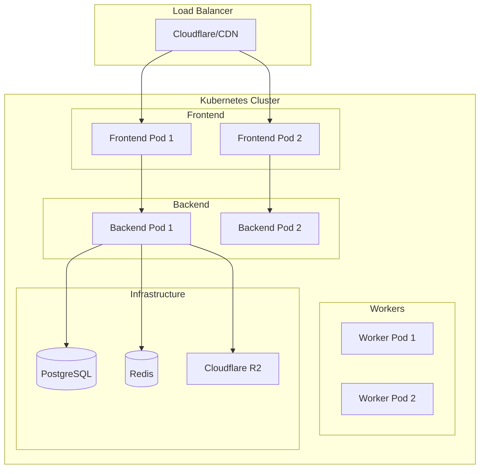

### Docker Configuration

#### Backend Dockerfile
```dockerfile
FROM node:22-alpine AS builder
WORKDIR /app
COPY package.json pnpm-lock.yaml ./
RUN npm install -g pnpm && pnpm install --frozen-lockfile
COPY . .
RUN pnpm run build

FROM node:22-alpine AS runtime
WORKDIR /app
COPY --from=builder /app/dist ./dist
COPY --from=builder /app/node_modules ./node_modules
COPY --from=builder /app/package.json ./package.json
EXPOSE 3001
CMD ["node", "dist/main"]
```

### Kubernetes Auto-Scaling

```yaml
apiVersion: autoscaling/v2
kind: HorizontalPodAutoscaler
metadata:
  name: backend-hpa
spec:
  scaleTargetRef:
    apiVersion: apps/v1
    kind: Deployment
    name: backend
  minReplicas: 2
  maxReplicas: 10
  metrics:
  - type: Resource
    resource:
      name: cpu
      target:
        type: Utilization
        averageUtilization: 70
```

### Health Checks

| Probe | Endpoint | Purpose |
|-------|----------|---------|
| Liveness | `/health` | Check if app is running |
| Readiness | `/ready` | Check if app is ready to serve |

### Rollback Strategy

```bash
# Database rollback
pnpm prisma migrate resolve --rolled-back

# Kubernetes rollback
kubectl rollout undo deployment/backend

# Restore from backup
pg_restore -h $DB_HOST -U $DB_USER -d $DB_NAME backup.sql
```

---

## 17. UI/UX Design

### Design System

| Component | Technology |
|-----------|------------|
| Framework | Next.js 15 with App Router |
| Styling | Tailwind CSS |
| Components | shadcn/ui |
| Primitives | Radix UI |
| Icons | Lucide React |
| Charts | Recharts |
| Animations | Framer Motion |

### Color Palette

| Color | Hex | Usage |
|-------|-----|-------|
| Primary | #0ea5e9 | Main actions |
| Secondary | #64748b | Secondary actions |
| Success | #22c55e | Success states |
| Warning | #f59e0b | Warning states |
| Error | #ef4444 | Error states |

### Typography

| Element | Size | Weight | Line Height |
|---------|------|--------|-------------|
| h1 | 2.5rem | 700 | 1.2 |
| h2 | 2rem | 600 | 1.3 |
| h3 | 1.5rem | 600 | 1.4 |
| body | 1rem | 400 | 1.5 |
| small | 0.875rem | 400 | 1.4 |

### Responsive Breakpoints

| Name | Width | Usage |
|------|-------|-------|
| sm | 640px | Mobile |
| md | 768px | Tablet |
| lg | 1024px | Desktop |
| xl | 1280px | Large desktop |

### Core Components

| Component | Description |
|-----------|-------------|
| Button | Primary, secondary, destructive variants |
| Input | Text, email, password, file |
| Card | Video card, user card |
| Modal | Confirmation, form modal |
| Table | Video list, user list |
| Avatar | User avatar with status |
| VideoPlayer | Video.js wrapper |
| VideoCard | Video thumbnail with info |
| VideoUpload | Drag-and-drop upload |
| VideoProgress | Processing progress bar |

### User Flow

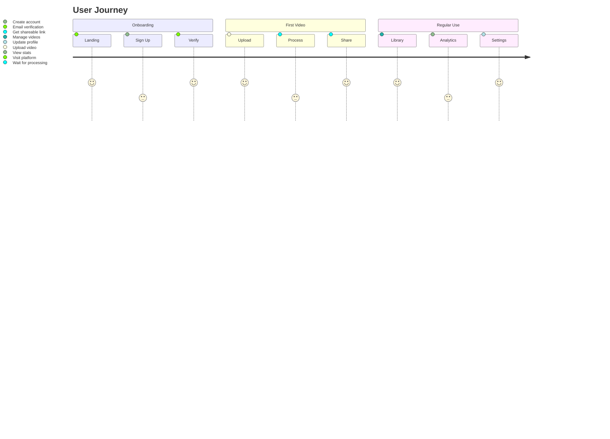

### Accessibility

- **WCAG 2.1 AA** compliance
- Keyboard navigation
- Screen reader support
- Color contrast ratios > 4.5:1
- Minimum 44x44 pixel touch targets

---

## 18. Project Structure

### Root Structure

```
video-streaming-platform/
├── docs/                    # Project documentation
│   ├── diagrams/            # Architecture diagrams
│   ├── assets/              # Documentation assets
│   └── *.md                 # 35 documentation files
├── frontend/                # Next.js frontend application
├── backend/                 # NestJS backend application
├── infrastructure/          # Docker, Kubernetes, CI/CD
├── .github/                 # GitHub Actions workflows
├── .husky/                  # Git hooks
├── .vscode/                 # VS Code settings
├── docker-compose.yml       # Development orchestration
├── turbo.json               # Turborepo config
├── pnpm-workspace.yaml      # pnpm workspace config
├── package.json             # Root package.json
└── README.md                # Project README
```

### Backend Structure

```
backend/
├── src/
│   ├── modules/             # Feature modules (DDD bounded contexts)
│   │   ├── auth/            # Authentication module
│   │   │   ├── application/ # Use cases, services
│   │   │   ├── domain/      # Entities, value objects
│   │   │   ├── infrastructure/ # Repositories, services
│   │   │   └── presentation/   # Controllers, guards, DTOs
│   │   ├── user/            # User module
│   │   ├── video/           # Video module
│   │   └── admin/           # Admin module
│   ├── shared/              # Shared kernel
│   │   ├── kernel/          # Core utilities
│   │   ├── application/     # Shared application code
│   │   └── infrastructure/  # Shared infrastructure
│   ├── app.module.ts        # Root module
│   ├── main.ts              # Entry point
│   └── bootstrap.ts         # Bootstrap function
├── test/                    # Test files
│   ├── unit/                # Unit tests
│   ├── integration/         # Integration tests
│   └── e2e/                 # End-to-end tests
├── prisma/                  # Prisma schema and migrations
│   ├── schema.prisma        # Database schema
│   └── migrations/          # Database migrations
├── Dockerfile               # Backend Docker configuration
├── tsconfig.json            # TypeScript configuration
└── package.json             # Backend dependencies
```

### Frontend Structure

```
frontend/
├── src/
│   ├── app/                 # Next.js App Router pages
│   │   ├── api/             # API routes
│   │   ├── auth/            # Authentication pages
│   │   ├── dashboard/       # Dashboard page
│   │   ├── library/         # Video library page
│   │   ├── player/          # Video player page
│   │   └── admin/           # Admin panel page
│   ├── components/          # React components
│   │   ├── ui/              # shadcn/ui components
│   │   ├── video/           # Video-related components
│   │   ├── forms/           # Form components
│   │   └── layout/          # Layout components
│   ├── lib/                 # Utility libraries
│   │   ├── api/             # API client
│   │   ├── utils/           # Utility functions
│   │   └── validations/     # Zod validation schemas
│   ├── hooks/               # Custom React hooks
│   ├── stores/              # Zustand stores
│   ├── types/               # TypeScript types
│   ├── styles/              # Global styles
│   ├── middleware.ts        # Next.js middleware
│   ├── layout.tsx           # Root layout
│   └── page.tsx             # Home page
├── public/                  # Static assets
├── test/                    # Test files
├── Dockerfile               # Frontend Docker configuration
├── tsconfig.json            # TypeScript configuration
├── tailwind.config.js       # Tailwind CSS configuration
└── package.json             # Frontend dependencies
```

### Infrastructure Structure

```
infrastructure/
├── docker/                  # Dockerfiles
│   ├── backend.Dockerfile
│   ├── frontend.Dockerfile
│   └── worker.Dockerfile
├── kubernetes/              # Kubernetes manifests
│   ├── base/                # Base configurations
│   ├── development/         # Dev environment
│   └── production/          # Production environment
├── terraform/               # Infrastructure as Code
│   ├── modules/             # Terraform modules
│   └── environments/        # Environment configurations
├── scripts/                 # Deployment scripts
│   ├── setup.sh
│   └── deploy.sh
├── docker-compose.yml       # Base compose file
├── docker-compose.dev.yml   # Development compose
├── docker-compose.prod.yml  # Production compose
└── helm/                    # Helm charts
    └── video-streaming-platform/
```

---

## 19. Development Roadmap

### Roadmap Gantt Chart

```mermaid
gantt
    title Video Streaming Platform Roadmap
    dateFormat  YYYY-MM-DD
    section Phase 1
    Core Transcoding :done, des1, 2024-01-01, 2024-03-31
    Authentication :done, des2, 2024-01-01, 2024-03-31
    Video Library :done, des3, 2024-01-01, 2024-03-31
    section Phase 2
    Chunked Upload :active, des4, 2024-04-01, 2024-06-30
    Analytics :active, des5, 2024-04-01, 2024-06-30
    Webhooks :active, des6, 2024-04-01, 2024-06-30
    section Phase 3
    Audit Logging : des7, 2024-07-01, 2024-09-30
    Custom Profiles : des8, 2024-07-01, 2024-09-30
    Rate Limiting : des9, 2024-07-01, 2024-09-30
    section Phase 4
    AI Subtitles : des10, 2024-10-01, 2024-12-31
    Watermarking : des11, 2024-10-01, 2024-12-31
    DRM : des12, 2024-10-01, 2024-12-31
```

### Phase 1: Foundation (Q1 2024) ✅ Complete

| Feature | Status | Description |
|---------|--------|-------------|
| User Authentication | ✅ | JWT-based auth with refresh tokens |
| Video Upload | ✅ | Single file upload with validation |
| Video Processing | ✅ | Automatic HLS transcoding |
| Video Library | ✅ | List, search, and manage videos |
| Video Streaming | ✅ | HLS adaptive streaming |
| Admin Dashboard | ✅ | System monitoring and user management |

### Phase 2: Scale (Q2 2024) ⏳ In Progress

| Feature | Status | Description |
|---------|--------|-------------|
| Chunked Upload | ⏳ | Large file support with resume |
| Analytics Dashboard | ⏳ | Usage and performance metrics |
| Webhook Notifications | ⏳ | Event-driven notifications |
| Performance Optimization | ⏳ | Caching and query optimization |

### Phase 3: Enterprise (Q3 2024)

| Feature | Status | Description |
|---------|--------|-------------|
| Audit Logging | ⏳ | Comprehensive audit trail |
| Custom Profiles | ⏳ | User-defined transcoding profiles |
| Rate Limiting | ⏳ | API rate limiting |
| Advanced Security | ⏳ | MFA, IP restrictions |

### Phase 4: Innovation (Q4 2024)

| Feature | Status | Description |
|---------|--------|-------------|
| AI Subtitle Generation | ⏳ | Automatic subtitle generation |
| Watermarking | ⏳ | Video watermarking support |
| DRM Integration | ⏳ | Digital rights management |
| Kubernetes Deployment | ⏳ | Production Kubernetes setup |

### Future Phases (2025+)

| Phase | Feature | Description |
|-------|---------|-------------|
| 5 | CDN Integration | Global content delivery |
| 5 | Multi-region | Multi-region deployment |
| 5 | Advanced Analytics | ML-powered insights |
| 5 | API Marketplace | Third-party integrations |
| 6 | Multi-cloud | Multi-cloud support |
| 6 | Edge Computing | Edge processing |
| 6 | Real-time Streaming | Live streaming support |
| 6 | Mobile Apps | Native mobile applications |

### Success Metrics

| Metric | Q1 Target | Q2 Target | Q3 Target | Q4 Target |
|--------|-----------|-----------|-----------|-----------|
| MAU | 1,000 | 5,000 | 15,000 | 30,000 |
| Videos Processed | 10,000 | 50,000 | 150,000 | 500,000 |
| Uptime | 99.5% | 99.8% | 99.9% | 99.95% |

---

## 20. Coding Standards & Guidelines

### Naming Conventions

| Element | Convention | Example |
|---------|------------|---------|
| Files | kebab-case | `video-transcoder.ts` |
| Directories | kebab-case | `video-processing/` |
| Variables | camelCase | `videoMetadata` |
| Functions | camelCase | `transcodeVideo()` |
| Classes | PascalCase | `VideoTranscoder` |
| Interfaces | PascalCase | `VideoMetadata` |
| Types | PascalCase | `VideoStatus` |
| Constants | UPPER_SNAKE_CASE | `MAX_FILE_SIZE` |
| Enums | PascalCase | `VideoResolution` |
| Private Members | #private or _private | `#internalState` |

### Git Standards

#### Branch Naming

| Type | Format | Example |
|------|--------|---------|
| Feature | `feature/{ticket}-{description}` | `feature/VSP-123-add-video-upload` |
| Bug | `bugfix/{ticket}-{description}` | `bugfix/VSP-456-fix-transcoding-error` |
| Hotfix | `hotfix/{ticket}-{description}` | `hotfix/VSP-789-security-patch` |
| Release | `release/{version}` | `release/v1.2.0` |

#### Commit Messages

```
type(scope): subject

body (optional)

footer (optional)
```

| Type | Usage |
|------|-------|
| feat | New feature |
| fix | Bug fix |
| docs | Documentation |
| style | Formatting |
| refactor | Code refactoring |
| test | Adding tests |
| chore | Maintenance |

### Testing Standards

| Layer | Coverage | Tools |
|-------|----------|-------|
| Unit | 70% | Jest |
| Integration | 20% | Jest, Supertest |
| E2E | 10% | Playwright, Supertest |

### Design Patterns

#### Backend Patterns

| Pattern | Usage |
|---------|-------|
| Repository | Data access abstraction |
| Unit of Work | Transaction management |
| Factory | Object creation for transcoding strategies |
| Strategy | Multiple transcoding algorithms |
| Observer | Event-driven processing |
| Decorator | Cross-cutting concerns (logging, caching) |
| Command | Background job processing |
| Mediator | Request/response handling |

#### Frontend Patterns

| Pattern | Usage |
|---------|-------|
| Container/Presentational | Component separation |
| Custom Hooks | Reusable logic |
| Provider Pattern | State management |
| Compound Components | Complex UI components |
| Render Props | Flexible component composition |

---

## 21. Environment Configuration

### Key Environment Variables

| Variable | Required | Default | Description |
|----------|----------|---------|-------------|
| `NODE_ENV` | Yes | `development` | Environment mode |
| `PORT` | No | `3001` | Backend server port |
| `DATABASE_URL` | Yes | - | PostgreSQL connection string |
| `REDIS_URL` | Yes | `redis://localhost:6379` | Redis connection string |
| `JWT_SECRET` | Yes | - | JWT signing secret (32+ chars) |
| `JWT_EXPIRES_IN` | No | `15m` | Access token expiry |
| `JWT_REFRESH_EXPIRES_IN` | No | `7d` | Refresh token expiry |
| `MINIO_ENDPOINT` | Yes | `localhost` | MinIO endpoint |
| `MINIO_ACCESS_KEY` | Yes | `minioadmin` | MinIO access key |
| `MINIO_SECRET_KEY` | Yes | `minioadmin` | MinIO secret key |
| `MINIO_BUCKET` | Yes | `video-streaming` | MinIO bucket name |
| `FFMPEG_PATH` | No | `/usr/bin/ffmpeg` | FFmpeg binary path |
| `FFPROBE_PATH` | No | `/usr/bin/ffprobe` | FFprobe binary path |

### Environment Validation

```typescript
import { z } from 'zod';

const envSchema = z.object({
  NODE_ENV: z.enum(['development', 'staging', 'production']),
  DATABASE_URL: z.string().url(),
  REDIS_URL: z.string().url(),
  JWT_SECRET: z.string().min(32),
  MINIO_ACCESS_KEY: z.string().min(1),
  MINIO_SECRET_KEY: z.string().min(1),
});

export const env = envSchema.parse(process.env);
```

---

## 22. Quick Start Guide

### Prerequisites

- Node.js 22 LTS
- pnpm 9.x
- Docker & Docker Compose
- FFmpeg & FFprobe

### Installation

```bash
# Clone the repository
git clone https://github.com/your-org/video-streaming-platform.git
cd video-streaming-platform

# Start development environment
docker-compose up -d

# Install dependencies
pnpm install

# Run database migrations
pnpm prisma migrate dev

# Start development servers
pnpm dev
```

### Access Points

| Service | URL |
|---------|-----|
| Frontend | http://localhost:3000 |
| Backend API | http://localhost:3001 |
| API Documentation | http://localhost:3001/api/docs |
| MinIO Console | http://localhost:9001 |
| PostgreSQL | localhost:5432 |
| Redis | localhost:6379 |

### Default Credentials

| Service | Username | Password |
|---------|----------|----------|
| MinIO | minioadmin | minioadmin |
| PostgreSQL | postgres | password |

### Development Commands

```bash
# Install dependencies
pnpm install

# Run development servers
pnpm dev

# Run tests
pnpm test

# Run linting
pnpm lint

# Build for production
pnpm build

# Run database migrations
pnpm prisma migrate dev

# Generate Prisma client
pnpm prisma generate
```

---

## 📊 Key Diagrams Summary

### Available Diagrams in `docs/diagrams/`

| Diagram | Description |
|---------|-------------|
| `High_Level_Architecture.md` | Overall system architecture |
| `Low_Level_Architecture.md` | Detailed component architecture |
| `Component_Diagram.md` | Component relationships |
| `Deployment_Diagram.md` | Deployment topology |
| `ER_Diagram.md` | Database entity relationships |
| `Authentication_Flow.md` | Authentication process |
| `Upload_Flow.md` | Video upload process |
| `Transcoding_Flow.md` | Video transcoding process |
| `Streaming_Flow.md` | Video streaming process |
| `Storage_Flow.md` | Storage operations |
| `Queue_Flow.md` | Job queue processing |
| `Sequence_Diagrams.md` | Various sequence diagrams |

---

## 📚 Documentation Index

| Document | Description |
|----------|-------------|
| [00_Project_Standards.md](./docs/00_Project_Standards.md) | Coding standards, architecture principles |
| [01_Project_Vision.md](./docs/01_Project_Vision.md) | Product vision, mission, strategy |
| [02_Requirements.md](./docs/02_Requirements.md) | Functional and non-functional requirements |
| [03_PRD.md](./docs/03_PRD.md) | Product requirements document |
| [04_System_Architecture.md](./docs/04_System_Architecture.md) | System architecture and design |
| [05_Tech_Stack.md](./docs/05_Tech_Stack.md) | Technology stack and justifications |
| [06_Folder_Structure.md](./docs/06_Folder_Structure.md) | Project folder organization |
| [07_Database_Schema.md](./docs/07_Database_Schema.md) | Database schema design |
| [08_API_Design.md](./docs/08_API_Design.md) | REST API specification |
| [09_Authentication.md](./docs/09_Authentication.md) | Authentication and authorization |
| [10_User_Roles.md](./docs/10_User_Roles.md) | RBAC and permissions |
| [11_Workflow.md](./docs/11_Workflow.md) | Business workflows |
| [12_Queue_System.md](./docs/12_Queue_System.md) | BullMQ queue system |
| [13_Storage_Architecture.md](./docs/13_Storage_Architecture.md) | Object storage design |
| [14_Streaming_Architecture.md](./docs/14_Streaming_Architecture.md) | HLS streaming architecture |
| [15_Transcoding_Pipeline.md](./docs/15_Transcoding_Pipeline.md) | FFmpeg transcoding pipeline |
| [16_Deployment.md](./docs/16_Deployment.md) | Deployment and CI/CD |
| [17_Security.md](./docs/17_Security.md) | Security architecture |
| [18_Caching.md](./docs/18_Caching.md) | Caching strategy |
| [19_Error_Handling.md](./docs/19_Error_Handling.md) | Error handling patterns |
| [20_Logging_Monitoring.md](./docs/20_Logging_Monitoring.md) | Logging and monitoring |
| [21_Background_Jobs.md](./docs/21_Background_Jobs.md) | Background job processing |
| [22_Microservices.md](./docs/22_Microservices.md) | Microservices migration path |
| [23_API_Examples.md](./docs/23_API_Examples.md) | API usage examples |
| [24_UI_UX.md](./docs/24_UI_UX.md) | UI/UX design system |
| [25_Roadmap.md](./docs/25_Roadmap.md) | Development roadmap |
| [26_Environment_Variables.md](./docs/26_Environment_Variables.md) | Environment configuration |
| [27_Configuration_Guide.md](./docs/27_Configuration_Guide.md) | Configuration management |
| [28_Coding_Guidelines.md](./docs/28_Coding_Guidelines.md) | Coding conventions |
| [29_UI_Flow.md](./docs/29_UI_Flow.md) | UI navigation flows |
| [30_API_Status_Codes.md](./docs/30_API_Status_Codes.md) | API status codes reference |
| [31_File_Upload_Policy.md](./docs/31_File_Upload_Policy.md) | File upload policies |
| [32_FFmpeg_Profiles.md](./docs/32_FFmpeg_Profiles.md) | FFmpeg transcoding profiles |
| [33_Bucket_Structure.md](./docs/33_Bucket_Structure.md) | Storage bucket organization |
| [34_AI_Generation_Guidelines.md](./docs/34_AI_Generation_Guidelines.md) | AI-assisted development guidelines |

---

## 🎯 Summary

This project is a **comprehensive, enterprise-grade video streaming platform** built with modern cloud-native technologies. It provides:

1. **Automated video processing** - Upload any format, get HLS adaptive streaming
2. **Enterprise security** - JWT auth, RBAC, encryption, audit logs
3. **Scalable architecture** - Modular monolith with microservices migration path
4. **Real-time monitoring** - Prometheus, Grafana, Loki observability stack
5. **Developer-friendly** - RESTful API, comprehensive documentation, TypeScript SDK
6. **Cloud-native** - Docker containers, Kubernetes ready, 12-factor app

The platform is designed to handle video content management from upload to streaming, with automated transcoding, multi-resolution output, and enterprise-grade reliability.

---

*This document was generated as a comprehensive project overview for academic presentation purposes.*